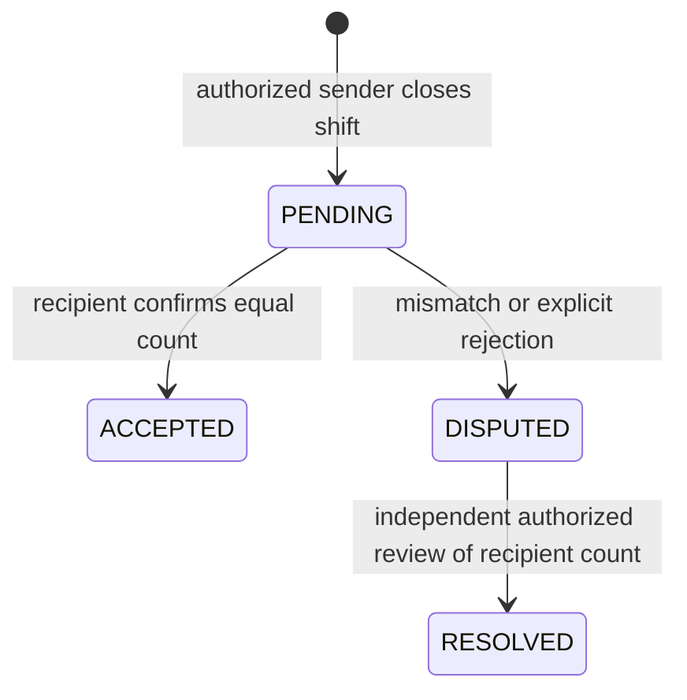

# SOKOON — إصلاح أمن وسلامة تسليم النقد

التاريخ: 2026-11-04. الأساس: `main@cfe1b23` مع تغييرات محلية غير ملتزمة. التقرير الشامل السابق محفوظ كلقطة تاريخية؛ لا يعني هذا الإصلاح إغلاق بقية عيوب المشروع.

## النتيجة

تم تنفيذ إصلاحات تفويض وحالات ومعاملات تسليم النقد في الكود. **قبول الإصلاح للإطلاق ما زال BLOCKED حتى تنفيذ اختبارات PostgreSQL المعزولة**. لم يحدث أي اتصال بقاعدة الإنتاج أو ترحيل أو تعديل بيانات تشغيل أو commit أو push أو deploy أو merge.

## الأسباب المؤكدة قبل الإصلاح

1. `disputeCashHandover` كان يغير الحالة قبل فحص المستلم والفرع، خارج transaction تضم التفويض والتدقيق؛ حتى403 كانت تترك أثرًا.
2. `resolveCashHandover` كان يفحص الفرع فقط دون اشتراط Manager/Owner أو صلاحية مالية، ويسمح باستبدال العدّ والفرق الأصليين.
3. القبول كان ينشر مبلغ المرسل حتى عند اختلاف عدّ المستلم، ولا يكتب حدث قبول مستقلًا في AuditLog؛ قيمة movementId المعادة لم تكن قيمة الحركة الجديدة.
4. الحل كان ينشئ حركة دون ربط movementId بالتسليم، وAuditLog يأتي بعد commit؛ يمكن أن تنجح الحركة ثم يبدو الطلب فاشلًا.
5. الـAPI لم يكن يربط handoverId بوردية المسار، ولا يطلب confirmed:true أو يتحقق من دقة المبلغ والحقول الزائدة بعقد صارم.
6. فتح الوردية كان يستطيع تجاوز تسليم معلّق برصيد يدوي، ويأخذ حركة واردة واحدة فقط. إغلاق الكاشير لم يمنع نقل النقد مع بقاء سلف عهدة شخصية غير مسوّاة.

## نطاق الملفات

| الملف | التغيير |
|---|---|
| `src/lib/staff-shifts.ts` | schema الطلب والعدّ؛ تفويض التسليم؛ قفل الصف؛ الحالات؛ حفظ الأدلة؛ idempotency؛ audit ذري؛ حماية فتح وإغلاق الوردية واستهلاك النقد المؤكد |
| `src/app/api/staff/shifts/[id]/handover/route.ts` | عقد صارم؛ explicit confirmation؛ ربط المصدر بالمسار؛ errors عامة؛ قائمة pending/disputed محمية |
| `tests/cash-handover-offline.test.ts` |16 اختبار خدمة بمضاعف معاملات في الذاكرة، بلا اتصال قاعدة بيانات |
| `tests/cash-handover-postgres.test.ts` |11 حالة تكامل حقيقية مكتوبة، داخل suite لا تتصل إلا بقاعدة محلية معزولة ومصرح بها |
| `package.json` | إدراج اختبارات الخدمة في npm test وإضافة test:cash-handover-postgres |
| `docs/audits/P0_CASH_HANDOVER_FIX.md` | هذا التقرير |

لا تغيير في Prisma schema أو migrations أو كود POS أو المخزون أو الدفع أو الاستردادات أو الطاولات أو خدمة Fixed Float. تعديلات الورديات محصورة في حدود عهدة النقد وتسليمها؛ معادلة مبيعات/استردادات الوردية لم تُعدَّل.

## كل مسارات تغيير الحالة والرصيد

| المسار | الأثر بعد الإصلاح |
|---|---|
| POST `/api/staff/shifts/[id]/close` → closeShift | المرسل صاحب الوردية فقط، branch scope، Cashier مع orders.payment وعدّ رقمي صريح؛ يمنع self-handover ويعيد التحقق من أهلية المستلم داخل tx؛ ينشئ PENDING وحدث create داخل نفس معاملة إغلاق الوردية |
| closeShift بعد عبور منتصف الليل المحلي | يحافظ على المسار الحالي إلى MAIN_SAFE دون إنشاء CashHandover؛ التدقيق ومعاملة الإغلاق قائمَان، وتطبق حماية سلف الكاشير أيضًا؛ لم يُعَد تصميم سياسة الخزنة |
| POST handover/action=accept | المستلم المحدد Cashier فعال في الفرع مع orders.payment فقط؛ عدّ وتأكيد صريح؛ equal count يقبل وينشر حركة واحدة؛ mismatch يسجل DISPUTED بلا حركة |
| POST handover/action=dispute أو reject | المستلم فقط؛ سبب وعدّ وتأكيد؛ DISPUTED بلا حركة؛ reject لا ينشئ حالة مالية جديدة أو رد نقد آلي |
| POST handover/action=resolve | Manager مع orders.payment، أو Owner مع فرع مختار صراحةً؛ يجب أن يكون مستقلًا عن طرفي التسليم؛ سبب وتأكيد وعدّ سابق من المستلم؛ لا يحق له تغيير هذا العدّ |
| openShift | يمنع تجاوز pending/disputed أو تسليم نهائي بلا movement؛ يجمع كل الوارد المؤكد غير المستهلك، ويضع consumedAt مرة واحدة، دون تغيير المبالغ الأصلية |
| Fixed Float/advances | لم تتغير كتاباتها؛ closeShift يقرأ السلف المرسلة للكاشير وإرجاعاتها المرتبطة ويمنع الإغلاق ما دام أصل غير مسدد؛ لا يسدد الدين أو ينقله آليًا |

المراجعة النصية لكل `cashHandover.create/update/updateMany` في src وجدت الكتّاب في staff-shifts وحده. الـAPI لا يملك كتابة مباشرة خارج هذه الخدمات.

## التفويض وعقد الـAPI

- دور المستلم: Cashier + `orders.payment` + تطابق `toCashierId` وbranch. لا يمكن للمرسل التأكيد نيابة عنه.
- دور الحل: Manager + `orders.payment` أو Owner. المالك يختار `branchId` صراحة إذا كان حسابه بلا فرع؛ صلاحياته عبر الفروع تبقى وفق سياسة Owner الحالية، وكل عملية مقيدة بفرع محدد.
- `[id]` هو `fromShiftId`، وليس معرفًا شكليًا. handoverId لا بد أن ينتمي لوردية المسار.
- الحقول المسموحة فقط: action، handoverId، confirmed:true، branchId اختياري؛ accept/dispute/reject تتطلب countedAmount؛ dispute/reject تتطلب disputeReason؛ resolve يتطلب resolvedAmount وresolutionNote.
- المبلغ finite، غير سالب، بحد9,999,999 وبدقة قرش. حقول مثل amount أو fromCashierId لتغيير إعلان المرسل مرفوضة.
- تغيير العقد متعمد: الطلبات القديمة دون confirmed:true، أو dispute دون countedAmount، تفشل400. لم توجد استدعاءات UI لهذه الأفعال قبل الإصلاح؛ لم تُنشأ واجهة مالية جديدة ضمن هذا التغيير.
- GET يقبل status=PENDING افتراضيًا أو DISPUTED. الكاشير يرى تسليماته الواردة فقط؛ المدير/المالك يرى قائمة الفرع المصرح. القائمة تتضمن العدّ والفرق وسبب النزاع اللازمين للمراجعة.

## الحالات وحفظ الأدلة

- amount يبقى إعلان المرسل الأصلي. countedAmount وdifference يسجلان أول عدّ مؤكد ولا يعاد كتابتهما بعد ذلك.
- عند الحل لا تتغير notes أو disputeReason أو countedAmount أوdifference. سبب الحل وقيمته وهوية المراجع وزمنه تُضاف إلى AuditLog وmetadata الحركة الجديدة، مع resolvedById/resolvedAt وmovementId.
- لا حركة مالية أثناء النزاع. عند الحل تُنشر قيمة العدّ المؤكد فقط؛ مبلغ مختلف يُرفض409 ويتطلب مسار تصحيح مستقلًا لم يُضَف هنا.
- النزاعات التاريخية التي لا عدّ لها يمكن أن تستقبل **أول** عدّ من المستلم نفسه، مع حدث جديد وحفظ السبب التاريخي. أي دليل أو حركة قديمة متعارضة يوقف العملية بدل محاولة إصلاح تلقائي.
- ACCEPTED وRESOLVED نهائيتان بالنسبة لهذه الأفعال؛ لا رجوع إلى PENDING، ولا إلغاء/حذف حركة مرحّلة.

## الأقفال وidempotency والدفتر

1. تفويض الدور والفرع والتأكيد والمدخلات قبل أي كتابة.
2. `SELECT ... FROM cash_handovers WHERE id=? AND branch_id=? FOR UPDATE` داخل transaction، ثم فحص المصدر والمستلم والحالة.
3. انتقال حالة مشروط بالحالة السابقة والفرع والربط المالي؛ إنشاء الحركة وربطها وAuditLog داخل نفس transaction. فشل التدقيق يعيد rollback للانتقال والحركة.
4. القبول والحل يشتركان مع openShift في قفل `shift-open:recipient:branch`. لا ينشران نقد الوردية التالية أثناء وجود وردية مفتوحة للمستلم؛ يلزم إغلاقها أولًا. فتح الوردية لا يقفل cash_handovers، فلا يعكس ترتيب أقفال الكاتب.
5. إغلاق الوردية يحتفظ بقفل `shift-financial` المشترك مع advance/return/payment، فلا تمر سلفة جديدة بعد فحص الإغلاق.
6. التكرار المطابق بعد القبول أو الحل يعيد movementId المخزن وidempotent=true دون إنشاء حركة أو audit آخر. الطلب المخالف للعدّ/السبب أو الحالة يرفض409. مصدر idempotency هو التسليم نفسه وحالته وربط حركته، وليس مفتاحًا عشوائيًا يمكن تبديله.
7. openShift يستهلك جميع الحركات المؤكدة الواردة مرة واحدة؛ التغيير الوحيد المسموح في الحركات السابقة هو consumedAt كما في النموذج الحالي. لا يُكتب فوق amount أوactor أوreason أوالحسابات أوالأثر التاريخي.

مثال دلالي فقط: إعلان100 وعدّ95 يبقي amount=100 وcountedAmount=95 وdifference=-5. لا نقد متاح أثناء DISPUTED. مراجعة مستقلة تقر count95 فتنشر95 وتحتفظ بدليل الفرق؛ لا تنشئ تعويضًا أو دين موظف وهميًا للخمسة.

الأقفال تحقق تنسيق المسارات داخل التطبيق، وليست منعًا لمسؤول قاعدة بيانات من إجراء SQL مباشر. مرجع سلوك الأقفال: [PostgreSQL 17 — Explicit Locking](https://www.postgresql.org/docs/17/explicit-locking.html). تمت مراجعة [Supabase Changelog](https://supabase.com/changelog)؛ لم تُستخدم CLI أو عمليات hosted أثناء التنفيذ.

## الاختبارات والنتائج الفعلية

| الفحص | النتيجة |
|---|---|
| TypeScript | PASS |
| ESLint | PASS |
| npm test |274 PASS:258 قائمة +16 خدمة جديدة؛ صفر فشل/تخطي |
| test:cash-handover-postgres | suite واحدة SKIPPED/BLOCKED؛ لا اتصال، ولا تنفيذ للحالات11 |
| Production build محلي | PASS؛ compile/type/lint/static generation ناجحة |
| git diff --check | PASS |

اختبارات الخدمة تضاعف المعاملة والـPrisma في الذاكرة، وتختبر التفويض وعدم آثار403، العدّ المختلف والنزاع، الحل المستقل، تكرار/جدولة الطلبات، الفرع ووردية المسار، فشل AuditLog وrollback، السلف غير المسددة، حفظ السجل، استهلاك النقد عند الفتح، ومنع تبديل العدّ. **ليست إثبات PostgreSQL isolation**.

ملف التكامل يغطي: إنشاء تسليم مشروع بين كاشيرين، منع الموظف غير المخول، العدّ المختلف والفرق، حل مستقل وحفظ الدليل، duplicate confirmation، concurrent confirmations، confirmation مقابل dispute، cross-branch/path، حفظ ledger/audit القديم، فتحين متزامنين واستهلاك الوارد مرة واحدة، وسلف العهدة غير المسددة. الكود مكتوب ولا توجد نتيجة تشغيل ناجحة له بعد.

حارس التكامل لا يقرأ .env ولا يهيئ Prisma قبل السماح. يتطلب `SKOON_HANDOVER_TEST_DATABASE_URL` يشير حرفيًا إلى قاعدة محلية باسم `skoon_handover_test`، و`SKOON_HANDOVER_TEST_ACK=isolated-local-test-only`. query parameters لا تسمح بتغيير host أو schema عن public. المخطط وأدوار التطبيق يجب أن تكون موجودة مسبقًا؛ الاختبار لا ينفذ migration أو seed. التنظيف محصور في branch IDs المولدة للـfixtures.

تم فحص إعداد staging محليًا دون طباعة قيمه؛ ما زال template، لذلك لم يُشغل ضده اختبار ولا استُخدمت قاعدة مشتركة كبديل.

الـbuild استعمل DATABASE_URL/DIRECT_URL مؤقتين إلى localhost بمنفذ غير متاح وSupabase URL/key وهميين بدل بيانات الإنتاج. عبارة Next «Environments: .env» تعني وجود الملف، والقيم المؤقتة لها أولوية. هذا artifact للتحقق المحلي فقط، لا يُنشر بإعدادات المصادقة الوهمية. تحذيرات webpack serialization وESLint plugin الموجودة لم تمنع البناء.

## الترحيلات

**لا migration مطلوبة لهذا الإصلاح، ولا SQL ترحيل منفذ أو مُضاف.** حقول CashHandover الحالية وAuditLog وFinancialMovement.metadata تكفي لحفظ العدّ الأصلي والتسوية الإضافية. لا إضافة قيود على بيانات تاريخية لم تُفحص، ولا backfill أو إصلاح تلقائي لسجلات قديمة.

## المخاطر المتبقية وشرط الإغلاق

1. نتائج التزامن والأقفال وrollback الحقيقية تحتاج تشغيل ملف PostgreSQL على قاعدة اختبار معزولة ومصرح بها؛ هذه بوابة إطلاق محجوبة.
2. لم تُفحص بيانات الإنتاج، فلا يوجد تصريح بأن تسليمات تاريخية غير متسقة أو حركات قديمة مكررة قد صُححت. تلك تحتاج reconciliation منفصلة بصلاحية وأدلة؛ الكود يرفض بعض حالات عدم الاتساق بدل الكتابة فوقها.
3. لا واجهة cash handover جديدة ضمن هذا الإصلاح. مستهلك الـAPI يجب أن يعرض العدّ والفرق والتأكيد وسبب الحل، ويتعامل مع DISPUTED و409، ولا يعتبر mismatch قبولًا.
4. التصحيح اللاحق لعدّ مؤكد لا يمر بهذه الأفعال؛ يتطلب عملية تصحيح إضافية معتمدة، فلا يُستخدم resolve لمحو تاريخ العدّ.
5. سياسة MAIN_SAFE بعد منتصف الليل قائمة كما هي؛ ليست تسليمًا بين كاشيرين ولا تمثل تأكيد استلام بشري من أمين خزنة.
6. عيب ربط Cash Refund بـexpectedCash في التدقيق الشامل خارج النطاق ولم يُصلح. لا يعني نجاح هذه الفحوص اعتماد النظام المالي كله.

**الخلاصة التنفيذية:** الثغرات المؤكدة في مسار تسليم النقد عولجت محليًا مع اختبارات خدمة ناجحة، لكن لا نعلن إغلاق P0 تشغيليًا قبل قبول PostgreSQL والتدفق المصادق. العمل متوقف بعد التنفيذ والتحقق؛ لا نشر ولا تغيير إنتاج.
