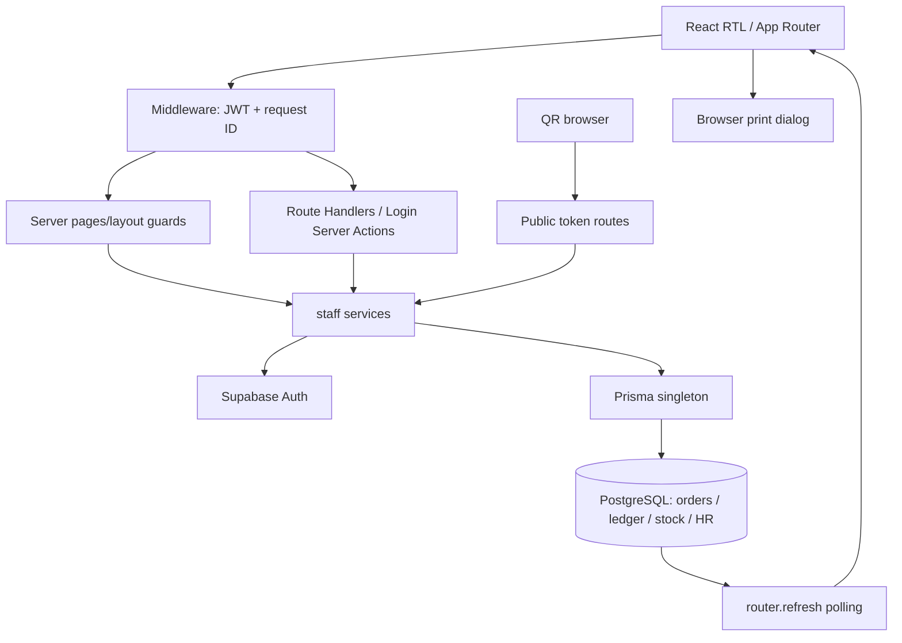

عاي# البنية والمستودع
## لقطة Git
main، HEAD cfe1b2334d90184eb4ceaedfbe0a20a160224752. working tree نظيف عند بدء التدقيق. origin/main مطابق محليًا وقت الفحص؛ remote-tracking snapshot دون fetch/pull.
الفروع المحلية والـremote-tracking: chore/repository-cleanup، feat/cashier-dashboard-ux-improvements، feat/financial-phase2a-payments-refunds، feat/financial-phase2b-cash-reconciliation، fix/invoice-inventory-consistency، main.
main...feat/financial-phase2b-cash-reconciliation =21 يسار/0 يمين؛ الفرع المذكور ancestor لـmain، رأسه6eecadd. ميزات refund lifecycle/cash handover/main safe موجودة علىmain، وليست عملًا ينتظر الدمج.
آخر commits: cfe1b23 recovery network،476b498 nested buttons،7e23e08 direct waiter table create، ثم إعادة تصميم workspace وsingle-order/QR. لا local-only application changes عند البداية. deployment metadata يؤكد HEAD، راجع12.

|الفرع مقارنة بـmain|commits في main فقط|commits في الفرع فقط|
|---|---|---|
|chore/repository-cleanup|73|0|
|feat/cashier-dashboard-ux-improvements|65|0|
|feat/financial-phase2a-payments-refunds|22|0|
|feat/financial-phase2b-cash-reconciliation|21|0|
|fix/invoice-inventory-consistency|72|0|

لا توجد commits فريدة على هذه الفروع المحلية مقارنة بـmain. هذا استنتاج ancestry عن المراجع الموجودة، دون fetch أو تأكيد أن remote لم يتغير بعد الفحص. لا تبديل فروع أو merge أثناء التدقيق.

## الإصدارات الفعلية
| الحزمة | package range/المثبت |
|---|---|
| Next.js |15.5.28 /15.5.28|
| React وReact DOM |^19.1.1 /19.3.0|
| TypeScript |^5.9.2 /5.9.3|
| Prisma وClient |6.19.3|
| @supabase/ssr |^0.12.7 /0.12.7|
| @supabase/supabase-js |^2.117.3 /2.117.3|
| Tailwind |^3.4.17 /3.4.19|
| ESLint |^9.39.5 /9.39.5|
| Node |مطلوب>=22؛ Hostinger22|
التثبيت المحلي وlockfile متفقان للحزم المفحوصة. package-lock ملتزم؛ range لا يساوي version بالضرورة.
`next.config.ts:15`: strictMode،serverExternalPackages Prisma/bcrypt، remote image allowlist،SVG غير مسموح. لا output:standalone محلي صريح، بينما Hostinger build metadata يكتشف standalone؛ لا نغير config بناءً على ذلك.
`tsconfig.json:3`: strict،noEmit،bundler،alias@/،includes عامة،incremental؛ استخدمنا --incremental false لحفظ قيد الملفات.

## خريطة البنية

Supabase Auth للهوية، Prisma للتفويض والبيانات، معاملات الخدمات مصدر قواعد العمل. لا API gateway مركزي يوحد التفويض لجميع handlers. الحالة التشغيلية تتزامن polling، لا realtime subscriptions مثبتة. طباعة المتصفح وليست service spool.

## خريطة الوحدات
| الوحدة | entry pages | الخدمات داخل src/lib | models | مجال UI |
|---|---|---|---|---|
|الهوية|/login|session.ts;staff-username.ts|User;UserSession|src/components/auth;login|
|التفويض|/(app)/layout|authz.ts;route-access.ts;require-page-access.ts|Role;Permission;RolePermission|src/components/layout;auth|
|الفروع|/settings|branch-bootstrap.ts;main-branch.ts|CafeBranch;AppSetting|src/components/settings|
|الموظفون|/staff|staff-provision-write.ts;staff-employee-write.ts|User;EmployeeProfile;EmploymentContract;CompensationRate|src/components/staff;hr|
|HR والرواتب|/staff|staff-payroll-write.ts;staff-scheduling-write.ts;staff-leave-write.ts;staff-overtime-write.ts;staff-attendance-summary.ts|WorkSchedule;AttendanceCorrection;LeaveRequest;PayrollPeriod;PayrollRun;PayrollLine;PayrollPayment|src/components/hr|
|الكتالوج|/products|staff-catalog-write.ts;staff-category-write.ts;staff-product-modifiers.ts;product-configuration.ts|Product;Category;ProductVariant;ProductAttribute;ProductOption|src/components/products|
|POS|/pos;/cashier|staff-pos.ts;staff-pos-write.ts;pos-draft.ts|Order;OrderItem;FinancialOperation|src/components/pos|
|الفواتير|/cashier;/owner/invoices|staff-invoices.ts;invoice-recalculation.ts;invoice-discounts.ts;staff-order-item-adjustment.ts;staff-order-item-void.ts|Order;OrderItem;Payment;AuditLog|src/components/cashier|
|الطاولات|/tables;/cashier/tables/[tableId]|staff-tables.ts;table-reservations.ts|CafeTable;WaiterTableReservation;OrderTableTransfer|src/components/tables;cashier|
|النادل|/waiter;/waiter/tables/[tableId]|staff-waiter.ts;staff-waiter-operations.ts;staff-waiter-readiness.ts|OrderResponsibilityHistory;WaiterShiftHandover;WaiterTableTransfer;WaiterOrderReconciliationReview|src/components/waiter|
|QR العام|/menu/[token];/order/[id]|public-menu.ts;public-orders.ts;qr.ts;guest-orders.ts|CafeTable;Order;OrderItem;ServiceRequest|src/components/public;menu|
|المطبخ|/kitchen|staff-orders.ts;order-status.ts|Order;OrderItem;OrderStatusHistory|src/components/kitchen|
|المخزون|/inventory|staff-inventory-engine.ts;staff-inventory-write.ts;staff-stock-count-write.ts;staff-waste-write.ts|InventoryItem;Recipe;InventoryBatch;InventoryReservation;StockCount;WasteEvent;EmployeeAccountability|src/components/inventory|
|المدفوعات والاستردادات|/cashier;/finance|staff-payments-write.ts;payment-request.ts;refund-accounting.ts|Payment;Refund;FinancialOperation|src/components/cashier|
|الورديات والتسليم|/shifts;/cashier|staff-shifts.ts;financial-shift-lock.ts|Shift;CashHandover;FinancialMovement|src/components/shifts;cashier|
|العهدة والخزنة|/fixed-float;/finance|staff-float.ts|FinancialMovement;FinancialOperation|src/components/cashier;finance;fixed-float|
|التقارير والضريبة|/reports;/finance;/customers|staff-reports.ts;finance-metrics.ts;staff-finance.ts;vat-report.ts;staff-customers.ts|Order;Payment;Refund;Shift;InventoryTransaction|src/components/reports;dashboard;finance|
|الإشعارات والطباعة والتشغيل|/kitchen;/cashier|notifications.ts;receipt-display.ts;request-correlation.ts|Notification;AuditLog|src/components/notifications;cashier;kitchen|

## ازدواج وفصل غير مكتمل
PosView/usePosCart وWaiterView/demo بيانات عرض غير مستخدمة بالمسار الإنتاجي؛ لا تحذفها ضمن audit. staff-pos يعود إلى demo categories عند غياب الفئات الحقيقية.
getServerEnv وتعريف CRON_SECRET بلا مستهلك ظاهر؛ single-active-session غير مربوط login/session. tables predicates متعددة، مالية Refund جديدة مقابل reports/shift legacy، وSQL histories مزدوجة.
Cashier وWaiter يشتركان في WaiterTableWorkspace لكن تحميل البيانات يرشح المسؤول مما يكسر المشاركة. UI actions refund/CashHandover/QR approvals غير مستهلكة رغم وجود الخدمات.
build_output.txt/test_output.txt/tree-output.txt artifacts متتبعة، ليست نتائج هذه الجولة. `src/lib/staff-waiter-operations.ts.tmp` ملف محلي ignored، لا implementation منشور. لا اعتماد على التقارير القديمة كإثبات.

## نطاق الفحص
الجرد الآلي أدناه يحصي كل الصفحات وAPI methods/services/models وملفات tests/migrations مع مراجع أسطر. مراجعة semantics أعمق للمسارات المالية والطاولة وQR؛ لا ندعي تشغيل كل endpoint أو كل form. بقية الوحدات تُصنف IMPLEMENTED أو BLOCKED ما لم يوجد دليل اختبار ذي معنى.

## ملحق الجرد الكامل

هذا فهرس لكل الملفات المتتبعة عند بدء التدقيق، مع تعريفات الكود وأسطرها. الجرد لا يساوي اختبار runtime؛ الأدلة الدلالية وحدودها في التقارير الموضوعية.

### الصفحات وAPI والـlayouts

|المصدر|التعريفات وأسطرها|
|---|---|
|`src/app/(app)/admin-home.tsx:1`|CanonicalDashboardPage:30، AdminHomePage:153|
|`src/app/(app)/cashier/page.tsx:1`|dynamic:13، CashierPage:15|
|`src/app/(app)/cashier/tables/[tableId]/page.tsx:1`|dynamic:8، metadata:10، CashierTablePage:12|
|`src/app/(app)/customers/page.tsx:1`|dynamic:7، CustomersPage:13|
|`src/app/(app)/dashboard/page.tsx:1`|DashboardCompatPage:18|
|`src/app/(app)/error.tsx:1`|AppError:14|
|`src/app/(app)/finance/page.tsx:1`|dynamic:5، FinancePage:7|
|`src/app/(app)/fixed-float/baseline/page.tsx:1`|dynamic:3، BaselinePage:4|
|`src/app/(app)/fixed-float/page.tsx:1`|dynamic:4، FixedFloatPage:5|
|`src/app/(app)/fixed-float/settlements/page.tsx:1`|dynamic:4، SettlementsPage:5|
|`src/app/(app)/inventory/page.tsx:1`|dynamic:9، InventoryPage:15|
|`src/app/(app)/kitchen/page.tsx:1`|dynamic:8، KitchenPage:16|
|`src/app/(app)/layout.tsx:1`|AppLayout:32|
|`src/app/(app)/logout-blocked/page.tsx:1`|dynamic:6، LogoutBlockedPage:9|
|`src/app/(app)/manager/page.tsx:1`|ManagerPage:3|
|`src/app/(app)/orders/page.tsx:1`|dynamic:8، OrdersPage:14|
|`src/app/(app)/owner/invoices/page.tsx:1`|dynamic:5، OwnerInvoicesPage:7|
|`src/app/(app)/owner/page.tsx:1`|OwnerPage:6|
|`src/app/(app)/pos/page.tsx:1`|dynamic:10، PosPage:13|
|`src/app/(app)/products/page.tsx:1`|dynamic:11، ProductsPage:17|
|`src/app/(app)/reports/page.tsx:1`|dynamic:9، ReportsPage:12|
|`src/app/(app)/settings/page.tsx:1`|dynamic:7، SettingsPage:14|
|`src/app/(app)/shifts/page.tsx:1`|dynamic:5، ShiftsPage:12|
|`src/app/(app)/staff/attendance-corrections/page.tsx:1`|dynamic:5، AttendanceCorrectionsPage:7|
|`src/app/(app)/staff/leave/page.tsx:1`|dynamic:5، LeaveRequestsPage:7|
|`src/app/(app)/staff/page.tsx:1`|dynamic:5، StaffPage:11|
|`src/app/(app)/tables/page.tsx:1`|dynamic:9، TablesPage:15|
|`src/app/(app)/tables/print/page.tsx:1`|metadata:7، TablePrintPage:11|
|`src/app/(app)/waiter/loading.tsx:1`|WaiterLoading:4|
|`src/app/(app)/waiter/page.tsx:1`|dynamic:9، metadata:11، WaiterPage:19|
|`src/app/(app)/waiter/tables/[tableId]/page.tsx:1`|dynamic:8، metadata:10، WaiterTablePage:12|
|`src/app/(public)/error.tsx:1`|PublicError:13|
|`src/app/(public)/layout.tsx:1`|PublicLayout:8|
|`src/app/(public)/menu/[token]/page.tsx:1`|dynamic:5، MenuPage:11|
|`src/app/(public)/order-type/page.tsx:1`|OrderTypePage:14|
|`src/app/(public)/order/[id]/page.tsx:1`|dynamic:13، OrderPage:24|
|`src/app/(public)/page.tsx:1`|LandingPage:18|
|`src/app/(public)/select-table/page.tsx:1`|dynamic:7، SelectTablePage:17|
|`src/app/api/public/orders/[id]/route.ts:1`|dynamic:11، GET:13|
|`src/app/api/public/orders/route.ts:1`|dynamic:9، POST:11|
|`src/app/api/public/service-requests/route.ts:1`||
|`src/app/api/staff/branches/bootstrap/route.ts:1`|dynamic:5، POST:8|
|`src/app/api/staff/branches/route.ts:1`|dynamic:10، GET:12|
|`src/app/api/staff/categories/[id]/route.ts:1`|dynamic:7، PATCH:11، DELETE:31|
|`src/app/api/staff/categories/route.ts:1`|dynamic:7، POST:9|
|`src/app/api/staff/employees/[id]/archive/route.ts:1`|dynamic:5، POST:7|
|`src/app/api/staff/employees/[id]/compensation/route.ts:1`|dynamic:5، POST:7|
|`src/app/api/staff/employees/[id]/contracts/route.ts:1`|dynamic:5، POST:7|
|`src/app/api/staff/employees/[id]/reactivate/route.ts:1`|dynamic:5، POST:7|
|`src/app/api/staff/employees/[id]/route.ts:1`|dynamic:5، GET:7|
|`src/app/api/staff/employees/[id]/terminate/route.ts:1`||
|`src/app/api/staff/employees/route.ts:1`|dynamic:5، GET:7|
|`src/app/api/staff/fixed-float/[id]/reverse/route.ts:1`|dynamic:4، POST:5|
|`src/app/api/staff/fixed-float/route.ts:1`|dynamic:5، POST:6|
|`src/app/api/staff/hr/attendance-corrections/[id]/decision/route.ts:1`|dynamic:5، POST:7|
|`src/app/api/staff/hr/attendance-corrections/route.ts:1`|dynamic:5، GET:13، POST:23|
|`src/app/api/staff/hr/attendance-summary/route.ts:1`|dynamic:5، GET:7|
|`src/app/api/staff/hr/documents/[id]/signed-url/route.ts:1`|dynamic:4، GET:5|
|`src/app/api/staff/hr/documents/route.ts:1`|dynamic:4، GET:6، POST:7|
|`src/app/api/staff/hr/financials/[id]/route.ts:1`|dynamic:4، POST:5|
|`src/app/api/staff/hr/financials/route.ts:1`|dynamic:4، GET:6، POST:7|
|`src/app/api/staff/hr/leave/[id]/decision/route.ts:1`|dynamic:4، POST:5|
|`src/app/api/staff/hr/leave/route.ts:1`|dynamic:4، GET:10، POST:11|
|`src/app/api/staff/hr/overtime/[id]/decision/route.ts:1`|POST:4|
|`src/app/api/staff/hr/overtime/route.ts:1`|dynamic:4، GET:6، POST:7|
|`src/app/api/staff/hr/overview/route.ts:1`|dynamic:7، GET:8|
|`src/app/api/staff/hr/payroll/[id]/route.ts:1`|dynamic:4، POST:5|
|`src/app/api/staff/hr/payroll/lines/[id]/payments/route.ts:1`|dynamic:4، POST:5|
|`src/app/api/staff/hr/payroll/route.ts:1`|dynamic:4، GET:6، POST:7|
|`src/app/api/staff/hr/reports/route.ts:1`|dynamic:6، GET:18|
|`src/app/api/staff/hr/schedules/route.ts:1`|dynamic:5، GET:12، POST:19|
|`src/app/api/staff/inventory/[id]/movement/route.ts:1`|dynamic:6، POST:10|
|`src/app/api/staff/inventory/accountability/[id]/waive/route.ts:1`|POST:5|
|`src/app/api/staff/inventory/accountability/route.ts:1`|GET:6|
|`src/app/api/staff/inventory/counts/[id]/[action]/route.ts:1`|POST:6|
|`src/app/api/staff/inventory/counts/[id]/route.ts:1`|GET:6|
|`src/app/api/staff/inventory/counts/route.ts:1`|GET:11، POST:17|
|`src/app/api/staff/inventory/waste/route.ts:1`|GET:7، POST:8|
|`src/app/api/staff/invoices/[id]/route.ts:1`|dynamic:5، PATCH:6، DELETE:15|
|`src/app/api/staff/invoices/route.ts:1`|dynamic:5، GET:37|
|`src/app/api/staff/main-safe/route.ts:1`|dynamic:16، GET:18، POST:31|
|`src/app/api/staff/notifications/read/route.ts:1`|dynamic:10، POST:12|
|`src/app/api/staff/notifications/route.ts:1`|dynamic:11، GET:13|
|`src/app/api/staff/orders/[id]/items/[itemId]/adjust/route.ts:1`|dynamic:5، POST:7|
|`src/app/api/staff/orders/[id]/items/[itemId]/void/route.ts:1`|dynamic:5، POST:7|
|`src/app/api/staff/orders/[id]/items/append/route.ts:1`|dynamic:8، POST:12|
|`src/app/api/staff/orders/[id]/items/serve/route.ts:1`|dynamic:9، POST:13|
|`src/app/api/staff/orders/[id]/pay/route.ts:1`|dynamic:28، POST:30، GET:93|
|`src/app/api/staff/orders/[id]/route.ts:1`|dynamic:5، PATCH:7|
|`src/app/api/staff/orders/[id]/send/route.ts:1`|dynamic:11، POST:15|
|`src/app/api/staff/orders/[id]/status/route.ts:1`|dynamic:16، POST:20|
|`src/app/api/staff/orders/[id]/waiter/route.ts:1`|dynamic:12، POST:18|
|`src/app/api/staff/orders/route.ts:1`|GET:10|
|`src/app/api/staff/pos/orders/route.ts:1`|dynamic:7، POST:9|
|`src/app/api/staff/product-configuration/attributes/[id]/route.ts:1`|dynamic:21، PATCH:23، DELETE:89|
|`src/app/api/staff/product-configuration/route.ts:1`|dynamic:6، GET:8، POST:16|
|`src/app/api/staff/product-configuration/values/[id]/route.ts:1`|dynamic:21، PATCH:23، DELETE:103|
|`src/app/api/staff/product-modifiers/route.ts:1`|dynamic:6، GET:8، POST:9|
|`src/app/api/staff/products/[id]/route.ts:1`|dynamic:7، PATCH:11، DELETE:30|
|`src/app/api/staff/products/[id]/toggle/route.ts:1`|dynamic:7، POST:11|
|`src/app/api/staff/products/route.ts:1`|dynamic:7، POST:9|
|`src/app/api/staff/qr/orders/route.ts:1`||
|`src/app/api/staff/reconcile/route.ts:1`||
|`src/app/api/staff/refunds/route.ts:1`||
|`src/app/api/staff/search/route.ts:1`|dynamic:11، GET:13|
|`src/app/api/staff/service-requests/[id]/route.ts:1`|dynamic:4، POST:5|
|`src/app/api/staff/service-requests/route.ts:1`|dynamic:4، GET:5|
|`src/app/api/staff/settings/route.ts:1`|dynamic:10، PUT:12|
|`src/app/api/staff/shifts/[id]/close/route.ts:1`|dynamic:12، POST:16|
|`src/app/api/staff/shifts/[id]/handover/route.ts:1`|dynamic:18، GET:20، POST:37|
|`src/app/api/staff/shifts/route.ts:1`|dynamic:15، GET:17، POST:30|
|`src/app/api/staff/tables/layout/route.ts:1`|dynamic:7، PATCH:18|
|`src/app/api/staff/tables/reservations/route.ts:1`|GET:34، POST:43، DELETE:62، HEAD:83|
|`src/app/api/staff/tables/route.ts:1`|dynamic:8، POST:17، PATCH:33، DELETE:39|
|`src/app/api/staff/users/[id]/password/route.ts:1`||
|`src/app/api/staff/users/[id]/route.ts:1`||
|`src/app/api/staff/users/route.ts:1`|dynamic:12، GET:18، POST:31|
|`src/app/api/staff/vat/route.ts:1`||
|`src/app/api/staff/waiter/handovers/[id]/route.ts:1`||
|`src/app/api/staff/waiter/handovers/route.ts:1`||
|`src/app/api/staff/waiter/table-transfers/[id]/route.ts:1`||
|`src/app/api/staff/waiter/table-transfers/route.ts:1`||
|`src/app/global-error.tsx:1`|GlobalError:16|
|`src/app/globals.css:1`||
|`src/app/layout.tsx:1`|metadata:17، viewport:34، RootLayout:45|
|`src/app/login/actions.ts:1`|LoginState:17، loginAction:22، logoutAction:97|
|`src/app/login/page.tsx:1`|LoginPage:12|

### الخدمات

|المصدر|التعريفات وأسطرها|
|---|---|
|`src/lib/api-auth-response.ts:1`|isStaffApiPath:4، unauthenticatedStaffResponse:9، forbiddenStaffResponse:13|
|`src/lib/auth/login-storage.ts:1`|LEGACY_LOGIN_CREDENTIAL_KEY:2، clearLegacyLoginCredentials:5|
|`src/lib/auth/safe-redirect.ts:1`|safeInternalRedirect:6|
|`src/lib/authz.ts:1`||
|`src/lib/branch-bootstrap.ts:1`||
|`src/lib/catalog-branch.ts:1`||
|`src/lib/catalog-import.ts:1`||
|`src/lib/dashboard-stats.ts:1`||
|`src/lib/demo/dashboard.ts:1`||
|`src/lib/demo/index.ts:1`||
|`src/lib/demo/orders.ts:1`||
|`src/lib/env.server.ts:1`||
|`src/lib/env.ts:1`||
|`src/lib/finance-metrics.ts:1`||
|`src/lib/financial-shift-lock.ts:1`||
|`src/lib/format.ts:1`||
|`src/lib/guest-orders.ts:1`||
|`src/lib/hr-authz.ts:1`||
|`src/lib/hr-payroll-calculation.ts:1`||
|`src/lib/hr-scheduling-policy.ts:1`||
|`src/lib/hr-time-calculation.ts:1`||
|`src/lib/invoice-deletion-policy.ts:1`||
|`src/lib/invoice-discounts.ts:1`||
|`src/lib/invoice-recalculation.ts:1`||
|`src/lib/logout-eligibility.ts:1`||
|`src/lib/main-branch.ts:1`||
|`src/lib/manager-operations.ts:1`||
|`src/lib/navigation.ts:1`||
|`src/lib/notifications.ts:1`||
|`src/lib/order-item-options.ts:1`||
|`src/lib/order-item-variant.ts:1`||
|`src/lib/order-status.ts:1`||
|`src/lib/payment-request.ts:1`||
|`src/lib/payroll-preview-policy.ts:1`||
|`src/lib/pexels.ts:1`||
|`src/lib/pos-discount-policy.ts:1`||
|`src/lib/pos-draft.ts:1`||
|`src/lib/pos/use-pos-cart.ts:1`||
|`src/lib/prisma.ts:1`||
|`src/lib/product-configuration-policy.ts:1`||
|`src/lib/product-configuration.ts:1`||
|`src/lib/public-menu.ts:1`||
|`src/lib/public-orders.ts:1`||
|`src/lib/qr-render.ts:1`||
|`src/lib/qr.ts:1`||
|`src/lib/receipt-display.ts:1`||
|`src/lib/receipt-settlement.ts:1`||
|`src/lib/refund-accounting.ts:1`||
|`src/lib/request-correlation.ts:1`||
|`src/lib/require-page-access.ts:1`||
|`src/lib/route-access.ts:1`||
|`src/lib/security/pin.ts:1`||
|`src/lib/service-request-policy.ts:1`||
|`src/lib/session.ts:1`||
|`src/lib/single-active-session.ts:1`||
|`src/lib/staff-attendance-summary.ts:1`||
|`src/lib/staff-catalog-write.ts:1`||
|`src/lib/staff-catalog.ts:1`||
|`src/lib/staff-category-write.ts:1`||
|`src/lib/staff-customers.ts:1`||
|`src/lib/staff-directory.ts:1`||
|`src/lib/staff-employee-write.ts:1`||
|`src/lib/staff-finance.ts:1`||
|`src/lib/staff-float.ts:1`||
|`src/lib/staff-hr-documents.ts:1`||
|`src/lib/staff-hr-financial-write.ts:1`||
|`src/lib/staff-inventory-engine.ts:1`||
|`src/lib/staff-inventory-write.ts:1`||
|`src/lib/staff-inventory.ts:1`||
|`src/lib/staff-invoices.ts:1`||
|`src/lib/staff-leave-write.ts:1`||
|`src/lib/staff-order-item-adjustment.ts:1`||
|`src/lib/staff-order-item-void.ts:1`||
|`src/lib/staff-orders.ts:1`||
|`src/lib/staff-overtime-write.ts:1`||
|`src/lib/staff-payments-write.ts:1`||
|`src/lib/staff-payroll-write.ts:1`||
|`src/lib/staff-pos-write.ts:1`||
|`src/lib/staff-pos.ts:1`||
|`src/lib/staff-product-modifiers.ts:1`||
|`src/lib/staff-provision-write.ts:1`||
|`src/lib/staff-reconcile.ts:1`||
|`src/lib/staff-reports.ts:1`|ReportsSummary:54، getReportsSummary:92|
|`src/lib/staff-scheduling-write.ts:1`|SchedulingError:10، createWorkSchedule:48، listWorkSchedules:67، requestAttendanceCorrection:83، listAttendanceCorrections:110، decideAttendanceCorrection:130|
|`src/lib/staff-service-requests.ts:1`|ServiceRequestError:12، createPublicServiceRequest:18، listServiceRequests:41، actOnServiceRequest:49|
|`src/lib/staff-settings-write.ts:1`|SettingsError:18، SETTING_DEFS:28، SettingKey:61، SettingsUpdateResult:70، updateBranchSettings:76|
|`src/lib/staff-settings.ts:1`|BranchSetting:10، SettingsSnapshot:15، getSettingsSnapshot:22|
|`src/lib/staff-shifts.ts:1`|ShiftError:23، isOpenShiftUniquenessConflict:33، ShiftStatus:38، CASH_HANDLING_ROLES:47، isCashHandlingRole:50، CashPaymentRow:55، ShiftView:61، ShiftOrderRow:82، ShiftBoardData:90، round2:104، computeShiftCashFlow:109، expectedCashFrom:127، expectedCashAfterOperationalWithdrawals:132، cashDifferenceOf:137، openShiftSchema:141، closeShiftSchema:153، crossedLocalMidnight:168، getOpenShift:184، openShift:244، closeShift:321، getPendingHandovers:483، acceptCashHandover:532، disputeCashHandover:595، resolveCashHandover:645، requireOpenShift:712، getShiftsBoard:725|
|`src/lib/staff-stock-count-write.ts:1`|StockCountError:9، createStockCount:27، startStockCount:40، saveStockCountLines:42، submitStockCount:50، previewStockCountVariances:56، postStockCount:71، cancelStockCount:134|
|`src/lib/staff-tables.ts:1`|StaffTable:6، getStaffTables:20|
|`src/lib/staff-username.ts:1`|normalizeStaffUsername:10، staffUsernameEmail:15، usernameFromStaffEmail:19، staffLoginEmail:31، staffIdentityEmail:40|
|`src/lib/staff-waiter-operations.ts:1`|isTransferEligible:24، requiresEmergencyServing:28، claimQrOrder:53، approveQrOrder:80، rejectQrOrder:232، reassignOrderResponsibility:253، transferOrderTable:272، requestWaiterResponsibilityHandover:297، acceptWaiterResponsibilityHandover:315، rejectWaiterResponsibilityHandover:339، requestTableTransfer:363، acceptTableTransfer:442، rejectTableTransfer:566، cancelTableTransfer:617، listUnclaimedQrOrders:665|
|`src/lib/staff-waiter-readiness.ts:1`|WaiterResponsibilityReviewRow:7، WaiterOperationalReadiness:25، getWaiterOperationalReadiness:37|
|`src/lib/staff-waiter.ts:1`|WaiterOrderRow:15، IncomingWaiterHandover:21، IncomingTableTransfer:29، OutgoingTableTransfer:38، WaiterWorkspace:49، OwnerWaiterMonitor:69، canViewOwnerWaiterMonitor:99، isWaiterTableOrderActive:115، WaiterSchemaError:124، isMissingWaiterHandoverTableError:132، getWaiterWorkspace:140، getOwnerWaiterMonitor:321|
|`src/lib/staff-waste-write.ts:1`|WasteError:8، recordWaste:13، waiveAccountability:42|
|`src/lib/stock-count-policy.ts:1`|FifoLayer:1، CountPlan:2، planStockCount:6|
|`src/lib/supabase/client.ts:1`|createClient:13|
|`src/lib/supabase/server.ts:1`|createClient:14|
|`src/lib/table-reservations.ts:1`|TableReservationError:7، DEFAULT_RESERVATION_TTL_SECONDS:15، acquireTableReservation:47، listActiveReservations:133، releaseTableReservation:161، cleanExpiredReservations:181، readReservationTableId:190، validateAndClaimWaiterReservationTx:210، finalizeReservationTx:234|
|`src/lib/theme.tsx:1`|Theme:25، ThemeProvider:47، useTheme:82|
|`src/lib/utils.ts:1`|ClassValue:8، cn:17|
|`src/lib/vat-report.ts:1`|VatReportError:6، VatPayment:10، VatInvoiceInput:11، VatInvoiceRow:16، VatExcludedInvoice:21، VatCalculation:23، calculateVat:40، VatReport:76، parseVatDate:94، normalizeVatReportFilters:103، getVatReport:112|
|`src/lib/waiter-pos-confirmation.ts:1`|WaiterPosOrderReference:1، WaiterPosConfirmationResult:7، confirmWaiterPosOrder:17|
|`src/lib/waiter-readiness-policy.ts:1`|WaiterResponsibilityBucket:6، UnassignedOrderFacts:8، WaiterResponsibilityProposal:14، classifyUnassignedWaiterOrder:19|
|`src/lib/waiter-reconciliation-policy.ts:1`|RECONCILIATION_DECISIONS:6، RECONCILIATION_REVIEW_STATUSES:13، ReconciliationDecision:21، ReconciliationReviewStatus:22، LegacyOrderSnapshot:24، EligibleWaiter:33، ProposalInput:41، ProposalValidation:49، canReviewLegacyResponsibility:51، isHistoricalLegacyOrder:55، validateLegacyReconciliationProposal:60، isLegacySnapshotCurrent:85، canTransitionReconciliationReview:94، approvalExecutesOrderMutation:109|

### المكونات

|المصدر|التعريفات وأسطرها|
|---|---|
|`src/components/auth/auth-expiry-guard.tsx:1`||
|`src/components/auth/login-form.tsx:1`||
|`src/components/cashier/cart-sidebar.tsx:1`||
|`src/components/cashier/cashier-dashboard.tsx:1`||
|`src/components/cashier/cashier-workspace.tsx:1`||
|`src/components/cashier/invoice-board.tsx:1`||
|`src/components/cashier/shared-float-panel.tsx:1`||
|`src/components/cashier/tables-sidebar.tsx:1`||
|`src/components/cashier/thermal-receipt-preview.tsx:1`||
|`src/components/dashboard/demo-banner.tsx:1`||
|`src/components/dashboard/manager-operations-center.tsx:1`||
|`src/components/dashboard/manager-service-request-panel.tsx:1`||
|`src/components/dashboard/quick-actions.tsx:1`||
|`src/components/dashboard/recent-orders-table.tsx:1`||
|`src/components/dashboard/sales-card.tsx:1`||
|`src/components/dashboard/tables-status.tsx:1`||
|`src/components/dashboard/top-products.tsx:1`||
|`src/components/dashboard/waiter-operational-readiness-panel.tsx:1`||
|`src/components/finance/owner-finance-board.tsx:1`|OwnerFinanceBoard:17|
|`src/components/fixed-float/baseline-board.tsx:1`|BaselineBoard:6|
|`src/components/fixed-float/fixed-float-board.tsx:1`|FixedFloatBoard:9|
|`src/components/fixed-float/settlement-board.tsx:1`|SettlementBoard:8|
|`src/components/inventory/accountability-board.tsx:1`|AccountabilityBoard:8|
|`src/components/inventory/inventory-board.tsx:1`|InventoryBoard:22|
|`src/components/inventory/stock-count-board.tsx:1`|StockCountBoard:17|
|`src/components/inventory/waste-board.tsx:1`|WasteBoard:7|
|`src/components/kitchen/kitchen-board.tsx:1`|KitchenBoard:25|
|`src/components/layout/app-shell.tsx:1`||
|`src/components/layout/notifications-bell.tsx:1`||
|`src/components/layout/sidebar.tsx:1`||
|`src/components/layout/topbar-search.tsx:1`||
|`src/components/layout/topbar.tsx:1`|TopbarProps:36، Topbar:42|
|`src/components/menu/menu-order-view.tsx:1`|MenuOrderView:33|
|`src/components/order/copy-order-link-button.tsx:1`|CopyOrderLinkButton:13|
|`src/components/order/order-status-tracker.tsx:1`|OrderStatusTracker:35|
|`src/components/order/resume-order-button.tsx:1`|ResumeOrderButton:14|
|`src/components/orders/orders-board.tsx:1`|OrdersBoard:46|
|`src/components/owner/owner-command-center.tsx:1`|OwnerCommandCenterProps:15، OwnerCommandCenter:35|
|`src/components/owner/owner-invoice-board.tsx:1`|OwnerInvoiceBoard:24|
|`src/components/placeholder-page.tsx:1`|PlaceholderPageProps:10، PlaceholderPage:16|
|`src/components/pos/pos-checkout.tsx:1`|PosCheckout:30|
|`src/components/pos/pos-view.tsx:1`|PosView:20|
|`src/components/products/owner-products-tabs.tsx:1`|OwnerProductsTabs:7|
|`src/components/products/product-configuration-board.tsx:1`|ProductConfigurationBoard:11|
|`src/components/products/product-modifiers-board.tsx:1`|ProductModifiersBoard:11|
|`src/components/products/products-board.tsx:1`|ProductsBoard:36|
|`src/components/public/public-backdrop.tsx:1`|PublicBackdrop:10|
|`src/components/reports/reports-board.tsx:1`|ReportsBoard:17|
|`src/components/reports/vat-report.tsx:1`|VatReport:13|
|`src/components/service-requests/service-request-board.tsx:1`||
|`src/components/settings/settings-board.tsx:1`||
|`src/components/shifts/shifts-board.tsx:1`||
|`src/components/staff/attendance-corrections-board.tsx:1`||
|`src/components/staff/employee-management-board.tsx:1`||
|`src/components/staff/hr-kpi-cards.tsx:1`||
|`src/components/staff/hr-reports-board.tsx:1`||
|`src/components/staff/hr-workspace-panels.tsx:1`||
|`src/components/staff/leave-review-board.tsx:1`||
|`src/components/staff/overtime-policy-history.tsx:1`||
|`src/components/staff/payroll-management-board.tsx:1`||
|`src/components/staff/schedule-management-board.tsx:1`||
|`src/components/staff/staff-board.tsx:1`||
|`src/components/tables/print-button.tsx:1`||
|`src/components/tables/table-qr-print-button.tsx:1`||
|`src/components/tables/tables-board.tsx:1`|TablesBoard:21|
|`src/components/ui/avatar.tsx:1`|AvatarProps:8، Avatar:42|
|`src/components/ui/badge.tsx:1`|BadgeTone:5، BadgeProps:24، Badge:28|
|`src/components/ui/button.tsx:1`||
|`src/components/ui/card.tsx:1`||
|`src/components/ui/chart.tsx:1`||
|`src/components/ui/dropdown.tsx:1`||
|`src/components/ui/empty-state.tsx:1`||
|`src/components/ui/icon.tsx:1`||
|`src/components/ui/input.tsx:1`||
|`src/components/ui/popover.tsx:1`||
|`src/components/ui/segmented.tsx:1`||
|`src/components/ui/stat.tsx:1`||
|`src/components/ui/switch.tsx:1`||
|`src/components/ui/theme-toggle.tsx:1`||
|`src/components/waiter/owner-waiter-monitor.tsx:1`|OwnerWaiterMonitor:38|
|`src/components/waiter/waiter-board.tsx:1`|WaiterBoard:131|
|`src/components/waiter/waiter-table-workspace.tsx:1`|WaiterTableWorkspace:60|
|`src/components/waiter/waiter-view.tsx:1`|WaiterView:107|

### Prisma والمخطط والترحيلات

|المصدر|التعريفات وأسطرها|
|---|---|
|`prisma/migrations/20261009231834_init/migration.sql:1`||
|`prisma/migrations/20261012234136_add_notifications_and_sent_to_kitchen/migration.sql:1`||
|`prisma/migrations/20261017130054_add_handover_fields/migration.sql:1`||
|`prisma/migrations/20261017_add_shifts/migration.sql:1`||
|`prisma/migrations/20261018120000_cash_ledger_and_handover/migration.sql:1`||
|`prisma/migrations/20261018120100_financial_idempotency_reversals/migration.sql:1`||
|`prisma/migrations/20261018120200_advance_repayment_links/migration.sql:1`||
|`prisma/migrations/20261018120300_expand_financial_movement_type/migration.sql:1`||
|`prisma/migrations/20261018140000_add_product_cost_unit_tax_and_user_salary/migration.sql:1`||
|`prisma/migrations/20261023120000_inventory_reservations_batches_accountability/migration.sql:1`||
|`prisma/migrations/20261023150000_hr_employee_foundation/migration.sql:1`||
|`prisma/migrations/20261026000000_product_configuration_variants/migration.sql:1`||
|`prisma/migrations/20261027000000_hr_scheduling_attendance_leave_foundation/migration.sql:1`||
|`prisma/migrations/20261027100000_complete_hr_payroll_foundation/migration.sql:1`||
|`prisma/migrations/20261027130000_order_item_and_invoice_discounts/migration.sql:1`||
|`prisma/migrations/20261028140000_add_username_to_user/migration.sql:1`||
|`prisma/migrations/20261028150000_add_floor_plan_columns/migration.sql:1`||
|`prisma/migrations/20261028160000_add_responsible_waiter_id/migration.sql:1`||
|`prisma/migrations/20261028170000_add_qr_claimed_at/migration.sql:1`||
|`prisma/migrations/20261028180000_add_qr_decision_columns/migration.sql:1`||
|`prisma/migrations/20261028190000_add_missing_waiter_operational_tables/migration.sql:1`||
|`prisma/migrations/20261029000000_add_waiter_table_transfers/migration.sql:1`||
|`prisma/migrations/20261029130000_reusable_product_modifier_groups/migration.sql:1`||
|`prisma/migrations/20261101000000_waiter_table_reservations.sql:1`||
|`prisma/migrations/20261102000000_add_refunds_and_payment_confirmation/migration.sql:1`||
|`prisma/migrations/20261102010000_add_cash_handovers/migration.sql:1`||
|`prisma/migrations/migration_lock.toml:1`||
|`prisma/schema.prisma:1`|CafeBranch:25، Role:80، Permission:95، RolePermission:109، User:121، UserSession:213، EmployeeProfile:234، EmploymentContract:273، CompensationRate:299، WorkSchedule:325، WorkScheduleDay:347، AttendanceCorrection:361، LeaveRequest:387، OfficialHoliday:413، WorkScheduleInterval:433، EmployeeDocument:445، OvertimePolicy:458، OvertimeRequest:484، HrAdjustment:505، EmployeeAdvance:524، PayrollPeriod:542، PayrollRun:554، PayrollLine:570، PayrollPayment:587، ServiceRequest:601، CafeTable:629، Category:663، Product:683، ProductOption:730، ProductOptionAssignment:757، ProductOptionValue:774، ProductAttribute:793، ProductAttributeValue:813، MeasurementUnit:834، ProductAttributeAssignment:861، ProductAttributeAssignmentValue:881، ProductVariant:893، ProductVariantValue:920، VariantInventoryMapping:932، Addon:946، ProductAddon:961، Order:975، OrderResponsibilityHistory:1048، OrderTableTransfer:1070، WaiterTableReservation:1095، WaiterShiftHandover:1119، WaiterTableTransfer:1145، WaiterOrderReconciliationReview:1170، WaiterOrderReconciliationAudit:1201، OrderItem:1226، OrderItemAddon:1269، OrderItemOption:1286، OrderStatusHistory:1304، Notification:1320، Payment:1341، Shift:1379، FinancialMovement:1418، FinancialOperation:1458، InventoryItem:1475، Recipe:1507، RecipeItem:1522، InventoryTransaction:1536، InventoryBatch:1568، InventoryReservation:1592، InventoryBatchAllocation:1617، StockCount:1637، StockCountLine:1664، WasteEvent:1689، WasteOperation:1714، EmployeeAccountability:1730، AccountabilityWaiver:1754، PayrollDeduction:1771، Discount:1787، DiscountRedemption:1816، AppSetting:1833، Refund:1854، CashHandover:1896، AuditLog:1926|
|`prisma/seed-demo.ts:1`||
|`prisma/seed-test-users.ts:1`||
|`prisma/seed.ts:1`||

### Supabase

|المصدر|التعريفات وأسطرها|
|---|---|
|`supabase/migrations/20261023130000_stock_counts.sql:1`||
|`supabase/migrations/20261023140000_waste_idempotency.sql:1`||
|`supabase/migrations/20261023150000_hr_employee_foundation.sql:1`||
|`supabase/migrations/20261023160000_hr_scheduling_attendance.sql:1`||
|`supabase/migrations/20261023161000_hr_leave_holidays.sql:1`||
|`supabase/migrations/20261023162000_manager_service_requests.sql:1`||
|`supabase/migrations/20261024100000_waiter_responsibility_operations.sql:1`||
|`supabase/migrations/20261024110000_waiter_order_reconciliation_reviews.sql:1`||
|`supabase/migrations/20261024125607_enforce_one_open_shift_per_employee_branch.sql:1`||
|`supabase/migrations/20261026120000_immutable_payment_refunds.sql:1`||
|`supabase/migrations/20261026_add_user_sessions_table.sql:1`||
|`supabase/migrations/20261027000000_payroll_preview_attendance.sql:1`||
|`supabase/migrations/20261027001000_salary_advances_preview.sql:1`||
|`supabase/policies/00-helpers.sql:1`||
|`supabase/policies/10-rls-enable-and-public.sql:1`||
|`supabase/policies/20-operational-rls.sql:1`||
|`supabase/policies/30-sensitive-deny.sql:1`||
|`supabase/policies/README.md:1`||

### الاختبارات والأدوات التشغيلية

|المصدر|التعريفات وأسطرها|
|---|---|
|`.github/workflows/quality.yml:1`||
|`scripts/check-shift-purge-dependencies.ts:1`||
|`scripts/compare-production-recovery-readonly.cjs:1`||
|`scripts/db-check.ts:1`||
|`scripts/fix-mojibake.mjs:1`||
|`scripts/forbid-prisma-production-migrate.cjs:1`||
|`scripts/import-skoon-menu.ts:1`||
|`scripts/inspect-financial-movement-fks.ts:1`||
|`scripts/inspect-order-fks.ts:1`||
|`scripts/inspect-shift-fks.ts:1`||
|`scripts/inspect-user-fks.ts:1`||
|`scripts/migrate-init.cjs:1`||
|`scripts/preview-non-owner-users.ts:1`||
|`scripts/preview-shift-purge.ts:1`||
|`scripts/preview-user-purge-blockers.ts:1`||
|`scripts/purge-non-owner-users.ts:1`||
|`scripts/purge-test-orders-before.ts:1`||
|`scripts/purge-test-shifts-before.ts:1`||
|`scripts/run-local-backup-recovery.ps1:1`||
|`scripts/validate-staging-env.cjs:1`||
|`scripts/verify-local-recovery.ps1:1`||
|`scripts/verify-staff-provisioning-roundtrip.ts:1`||
|`scripts/verify-test-order-purge.ts:1`||
|`scripts/with-authorized-test-env.cjs:1`||
|`scripts/with-staging-env.cjs:1`||
|`tests/cashier-postgres.test.ts:1`||
|`tests/cleanup-financial-fixture.cjs:1`||
|`tests/database-activity.cjs:1`||
|`tests/database-counts.cjs:1`||
|`tests/database-financial-schema.cjs:1`||
|`tests/financial-fixture-residue.cjs:1`||
|`tests/financial-postgres.test.ts:1`||
|`tests/hr-postgres.test.ts:1`||
|`tests/inventory-postgres.test.ts:1`||
|`tests/node-userinfo-workaround.cjs:1`||
|`tests/offline.test.ts:1`||
|`tests/service-requests-postgres.test.ts:1`||
|`tests/shift-concurrency-postgres.test.ts:1`||
|`tests/staff-provision-offline.test.ts:1`||

### الوثائق القائمة، لا تُعتمد كإثبات تشغيل حديث

|المصدر|التعريفات وأسطرها|
|---|---|
|`docs/BACKUP_RECOVERY_VALIDATION.md:1`||
|`docs/CAFE-SYSTEM-ARCHITECTURE.md:1`||
|`docs/CASH-HANDOVER-TIMEZONE-POLICY.md:1`||
|`docs/DATABASE-DESIGN.md:1`||
|`docs/ERP-ARCHITECTURE.md:1`||
|`docs/ERP-DATABASE-MIGRATIONS.md:1`||
|`docs/ERP-PERMISSIONS-MATRIX.md:1`||
|`docs/ERP-PRODUCTION-READINESS.md:1`||
|`docs/ERP-TRANSFORMATION-TRACKER.md:1`||
|`docs/FINANCIAL-ACCEPTANCE-TESTS.md:1`||
|`docs/FULL_UI_COMPLETION_AUDIT.md:1`||
|`docs/FULL_UI_COMPLETION_REPORT.md:1`||
|`docs/HOSTINGER-DEPLOYMENT.md:1`||
|`docs/HR_GAP_ANALYSIS.md:1`||
|`docs/HR_IMPLEMENTATION_REPORT.md:1`||
|`docs/INVENTORY-CUTOVER.md:1`||
|`docs/MANAGER_DASHBOARD_AUDIT.md:1`||
|`docs/MANAGER_DASHBOARD_IMPLEMENTATION_REPORT.md:1`||
|`docs/NEXTJS-HOSTINGER-VALIDATION.md:1`||
|`docs/OWNER-PROVISIONING.md:1`||
|`docs/PHASE-05-AUDIT-IMPLEMENTATION-PLAN.md:1`||
|`docs/PHASE-A-POSTGRES-SUPABASE-AUTH.md:1`||
|`docs/PHASE-B-SUPABASE-RLS-OWNER.md:1`||
|`docs/PIN-SECURITY-DESIGN.md:1`||
|`docs/PRODUCTION_DATABASE_SAFETY_AUDIT.md:1`||
|`docs/SKOON_ACCOUNT_RECONCILIATION_PLAN.md:1`||
|`docs/SKOON_AUTH_SESSION_VERIFICATION.md:1`||
|`docs/SKOON_BACKUP_RESTORE_RUNBOOK.md:1`||
|`docs/SKOON_FEATURE_INVENTORY.md:1`||
|`docs/SKOON_HR_ATTENDANCE_PAYROLL_AUDIT.md:1`||
|`docs/SKOON_MANUAL_TESTING_GUIDE.md:1`||
|`docs/SKOON_OWNER_COMPLETION_REPORT.md:1`||
|`docs/SKOON_OWNER_DASHBOARD_AUDIT.md:1`||
|`docs/SKOON_PRISMA_RUNTIME_VERIFICATION.md:1`||
|`docs/SKOON_PRODUCT_VARIANTS_IMPLEMENTATION.md:1`||
|`docs/SKOON_REFUND_ACCOUNTING_ARCHITECTURE.md:1`||
|`docs/SKOON_RELEASE_BLOCKERS_REMEDIATION.md:1`||
|`docs/STAGING-DATABASE.md:1`||
|`docs/SUPABASE_MIGRATION_RECONCILIATION.md:1`||
|`docs/THERMAL_RECEIPT_PRINTING.md:1`||
|`docs/WAITER_BOARD_UX_REPORT.md:1`||
|`docs/WAITER_MIGRATION_FINAL_AUDIT.md:1`||
|`docs/WAITER_MIGRATION_READINESS.md:1`||
|`docs/WAITER_MODULE_AUDIT.md:1`||
|`docs/WAITER_MODULE_IMPLEMENTATION_REPORT.md:1`||
|`docs/WAITER_MODULE_TEST_REPORT.md:1`||
|`docs/WAITER_OPERATIONAL_READINESS.md:1`||
|`docs/WAITER_ORDER_RECONCILIATION_PHASE2.md:1`||
|`docs/WAITER_RELEASE_READINESS.md:1`||
|`docs/WAITER_SCHEMA_DRIFT_RECOVERY.md:1`||
|`docs/architecture/TABLE_ORDER_LIFECYCLE.md:1`||
|`docs/audits/BUSINESS_LOGIC_AUDIT.md:1`||
|`docs/audits/DATABASE_AUDIT.md:1`||
|`docs/audits/EXECUTIVE_SUMMARY.md:1`||
|`docs/audits/FINANCIAL_AUDIT.md:1`||
|`docs/audits/FULL_AUDIT_REPORT.md:1`||
|`docs/audits/INVENTORY_AUDIT.md:1`||
|`docs/audits/PRODUCTION_READINESS.md:1`||
|`docs/audits/REMEDIATION_ROADMAP.md:1`||
|`docs/audits/SECURITY_AUDIT.md:1`||
|`docs/audits/TABLE_MANAGEMENT_AUDIT.md:1`||
|`docs/audits/TABLE_MANAGEMENT_IMPLEMENTATION.md:1`||
|`docs/audits/TEST_COVERAGE_MATRIX.md:1`||
|`docs/audits/full-codebase-audit.md:1`||
|`docs/audits/pre-commit-review.md:1`||
|`docs/cash-custody/architecture.md:1`||
|`docs/cash-custody/authorization-invariants.md:1`||
|`docs/cash-custody/cash-custody-lifecycle.md:1`||
|`docs/cash-custody/migration-compatibility.md:1`||
|`docs/cash-custody/migration-draft.sql:1`||
|`docs/cash-custody/prisma-schema.md:1`||
|`docs/cash-custody/rls-policies.md:1`||
|`docs/cash-custody/rollback-strategy.md:1`||
|`docs/cash-custody/test-plan.md:1`||
|`docs/cash-custody/test.txt:1`||
|`docs/completion-audit.md:1`||
|`docs/product/feature-inventory.md:1`||
|`docs/product/implementation-backlog.md:1`||
|`docs/product/implementation-roadmap.md:1`||
|`docs/product/target-architecture.md:1`||
|`docs/qa/AUTHENTICATION_TEST_REPORT.md:1`||
|`docs/qa/BUG_FIX_LOG.md:1`||
|`docs/qa/DATABASE_INTEGRITY_REPORT.md:1`||
|`docs/qa/EMPLOYEE_LOGIN_TEST_MATRIX.md:1`||
|`docs/qa/FINAL_REGRESSION_REPORT.md:1`||
|`docs/qa/FULL_SYSTEM_AUDIT.md:1`||
|`docs/qa/FUNCTIONAL_TEST_RESULTS.md:1`||
|`docs/qa/SECURITY_TEST_REPORT.md:1`||

### بقية الإعدادات والأصول

|المصدر|التعريفات وأسطرها|
|---|---|
|`.agents/skills/supabase-postgres-best-practices/CHANGELOG.md:1`||
|`.agents/skills/supabase-postgres-best-practices/SKILL.md:1`||
|`.agents/skills/supabase-postgres-best-practices/references/_contributing.md:1`||
|`.agents/skills/supabase-postgres-best-practices/references/_sections.md:1`||
|`.agents/skills/supabase-postgres-best-practices/references/_template.md:1`||
|`.agents/skills/supabase-postgres-best-practices/references/advanced-full-text-search.md:1`||
|`.agents/skills/supabase-postgres-best-practices/references/advanced-jsonb-indexing.md:1`||
|`.agents/skills/supabase-postgres-best-practices/references/conn-idle-timeout.md:1`||
|`.agents/skills/supabase-postgres-best-practices/references/conn-limits.md:1`||
|`.agents/skills/supabase-postgres-best-practices/references/conn-pooling.md:1`||
|`.agents/skills/supabase-postgres-best-practices/references/conn-prepared-statements.md:1`||
|`.agents/skills/supabase-postgres-best-practices/references/data-batch-inserts.md:1`||
|`.agents/skills/supabase-postgres-best-practices/references/data-n-plus-one.md:1`||
|`.agents/skills/supabase-postgres-best-practices/references/data-pagination.md:1`||
|`.agents/skills/supabase-postgres-best-practices/references/data-upsert.md:1`||
|`.agents/skills/supabase-postgres-best-practices/references/lock-advisory.md:1`||
|`.agents/skills/supabase-postgres-best-practices/references/lock-deadlock-prevention.md:1`||
|`.agents/skills/supabase-postgres-best-practices/references/lock-short-transactions.md:1`||
|`.agents/skills/supabase-postgres-best-practices/references/lock-skip-locked.md:1`||
|`.agents/skills/supabase-postgres-best-practices/references/monitor-explain-analyze.md:1`||
|`.agents/skills/supabase-postgres-best-practices/references/monitor-pg-stat-statements.md:1`||
|`.agents/skills/supabase-postgres-best-practices/references/monitor-vacuum-analyze.md:1`||
|`.agents/skills/supabase-postgres-best-practices/references/query-composite-indexes.md:1`||
|`.agents/skills/supabase-postgres-best-practices/references/query-covering-indexes.md:1`||
|`.agents/skills/supabase-postgres-best-practices/references/query-index-types.md:1`||
|`.agents/skills/supabase-postgres-best-practices/references/query-missing-indexes.md:1`||
|`.agents/skills/supabase-postgres-best-practices/references/query-partial-indexes.md:1`||
|`.agents/skills/supabase-postgres-best-practices/references/schema-constraints.md:1`||
|`.agents/skills/supabase-postgres-best-practices/references/schema-data-types.md:1`||
|`.agents/skills/supabase-postgres-best-practices/references/schema-foreign-key-indexes.md:1`||
|`.agents/skills/supabase-postgres-best-practices/references/schema-lowercase-identifiers.md:1`||
|`.agents/skills/supabase-postgres-best-practices/references/schema-partitioning.md:1`||
|`.agents/skills/supabase-postgres-best-practices/references/schema-primary-keys.md:1`||
|`.agents/skills/supabase-postgres-best-practices/references/security-privileges.md:1`||
|`.agents/skills/supabase-postgres-best-practices/references/security-rls-basics.md:1`||
|`.agents/skills/supabase-postgres-best-practices/references/security-rls-performance.md:1`||
|`.agents/skills/supabase/CHANGELOG.md:1`||
|`.agents/skills/supabase/SKILL.md:1`||
|`.agents/skills/supabase/assets/feedback-issue-template.md:1`||
|`.agents/skills/supabase/references/skill-feedback.md:1`||
|`.codex/cashier-hotfix-index-v2.patch:1`||
|`.codex/cashier-hotfix-index-v3.patch:1`||
|`.codex/cashier-hotfix-index-v4.patch:1`||
|`.codex/cashier-hotfix-index-v5.patch:1`||
|`.codex/cashier-hotfix-index.patch:1`||
|`.env.example:1`||
|`.env.staging.example:1`||
|`.gitattributes:1`||
|`.gitignore:1`||
|`audit-diff.txt:1`||
|`build_output.txt:1`||
|`checkbraces.js:1`||
|`eslint.config.mjs:1`||
|`next.config.ts:1`||
|`package-lock.json:1`||
|`package.json:1`||
|`postcss.config.mjs:1`||
|`public/fonts/Cairo-OFL.txt:1`||
|`public/fonts/Cairo-Variable.ttf:1`||
|`public/fonts/README.md:1`||
|`public/logo.png:1`||
|`public/receipt-logo.png:1`||
|`skills-lock.json:1`||
|`src/middleware.ts:1`|PUBLIC_PREFIXES:23، isPublicPath:38، middleware:42، config:147|
|`tailwind.config.ts:1`||
|`temp.txt:1`||
|`test_output.txt:1`||
|`tree-output.txt:1`||
|`tsc2.txt:1`||
|`tsconfig.json:1`||

