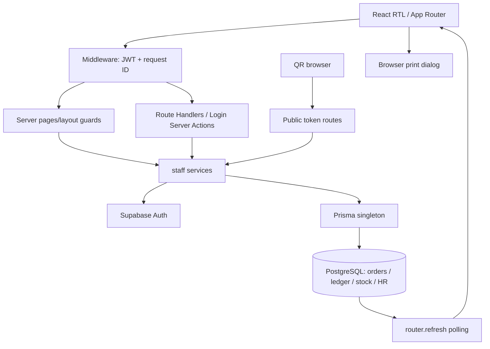

# SOKOON — المراجعة الشاملة المجمعة

يجمع هذا الملف النص الكامل للتقارير الستة عشر، بما فيها جرد المستودع ومصفوفة الميزات وسجل العيوب وخطة الإصلاح. تاريخ التدقيق الأصلي: 2026-11-04. التجميع لا يمثل تدقيقًا جديدًا أو إعادة تحقق من الإنتاج.

## الفهرس

- [الملخص التنفيذي — SOKOON](#audit-00)
- [البنية والمستودع](#audit-01)
- [مصفوفة اكتمال الميزات](#audit-02)
- [الأدوار والصلاحيات](#audit-03)
- [الكاشير وPOS والفواتير](#audit-04)
- [الطاولات والنادل وQR](#audit-05)
- [المطبخ والمخزون](#audit-06)
- [النظام المالي والتقارير](#audit-07)
- [قاعدة البيانات والترحيلات](#audit-08)
- [التدقيق الأمني](#audit-09)
- [الواجهة والطباعة](#audit-10)
- [الاختبارات والجودة](#audit-11)
- [النشر والتشغيل](#audit-12)
- [سجل العيوب المؤكدة والمخاطر](#audit-13)
- [بوابات جاهزية الإنتاج](#audit-14)
- [خطة التطوير ذات الأولوية](#audit-15)

---

المصدر: `00_EXECUTIVE_SUMMARY.md`

# الملخص التنفيذي — SOKOON
تاريخ المراجعة: 2026-11-04، Africa/Cairo. لقطة الكود: `main@cfe1b2334d90184eb4ceaedfbe0a20a160224752`.

## الحكم
**NOT READY FOR PRODUCTION** للاستخدام المالي غير المقيد. التطبيق يحتوي تنفيذًا حقيقيًا واسعًا وليس مجرد واجهات، لكن توجد أخطاء مؤكدة في تفويض تسليم النقد، ربط الاستردادات بالصندوق، اتساق إشغال الطاولات وربط QR بالواجهة. نجاح الاختبارات لا يغطي هذه المسارات.

## ما بُني
18 وحدة وظيفية حسب تقسيم هذا التدقيق: الهوية، التفويض، إدارة الفروع، الموظفون، HR والرواتب، الكتالوج، POS، الفواتير، الطاولات، النادل، QR العام، المطبخ، المخزون، المدفوعات والاستردادات، الورديات والتسليم، العهدة والخزنة، التقارير والضريبة، الإشعارات والطباعة والتشغيل. هذا تقسيم تحليلي وليس عدد حزم مستقلة.
الجرد: 561 ملفًا متتبعًا، 316 داخل src، 33 صفحة، 84 Route Handler، 83 ملف مكونات، 78 Prisma models، 25 ترحيل Prisma بصيغة directory/migration.sql و13 SQL في Supabase إضافة إلى SQL منفرد للحجوزات.

## النتائج الحاسمة
سجل التدقيق يتضمن **25 عيبًا مؤكدًا: 3 P0، و17 P1، و5 P2**، مع14 خطرًا منفصلًا يحتاج تحققًا أو قرار سياسة. بعض العيوب متداخلة في السبب والأثر؛ لا نجمعها كتقدير خسارة مالية.

- D01/P0: النزاع يغيّر CashHandover قبل التحقق من المستلم والفرع.
- D02/P0: حل النزاع متاح لأي موظف في الفرع لأن الخدمة والـAPI لا يفحصان دور Manager.
- D03/P0: Cash Refund الجديد يسجل Refund دون إدخاله في حساب expectedCash للورديات.
- D04/P1: الاستردادات تعتمد read/check/write دون قفل صف الدفعة أو انتقال حالة شرطي كافٍ.
- D05–D08/P1: إشغال الطاولات، ملكية الطلب وQR لا تتفق بين القاعدة والخدمات والشاشات.
- D09/P1: إنشاء POS يكتب taxAmount=0 رغم إعدادات الضريبة.
- D10–D12/P1: اختلاف مصادر الاسترداد والتواريخ وحدود النتائج يفسد اكتمال بعض الملخصات المالية.
- D13–D17: عيوب واجهة النادل والتكامل، توثيقها في السجل التفصيلي.

## قوة الدليل وحدوده
مصفوفة التقرير02 تحتوي125 بندًا:95 IMPLEMENTED، و19 BROKEN، و3 PARTIAL، و3 COMPLETE لسياسات/اختبارات محددة فقط، و2 MISSING، و2 BLOCKED، و1 NOT APPLICABLE. هذه تصنيفات بنود متفاوتة الحجم، ولا يجوز تحويلها إلى نسبة جاهزية أو مساواتها بعدد العيوب25.

تمت قراءة الكود والمسارات والمخطط، وتشغيل 267 اختبارًا Offline/Mock: 267 ناجح، صفر فشل/تخطي. TypeScript وESLint وPrisma validate ناجحة. PostgreSQL integration وBrowser E2E والطابعة الفعلية **NOT TESTED/BLOCKED**.
قراءات metadata وcounts فقط من مشروع Supabase المسمى skoon: PostgreSQL 17.11؛ قيد orders_one_open_order_per_table_idx موجود، ولا تكرار للطاولات وفق predicate القيد عند الفحص. لم تُقرأ بيانات عملاء أو أسرار ولم تُنفذ كتابة.
Hostinger يؤكد deployment مكتمل لنفس HEAD. هذا يثبت نشر commit، ولا يثبت صحة دورة البيع في جلسة موظف حقيقية.

## أولويات القرار
جمّد توسعة الوظائف حتى إصلاح تفويض CashHandover وحساب Cash Refund والتزامن. بعدها وحّد occupancy، أصلح QR، سوِّ سجل الترحيلات على staging، ثم نفّذ اختبارات PostgreSQL وE2E وقبول الطابعة والاستعادة. لا حاجة لإعادة كتابة النظام؛ الحاجة إلى ضبط المسارات المشتركة وتغطيتها باختبارات تكامل.

## الملفات
التقارير 01–15 في هذا المجلد تفصل البنية والمصفوفة والصلاحيات والتدفقات والمخاطر والاختبارات وبوابات الإطلاق والخطة. النتائج المؤكدة منفصلة عن مخاطر تحتاج تشغيلًا. لم يُعدّل التطبيق، ولم يحدث commit/push/deploy أو migration أثناء التدقيق.

---

المصدر: `01_ARCHITECTURE_AND_REPOSITORY.md`

# البنية والمستودع
## لقطة Git
main، HEAD cfe1b2334d90184eb4ceaedfbe0a20a160224752. working tree نظيف عند بدء التدقيق. origin/main مطابق محليًا وقت الفحص؛ remote-tracking snapshot دون fetch/pull.
الفروع المحلية والـremote-tracking: chore/repository-cleanup، feat/cashier-dashboard-ux-improvements، feat/financial-phase2a-payments-refunds، feat/financial-phase2b-cash-reconciliation، fix/invoice-inventory-consistency، main.
main...feat/financial-phase2b-cash-reconciliation =21 يسار/0 يمين؛ الفرع المذكور ancestor لـmain، رأسه6eecadd. ميزات refund lifecycle/cash handover/main safe موجودة علىmain، وليست عملًا ينتظر الدمج.
آخر commits: cfe1b23 recovery network،476b498 nested buttons،7e23e08 direct waiter table create، ثم إعادة تصميم workspace وsingle-order/QR. لا local-only application changes عند البداية. deployment metadata يؤكد HEAD، راجع12.

|الفرع مقارنة بـmain|commits في main فقط|commits في الفرع فقط|
|---|---|---|
|chore/repository-cleanup|73|0|
|feat/cashier-dashboard-ux-improvements|65|0|
|feat/financial-phase2a-payments-refunds|22|0|
|feat/financial-phase2b-cash-reconciliation|21|0|
|fix/invoice-inventory-consistency|72|0|

لا توجد commits فريدة على هذه الفروع المحلية مقارنة بـmain. هذا استنتاج ancestry عن المراجع الموجودة، دون fetch أو تأكيد أن remote لم يتغير بعد الفحص. لا تبديل فروع أو merge أثناء التدقيق.

## الإصدارات الفعلية
| الحزمة | package range/المثبت |
|---|---|
| Next.js |15.5.28 /15.5.28|
| React وReact DOM |^19.1.1 /19.3.0|
| TypeScript |^5.9.2 /5.9.3|
| Prisma وClient |6.19.3|
| @supabase/ssr |^0.12.7 /0.12.7|
| @supabase/supabase-js |^2.117.3 /2.117.3|
| Tailwind |^3.4.17 /3.4.19|
| ESLint |^9.39.5 /9.39.5|
| Node |مطلوب>=22؛ Hostinger22|
التثبيت المحلي وlockfile متفقان للحزم المفحوصة. package-lock ملتزم؛ range لا يساوي version بالضرورة.
`next.config.ts:15`: strictMode،serverExternalPackages Prisma/bcrypt، remote image allowlist،SVG غير مسموح. لا output:standalone محلي صريح، بينما Hostinger build metadata يكتشف standalone؛ لا نغير config بناءً على ذلك.
`tsconfig.json:3`: strict،noEmit،bundler،alias@/،includes عامة،incremental؛ استخدمنا --incremental false لحفظ قيد الملفات.

## خريطة البنية

Supabase Auth للهوية، Prisma للتفويض والبيانات، معاملات الخدمات مصدر قواعد العمل. لا API gateway مركزي يوحد التفويض لجميع handlers. الحالة التشغيلية تتزامن polling، لا realtime subscriptions مثبتة. طباعة المتصفح وليست service spool.

## خريطة الوحدات
| الوحدة | entry pages | الخدمات داخل src/lib | models | مجال UI |
|---|---|---|---|---|
|الهوية|/login|session.ts;staff-username.ts|User;UserSession|src/components/auth;login|
|التفويض|/(app)/layout|authz.ts;route-access.ts;require-page-access.ts|Role;Permission;RolePermission|src/components/layout;auth|
|الفروع|/settings|branch-bootstrap.ts;main-branch.ts|CafeBranch;AppSetting|src/components/settings|
|الموظفون|/staff|staff-provision-write.ts;staff-employee-write.ts|User;EmployeeProfile;EmploymentContract;CompensationRate|src/components/staff;hr|
|HR والرواتب|/staff|staff-payroll-write.ts;staff-scheduling-write.ts;staff-leave-write.ts;staff-overtime-write.ts;staff-attendance-summary.ts|WorkSchedule;AttendanceCorrection;LeaveRequest;PayrollPeriod;PayrollRun;PayrollLine;PayrollPayment|src/components/hr|
|الكتالوج|/products|staff-catalog-write.ts;staff-category-write.ts;staff-product-modifiers.ts;product-configuration.ts|Product;Category;ProductVariant;ProductAttribute;ProductOption|src/components/products|
|POS|/pos;/cashier|staff-pos.ts;staff-pos-write.ts;pos-draft.ts|Order;OrderItem;FinancialOperation|src/components/pos|
|الفواتير|/cashier;/owner/invoices|staff-invoices.ts;invoice-recalculation.ts;invoice-discounts.ts;staff-order-item-adjustment.ts;staff-order-item-void.ts|Order;OrderItem;Payment;AuditLog|src/components/cashier|
|الطاولات|/tables;/cashier/tables/[tableId]|staff-tables.ts;table-reservations.ts|CafeTable;WaiterTableReservation;OrderTableTransfer|src/components/tables;cashier|
|النادل|/waiter;/waiter/tables/[tableId]|staff-waiter.ts;staff-waiter-operations.ts;staff-waiter-readiness.ts|OrderResponsibilityHistory;WaiterShiftHandover;WaiterTableTransfer;WaiterOrderReconciliationReview|src/components/waiter|
|QR العام|/menu/[token];/order/[id]|public-menu.ts;public-orders.ts;qr.ts;guest-orders.ts|CafeTable;Order;OrderItem;ServiceRequest|src/components/public;menu|
|المطبخ|/kitchen|staff-orders.ts;order-status.ts|Order;OrderItem;OrderStatusHistory|src/components/kitchen|
|المخزون|/inventory|staff-inventory-engine.ts;staff-inventory-write.ts;staff-stock-count-write.ts;staff-waste-write.ts|InventoryItem;Recipe;InventoryBatch;InventoryReservation;StockCount;WasteEvent;EmployeeAccountability|src/components/inventory|
|المدفوعات والاستردادات|/cashier;/finance|staff-payments-write.ts;payment-request.ts;refund-accounting.ts|Payment;Refund;FinancialOperation|src/components/cashier|
|الورديات والتسليم|/shifts;/cashier|staff-shifts.ts;financial-shift-lock.ts|Shift;CashHandover;FinancialMovement|src/components/shifts;cashier|
|العهدة والخزنة|/fixed-float;/finance|staff-float.ts|FinancialMovement;FinancialOperation|src/components/cashier;finance;fixed-float|
|التقارير والضريبة|/reports;/finance;/customers|staff-reports.ts;finance-metrics.ts;staff-finance.ts;vat-report.ts;staff-customers.ts|Order;Payment;Refund;Shift;InventoryTransaction|src/components/reports;dashboard;finance|
|الإشعارات والطباعة والتشغيل|/kitchen;/cashier|notifications.ts;receipt-display.ts;request-correlation.ts|Notification;AuditLog|src/components/notifications;cashier;kitchen|

## ازدواج وفصل غير مكتمل
PosView/usePosCart وWaiterView/demo بيانات عرض غير مستخدمة بالمسار الإنتاجي؛ لا تحذفها ضمن audit. staff-pos يعود إلى demo categories عند غياب الفئات الحقيقية.
getServerEnv وتعريف CRON_SECRET بلا مستهلك ظاهر؛ single-active-session غير مربوط login/session. tables predicates متعددة، مالية Refund جديدة مقابل reports/shift legacy، وSQL histories مزدوجة.
Cashier وWaiter يشتركان في WaiterTableWorkspace لكن تحميل البيانات يرشح المسؤول مما يكسر المشاركة. UI actions refund/CashHandover/QR approvals غير مستهلكة رغم وجود الخدمات.
build_output.txt/test_output.txt/tree-output.txt artifacts متتبعة، ليست نتائج هذه الجولة. `src/lib/staff-waiter-operations.ts.tmp` ملف محلي ignored، لا implementation منشور. لا اعتماد على التقارير القديمة كإثبات.

## نطاق الفحص
الجرد الآلي أدناه يحصي كل الصفحات وAPI methods/services/models وملفات tests/migrations مع مراجع أسطر. مراجعة semantics أعمق للمسارات المالية والطاولة وQR؛ لا ندعي تشغيل كل endpoint أو كل form. بقية الوحدات تُصنف IMPLEMENTED أو BLOCKED ما لم يوجد دليل اختبار ذي معنى.

## ملحق الجرد الكامل

هذا فهرس لكل الملفات المتتبعة عند بدء التدقيق، مع تعريفات الكود وأسطرها. الجرد لا يساوي اختبار runtime؛ الأدلة الدلالية وحدودها في التقارير الموضوعية.

### الصفحات وAPI والـlayouts

|المصدر|التعريفات وأسطرها|
|---|---|
|`src/app/(app)/admin-home.tsx:1`|CanonicalDashboardPage:30، AdminHomePage:153|
|`src/app/(app)/cashier/page.tsx:1`|dynamic:13، CashierPage:15|
|`src/app/(app)/cashier/tables/[tableId]/page.tsx:1`|dynamic:8، metadata:10، CashierTablePage:12|
|`src/app/(app)/customers/page.tsx:1`|dynamic:7، CustomersPage:13|
|`src/app/(app)/dashboard/page.tsx:1`|DashboardCompatPage:18|
|`src/app/(app)/error.tsx:1`|AppError:14|
|`src/app/(app)/finance/page.tsx:1`|dynamic:5، FinancePage:7|
|`src/app/(app)/fixed-float/baseline/page.tsx:1`|dynamic:3، BaselinePage:4|
|`src/app/(app)/fixed-float/page.tsx:1`|dynamic:4، FixedFloatPage:5|
|`src/app/(app)/fixed-float/settlements/page.tsx:1`|dynamic:4، SettlementsPage:5|
|`src/app/(app)/inventory/page.tsx:1`|dynamic:9، InventoryPage:15|
|`src/app/(app)/kitchen/page.tsx:1`|dynamic:8، KitchenPage:16|
|`src/app/(app)/layout.tsx:1`|AppLayout:32|
|`src/app/(app)/logout-blocked/page.tsx:1`|dynamic:6، LogoutBlockedPage:9|
|`src/app/(app)/manager/page.tsx:1`|ManagerPage:3|
|`src/app/(app)/orders/page.tsx:1`|dynamic:8، OrdersPage:14|
|`src/app/(app)/owner/invoices/page.tsx:1`|dynamic:5، OwnerInvoicesPage:7|
|`src/app/(app)/owner/page.tsx:1`|OwnerPage:6|
|`src/app/(app)/pos/page.tsx:1`|dynamic:10، PosPage:13|
|`src/app/(app)/products/page.tsx:1`|dynamic:11، ProductsPage:17|
|`src/app/(app)/reports/page.tsx:1`|dynamic:9، ReportsPage:12|
|`src/app/(app)/settings/page.tsx:1`|dynamic:7، SettingsPage:14|
|`src/app/(app)/shifts/page.tsx:1`|dynamic:5، ShiftsPage:12|
|`src/app/(app)/staff/attendance-corrections/page.tsx:1`|dynamic:5، AttendanceCorrectionsPage:7|
|`src/app/(app)/staff/leave/page.tsx:1`|dynamic:5، LeaveRequestsPage:7|
|`src/app/(app)/staff/page.tsx:1`|dynamic:5، StaffPage:11|
|`src/app/(app)/tables/page.tsx:1`|dynamic:9، TablesPage:15|
|`src/app/(app)/tables/print/page.tsx:1`|metadata:7، TablePrintPage:11|
|`src/app/(app)/waiter/loading.tsx:1`|WaiterLoading:4|
|`src/app/(app)/waiter/page.tsx:1`|dynamic:9، metadata:11، WaiterPage:19|
|`src/app/(app)/waiter/tables/[tableId]/page.tsx:1`|dynamic:8، metadata:10، WaiterTablePage:12|
|`src/app/(public)/error.tsx:1`|PublicError:13|
|`src/app/(public)/layout.tsx:1`|PublicLayout:8|
|`src/app/(public)/menu/[token]/page.tsx:1`|dynamic:5، MenuPage:11|
|`src/app/(public)/order-type/page.tsx:1`|OrderTypePage:14|
|`src/app/(public)/order/[id]/page.tsx:1`|dynamic:13، OrderPage:24|
|`src/app/(public)/page.tsx:1`|LandingPage:18|
|`src/app/(public)/select-table/page.tsx:1`|dynamic:7، SelectTablePage:17|
|`src/app/api/public/orders/[id]/route.ts:1`|dynamic:11، GET:13|
|`src/app/api/public/orders/route.ts:1`|dynamic:9، POST:11|
|`src/app/api/public/service-requests/route.ts:1`||
|`src/app/api/staff/branches/bootstrap/route.ts:1`|dynamic:5، POST:8|
|`src/app/api/staff/branches/route.ts:1`|dynamic:10، GET:12|
|`src/app/api/staff/categories/[id]/route.ts:1`|dynamic:7، PATCH:11، DELETE:31|
|`src/app/api/staff/categories/route.ts:1`|dynamic:7، POST:9|
|`src/app/api/staff/employees/[id]/archive/route.ts:1`|dynamic:5، POST:7|
|`src/app/api/staff/employees/[id]/compensation/route.ts:1`|dynamic:5، POST:7|
|`src/app/api/staff/employees/[id]/contracts/route.ts:1`|dynamic:5، POST:7|
|`src/app/api/staff/employees/[id]/reactivate/route.ts:1`|dynamic:5، POST:7|
|`src/app/api/staff/employees/[id]/route.ts:1`|dynamic:5، GET:7|
|`src/app/api/staff/employees/[id]/terminate/route.ts:1`||
|`src/app/api/staff/employees/route.ts:1`|dynamic:5، GET:7|
|`src/app/api/staff/fixed-float/[id]/reverse/route.ts:1`|dynamic:4، POST:5|
|`src/app/api/staff/fixed-float/route.ts:1`|dynamic:5، POST:6|
|`src/app/api/staff/hr/attendance-corrections/[id]/decision/route.ts:1`|dynamic:5، POST:7|
|`src/app/api/staff/hr/attendance-corrections/route.ts:1`|dynamic:5، GET:13، POST:23|
|`src/app/api/staff/hr/attendance-summary/route.ts:1`|dynamic:5، GET:7|
|`src/app/api/staff/hr/documents/[id]/signed-url/route.ts:1`|dynamic:4، GET:5|
|`src/app/api/staff/hr/documents/route.ts:1`|dynamic:4، GET:6، POST:7|
|`src/app/api/staff/hr/financials/[id]/route.ts:1`|dynamic:4، POST:5|
|`src/app/api/staff/hr/financials/route.ts:1`|dynamic:4، GET:6، POST:7|
|`src/app/api/staff/hr/leave/[id]/decision/route.ts:1`|dynamic:4، POST:5|
|`src/app/api/staff/hr/leave/route.ts:1`|dynamic:4، GET:10، POST:11|
|`src/app/api/staff/hr/overtime/[id]/decision/route.ts:1`|POST:4|
|`src/app/api/staff/hr/overtime/route.ts:1`|dynamic:4، GET:6، POST:7|
|`src/app/api/staff/hr/overview/route.ts:1`|dynamic:7، GET:8|
|`src/app/api/staff/hr/payroll/[id]/route.ts:1`|dynamic:4، POST:5|
|`src/app/api/staff/hr/payroll/lines/[id]/payments/route.ts:1`|dynamic:4، POST:5|
|`src/app/api/staff/hr/payroll/route.ts:1`|dynamic:4، GET:6، POST:7|
|`src/app/api/staff/hr/reports/route.ts:1`|dynamic:6، GET:18|
|`src/app/api/staff/hr/schedules/route.ts:1`|dynamic:5، GET:12، POST:19|
|`src/app/api/staff/inventory/[id]/movement/route.ts:1`|dynamic:6، POST:10|
|`src/app/api/staff/inventory/accountability/[id]/waive/route.ts:1`|POST:5|
|`src/app/api/staff/inventory/accountability/route.ts:1`|GET:6|
|`src/app/api/staff/inventory/counts/[id]/[action]/route.ts:1`|POST:6|
|`src/app/api/staff/inventory/counts/[id]/route.ts:1`|GET:6|
|`src/app/api/staff/inventory/counts/route.ts:1`|GET:11، POST:17|
|`src/app/api/staff/inventory/waste/route.ts:1`|GET:7، POST:8|
|`src/app/api/staff/invoices/[id]/route.ts:1`|dynamic:5، PATCH:6، DELETE:15|
|`src/app/api/staff/invoices/route.ts:1`|dynamic:5، GET:37|
|`src/app/api/staff/main-safe/route.ts:1`|dynamic:16، GET:18، POST:31|
|`src/app/api/staff/notifications/read/route.ts:1`|dynamic:10، POST:12|
|`src/app/api/staff/notifications/route.ts:1`|dynamic:11، GET:13|
|`src/app/api/staff/orders/[id]/items/[itemId]/adjust/route.ts:1`|dynamic:5، POST:7|
|`src/app/api/staff/orders/[id]/items/[itemId]/void/route.ts:1`|dynamic:5، POST:7|
|`src/app/api/staff/orders/[id]/items/append/route.ts:1`|dynamic:8، POST:12|
|`src/app/api/staff/orders/[id]/items/serve/route.ts:1`|dynamic:9، POST:13|
|`src/app/api/staff/orders/[id]/pay/route.ts:1`|dynamic:28، POST:30، GET:93|
|`src/app/api/staff/orders/[id]/route.ts:1`|dynamic:5، PATCH:7|
|`src/app/api/staff/orders/[id]/send/route.ts:1`|dynamic:11، POST:15|
|`src/app/api/staff/orders/[id]/status/route.ts:1`|dynamic:16، POST:20|
|`src/app/api/staff/orders/[id]/waiter/route.ts:1`|dynamic:12، POST:18|
|`src/app/api/staff/orders/route.ts:1`|GET:10|
|`src/app/api/staff/pos/orders/route.ts:1`|dynamic:7، POST:9|
|`src/app/api/staff/product-configuration/attributes/[id]/route.ts:1`|dynamic:21، PATCH:23، DELETE:89|
|`src/app/api/staff/product-configuration/route.ts:1`|dynamic:6، GET:8، POST:16|
|`src/app/api/staff/product-configuration/values/[id]/route.ts:1`|dynamic:21، PATCH:23، DELETE:103|
|`src/app/api/staff/product-modifiers/route.ts:1`|dynamic:6، GET:8، POST:9|
|`src/app/api/staff/products/[id]/route.ts:1`|dynamic:7، PATCH:11، DELETE:30|
|`src/app/api/staff/products/[id]/toggle/route.ts:1`|dynamic:7، POST:11|
|`src/app/api/staff/products/route.ts:1`|dynamic:7، POST:9|
|`src/app/api/staff/qr/orders/route.ts:1`||
|`src/app/api/staff/reconcile/route.ts:1`||
|`src/app/api/staff/refunds/route.ts:1`||
|`src/app/api/staff/search/route.ts:1`|dynamic:11، GET:13|
|`src/app/api/staff/service-requests/[id]/route.ts:1`|dynamic:4، POST:5|
|`src/app/api/staff/service-requests/route.ts:1`|dynamic:4، GET:5|
|`src/app/api/staff/settings/route.ts:1`|dynamic:10، PUT:12|
|`src/app/api/staff/shifts/[id]/close/route.ts:1`|dynamic:12، POST:16|
|`src/app/api/staff/shifts/[id]/handover/route.ts:1`|dynamic:18، GET:20، POST:37|
|`src/app/api/staff/shifts/route.ts:1`|dynamic:15، GET:17، POST:30|
|`src/app/api/staff/tables/layout/route.ts:1`|dynamic:7، PATCH:18|
|`src/app/api/staff/tables/reservations/route.ts:1`|GET:34، POST:43، DELETE:62، HEAD:83|
|`src/app/api/staff/tables/route.ts:1`|dynamic:8، POST:17، PATCH:33، DELETE:39|
|`src/app/api/staff/users/[id]/password/route.ts:1`||
|`src/app/api/staff/users/[id]/route.ts:1`||
|`src/app/api/staff/users/route.ts:1`|dynamic:12، GET:18، POST:31|
|`src/app/api/staff/vat/route.ts:1`||
|`src/app/api/staff/waiter/handovers/[id]/route.ts:1`||
|`src/app/api/staff/waiter/handovers/route.ts:1`||
|`src/app/api/staff/waiter/table-transfers/[id]/route.ts:1`||
|`src/app/api/staff/waiter/table-transfers/route.ts:1`||
|`src/app/global-error.tsx:1`|GlobalError:16|
|`src/app/globals.css:1`||
|`src/app/layout.tsx:1`|metadata:17، viewport:34، RootLayout:45|
|`src/app/login/actions.ts:1`|LoginState:17، loginAction:22، logoutAction:97|
|`src/app/login/page.tsx:1`|LoginPage:12|

### الخدمات

|المصدر|التعريفات وأسطرها|
|---|---|
|`src/lib/api-auth-response.ts:1`|isStaffApiPath:4، unauthenticatedStaffResponse:9، forbiddenStaffResponse:13|
|`src/lib/auth/login-storage.ts:1`|LEGACY_LOGIN_CREDENTIAL_KEY:2، clearLegacyLoginCredentials:5|
|`src/lib/auth/safe-redirect.ts:1`|safeInternalRedirect:6|
|`src/lib/authz.ts:1`||
|`src/lib/branch-bootstrap.ts:1`||
|`src/lib/catalog-branch.ts:1`||
|`src/lib/catalog-import.ts:1`||
|`src/lib/dashboard-stats.ts:1`||
|`src/lib/demo/dashboard.ts:1`||
|`src/lib/demo/index.ts:1`||
|`src/lib/demo/orders.ts:1`||
|`src/lib/env.server.ts:1`||
|`src/lib/env.ts:1`||
|`src/lib/finance-metrics.ts:1`||
|`src/lib/financial-shift-lock.ts:1`||
|`src/lib/format.ts:1`||
|`src/lib/guest-orders.ts:1`||
|`src/lib/hr-authz.ts:1`||
|`src/lib/hr-payroll-calculation.ts:1`||
|`src/lib/hr-scheduling-policy.ts:1`||
|`src/lib/hr-time-calculation.ts:1`||
|`src/lib/invoice-deletion-policy.ts:1`||
|`src/lib/invoice-discounts.ts:1`||
|`src/lib/invoice-recalculation.ts:1`||
|`src/lib/logout-eligibility.ts:1`||
|`src/lib/main-branch.ts:1`||
|`src/lib/manager-operations.ts:1`||
|`src/lib/navigation.ts:1`||
|`src/lib/notifications.ts:1`||
|`src/lib/order-item-options.ts:1`||
|`src/lib/order-item-variant.ts:1`||
|`src/lib/order-status.ts:1`||
|`src/lib/payment-request.ts:1`||
|`src/lib/payroll-preview-policy.ts:1`||
|`src/lib/pexels.ts:1`||
|`src/lib/pos-discount-policy.ts:1`||
|`src/lib/pos-draft.ts:1`||
|`src/lib/pos/use-pos-cart.ts:1`||
|`src/lib/prisma.ts:1`||
|`src/lib/product-configuration-policy.ts:1`||
|`src/lib/product-configuration.ts:1`||
|`src/lib/public-menu.ts:1`||
|`src/lib/public-orders.ts:1`||
|`src/lib/qr-render.ts:1`||
|`src/lib/qr.ts:1`||
|`src/lib/receipt-display.ts:1`||
|`src/lib/receipt-settlement.ts:1`||
|`src/lib/refund-accounting.ts:1`||
|`src/lib/request-correlation.ts:1`||
|`src/lib/require-page-access.ts:1`||
|`src/lib/route-access.ts:1`||
|`src/lib/security/pin.ts:1`||
|`src/lib/service-request-policy.ts:1`||
|`src/lib/session.ts:1`||
|`src/lib/single-active-session.ts:1`||
|`src/lib/staff-attendance-summary.ts:1`||
|`src/lib/staff-catalog-write.ts:1`||
|`src/lib/staff-catalog.ts:1`||
|`src/lib/staff-category-write.ts:1`||
|`src/lib/staff-customers.ts:1`||
|`src/lib/staff-directory.ts:1`||
|`src/lib/staff-employee-write.ts:1`||
|`src/lib/staff-finance.ts:1`||
|`src/lib/staff-float.ts:1`||
|`src/lib/staff-hr-documents.ts:1`||
|`src/lib/staff-hr-financial-write.ts:1`||
|`src/lib/staff-inventory-engine.ts:1`||
|`src/lib/staff-inventory-write.ts:1`||
|`src/lib/staff-inventory.ts:1`||
|`src/lib/staff-invoices.ts:1`||
|`src/lib/staff-leave-write.ts:1`||
|`src/lib/staff-order-item-adjustment.ts:1`||
|`src/lib/staff-order-item-void.ts:1`||
|`src/lib/staff-orders.ts:1`||
|`src/lib/staff-overtime-write.ts:1`||
|`src/lib/staff-payments-write.ts:1`||
|`src/lib/staff-payroll-write.ts:1`||
|`src/lib/staff-pos-write.ts:1`||
|`src/lib/staff-pos.ts:1`||
|`src/lib/staff-product-modifiers.ts:1`||
|`src/lib/staff-provision-write.ts:1`||
|`src/lib/staff-reconcile.ts:1`||
|`src/lib/staff-reports.ts:1`|ReportsSummary:54، getReportsSummary:92|
|`src/lib/staff-scheduling-write.ts:1`|SchedulingError:10، createWorkSchedule:48، listWorkSchedules:67، requestAttendanceCorrection:83، listAttendanceCorrections:110، decideAttendanceCorrection:130|
|`src/lib/staff-service-requests.ts:1`|ServiceRequestError:12، createPublicServiceRequest:18، listServiceRequests:41، actOnServiceRequest:49|
|`src/lib/staff-settings-write.ts:1`|SettingsError:18، SETTING_DEFS:28، SettingKey:61، SettingsUpdateResult:70، updateBranchSettings:76|
|`src/lib/staff-settings.ts:1`|BranchSetting:10، SettingsSnapshot:15، getSettingsSnapshot:22|
|`src/lib/staff-shifts.ts:1`|ShiftError:23، isOpenShiftUniquenessConflict:33، ShiftStatus:38، CASH_HANDLING_ROLES:47، isCashHandlingRole:50، CashPaymentRow:55، ShiftView:61، ShiftOrderRow:82، ShiftBoardData:90، round2:104، computeShiftCashFlow:109، expectedCashFrom:127، expectedCashAfterOperationalWithdrawals:132، cashDifferenceOf:137، openShiftSchema:141، closeShiftSchema:153، crossedLocalMidnight:168، getOpenShift:184، openShift:244، closeShift:321، getPendingHandovers:483، acceptCashHandover:532، disputeCashHandover:595، resolveCashHandover:645، requireOpenShift:712، getShiftsBoard:725|
|`src/lib/staff-stock-count-write.ts:1`|StockCountError:9، createStockCount:27، startStockCount:40، saveStockCountLines:42، submitStockCount:50، previewStockCountVariances:56، postStockCount:71، cancelStockCount:134|
|`src/lib/staff-tables.ts:1`|StaffTable:6، getStaffTables:20|
|`src/lib/staff-username.ts:1`|normalizeStaffUsername:10، staffUsernameEmail:15، usernameFromStaffEmail:19، staffLoginEmail:31، staffIdentityEmail:40|
|`src/lib/staff-waiter-operations.ts:1`|isTransferEligible:24، requiresEmergencyServing:28، claimQrOrder:53، approveQrOrder:80، rejectQrOrder:232، reassignOrderResponsibility:253، transferOrderTable:272، requestWaiterResponsibilityHandover:297، acceptWaiterResponsibilityHandover:315، rejectWaiterResponsibilityHandover:339، requestTableTransfer:363، acceptTableTransfer:442، rejectTableTransfer:566، cancelTableTransfer:617، listUnclaimedQrOrders:665|
|`src/lib/staff-waiter-readiness.ts:1`|WaiterResponsibilityReviewRow:7، WaiterOperationalReadiness:25، getWaiterOperationalReadiness:37|
|`src/lib/staff-waiter.ts:1`|WaiterOrderRow:15، IncomingWaiterHandover:21، IncomingTableTransfer:29، OutgoingTableTransfer:38، WaiterWorkspace:49، OwnerWaiterMonitor:69، canViewOwnerWaiterMonitor:99، isWaiterTableOrderActive:115، WaiterSchemaError:124، isMissingWaiterHandoverTableError:132، getWaiterWorkspace:140، getOwnerWaiterMonitor:321|
|`src/lib/staff-waste-write.ts:1`|WasteError:8، recordWaste:13، waiveAccountability:42|
|`src/lib/stock-count-policy.ts:1`|FifoLayer:1، CountPlan:2، planStockCount:6|
|`src/lib/supabase/client.ts:1`|createClient:13|
|`src/lib/supabase/server.ts:1`|createClient:14|
|`src/lib/table-reservations.ts:1`|TableReservationError:7، DEFAULT_RESERVATION_TTL_SECONDS:15، acquireTableReservation:47، listActiveReservations:133، releaseTableReservation:161، cleanExpiredReservations:181، readReservationTableId:190، validateAndClaimWaiterReservationTx:210، finalizeReservationTx:234|
|`src/lib/theme.tsx:1`|Theme:25، ThemeProvider:47، useTheme:82|
|`src/lib/utils.ts:1`|ClassValue:8، cn:17|
|`src/lib/vat-report.ts:1`|VatReportError:6، VatPayment:10، VatInvoiceInput:11، VatInvoiceRow:16، VatExcludedInvoice:21، VatCalculation:23، calculateVat:40، VatReport:76، parseVatDate:94، normalizeVatReportFilters:103، getVatReport:112|
|`src/lib/waiter-pos-confirmation.ts:1`|WaiterPosOrderReference:1، WaiterPosConfirmationResult:7، confirmWaiterPosOrder:17|
|`src/lib/waiter-readiness-policy.ts:1`|WaiterResponsibilityBucket:6، UnassignedOrderFacts:8، WaiterResponsibilityProposal:14، classifyUnassignedWaiterOrder:19|
|`src/lib/waiter-reconciliation-policy.ts:1`|RECONCILIATION_DECISIONS:6، RECONCILIATION_REVIEW_STATUSES:13، ReconciliationDecision:21، ReconciliationReviewStatus:22، LegacyOrderSnapshot:24، EligibleWaiter:33، ProposalInput:41، ProposalValidation:49، canReviewLegacyResponsibility:51، isHistoricalLegacyOrder:55، validateLegacyReconciliationProposal:60، isLegacySnapshotCurrent:85، canTransitionReconciliationReview:94، approvalExecutesOrderMutation:109|

### المكونات

|المصدر|التعريفات وأسطرها|
|---|---|
|`src/components/auth/auth-expiry-guard.tsx:1`||
|`src/components/auth/login-form.tsx:1`||
|`src/components/cashier/cart-sidebar.tsx:1`||
|`src/components/cashier/cashier-dashboard.tsx:1`||
|`src/components/cashier/cashier-workspace.tsx:1`||
|`src/components/cashier/invoice-board.tsx:1`||
|`src/components/cashier/shared-float-panel.tsx:1`||
|`src/components/cashier/tables-sidebar.tsx:1`||
|`src/components/cashier/thermal-receipt-preview.tsx:1`||
|`src/components/dashboard/demo-banner.tsx:1`||
|`src/components/dashboard/manager-operations-center.tsx:1`||
|`src/components/dashboard/manager-service-request-panel.tsx:1`||
|`src/components/dashboard/quick-actions.tsx:1`||
|`src/components/dashboard/recent-orders-table.tsx:1`||
|`src/components/dashboard/sales-card.tsx:1`||
|`src/components/dashboard/tables-status.tsx:1`||
|`src/components/dashboard/top-products.tsx:1`||
|`src/components/dashboard/waiter-operational-readiness-panel.tsx:1`||
|`src/components/finance/owner-finance-board.tsx:1`|OwnerFinanceBoard:17|
|`src/components/fixed-float/baseline-board.tsx:1`|BaselineBoard:6|
|`src/components/fixed-float/fixed-float-board.tsx:1`|FixedFloatBoard:9|
|`src/components/fixed-float/settlement-board.tsx:1`|SettlementBoard:8|
|`src/components/inventory/accountability-board.tsx:1`|AccountabilityBoard:8|
|`src/components/inventory/inventory-board.tsx:1`|InventoryBoard:22|
|`src/components/inventory/stock-count-board.tsx:1`|StockCountBoard:17|
|`src/components/inventory/waste-board.tsx:1`|WasteBoard:7|
|`src/components/kitchen/kitchen-board.tsx:1`|KitchenBoard:25|
|`src/components/layout/app-shell.tsx:1`||
|`src/components/layout/notifications-bell.tsx:1`||
|`src/components/layout/sidebar.tsx:1`||
|`src/components/layout/topbar-search.tsx:1`||
|`src/components/layout/topbar.tsx:1`|TopbarProps:36، Topbar:42|
|`src/components/menu/menu-order-view.tsx:1`|MenuOrderView:33|
|`src/components/order/copy-order-link-button.tsx:1`|CopyOrderLinkButton:13|
|`src/components/order/order-status-tracker.tsx:1`|OrderStatusTracker:35|
|`src/components/order/resume-order-button.tsx:1`|ResumeOrderButton:14|
|`src/components/orders/orders-board.tsx:1`|OrdersBoard:46|
|`src/components/owner/owner-command-center.tsx:1`|OwnerCommandCenterProps:15، OwnerCommandCenter:35|
|`src/components/owner/owner-invoice-board.tsx:1`|OwnerInvoiceBoard:24|
|`src/components/placeholder-page.tsx:1`|PlaceholderPageProps:10، PlaceholderPage:16|
|`src/components/pos/pos-checkout.tsx:1`|PosCheckout:30|
|`src/components/pos/pos-view.tsx:1`|PosView:20|
|`src/components/products/owner-products-tabs.tsx:1`|OwnerProductsTabs:7|
|`src/components/products/product-configuration-board.tsx:1`|ProductConfigurationBoard:11|
|`src/components/products/product-modifiers-board.tsx:1`|ProductModifiersBoard:11|
|`src/components/products/products-board.tsx:1`|ProductsBoard:36|
|`src/components/public/public-backdrop.tsx:1`|PublicBackdrop:10|
|`src/components/reports/reports-board.tsx:1`|ReportsBoard:17|
|`src/components/reports/vat-report.tsx:1`|VatReport:13|
|`src/components/service-requests/service-request-board.tsx:1`||
|`src/components/settings/settings-board.tsx:1`||
|`src/components/shifts/shifts-board.tsx:1`||
|`src/components/staff/attendance-corrections-board.tsx:1`||
|`src/components/staff/employee-management-board.tsx:1`||
|`src/components/staff/hr-kpi-cards.tsx:1`||
|`src/components/staff/hr-reports-board.tsx:1`||
|`src/components/staff/hr-workspace-panels.tsx:1`||
|`src/components/staff/leave-review-board.tsx:1`||
|`src/components/staff/overtime-policy-history.tsx:1`||
|`src/components/staff/payroll-management-board.tsx:1`||
|`src/components/staff/schedule-management-board.tsx:1`||
|`src/components/staff/staff-board.tsx:1`||
|`src/components/tables/print-button.tsx:1`||
|`src/components/tables/table-qr-print-button.tsx:1`||
|`src/components/tables/tables-board.tsx:1`|TablesBoard:21|
|`src/components/ui/avatar.tsx:1`|AvatarProps:8، Avatar:42|
|`src/components/ui/badge.tsx:1`|BadgeTone:5، BadgeProps:24، Badge:28|
|`src/components/ui/button.tsx:1`||
|`src/components/ui/card.tsx:1`||
|`src/components/ui/chart.tsx:1`||
|`src/components/ui/dropdown.tsx:1`||
|`src/components/ui/empty-state.tsx:1`||
|`src/components/ui/icon.tsx:1`||
|`src/components/ui/input.tsx:1`||
|`src/components/ui/popover.tsx:1`||
|`src/components/ui/segmented.tsx:1`||
|`src/components/ui/stat.tsx:1`||
|`src/components/ui/switch.tsx:1`||
|`src/components/ui/theme-toggle.tsx:1`||
|`src/components/waiter/owner-waiter-monitor.tsx:1`|OwnerWaiterMonitor:38|
|`src/components/waiter/waiter-board.tsx:1`|WaiterBoard:131|
|`src/components/waiter/waiter-table-workspace.tsx:1`|WaiterTableWorkspace:60|
|`src/components/waiter/waiter-view.tsx:1`|WaiterView:107|

### Prisma والمخطط والترحيلات

|المصدر|التعريفات وأسطرها|
|---|---|
|`prisma/migrations/20261009231834_init/migration.sql:1`||
|`prisma/migrations/20261012234136_add_notifications_and_sent_to_kitchen/migration.sql:1`||
|`prisma/migrations/20261017130054_add_handover_fields/migration.sql:1`||
|`prisma/migrations/20261017_add_shifts/migration.sql:1`||
|`prisma/migrations/20261018120000_cash_ledger_and_handover/migration.sql:1`||
|`prisma/migrations/20261018120100_financial_idempotency_reversals/migration.sql:1`||
|`prisma/migrations/20261018120200_advance_repayment_links/migration.sql:1`||
|`prisma/migrations/20261018120300_expand_financial_movement_type/migration.sql:1`||
|`prisma/migrations/20261018140000_add_product_cost_unit_tax_and_user_salary/migration.sql:1`||
|`prisma/migrations/20261023120000_inventory_reservations_batches_accountability/migration.sql:1`||
|`prisma/migrations/20261023150000_hr_employee_foundation/migration.sql:1`||
|`prisma/migrations/20261026000000_product_configuration_variants/migration.sql:1`||
|`prisma/migrations/20261027000000_hr_scheduling_attendance_leave_foundation/migration.sql:1`||
|`prisma/migrations/20261027100000_complete_hr_payroll_foundation/migration.sql:1`||
|`prisma/migrations/20261027130000_order_item_and_invoice_discounts/migration.sql:1`||
|`prisma/migrations/20261028140000_add_username_to_user/migration.sql:1`||
|`prisma/migrations/20261028150000_add_floor_plan_columns/migration.sql:1`||
|`prisma/migrations/20261028160000_add_responsible_waiter_id/migration.sql:1`||
|`prisma/migrations/20261028170000_add_qr_claimed_at/migration.sql:1`||
|`prisma/migrations/20261028180000_add_qr_decision_columns/migration.sql:1`||
|`prisma/migrations/20261028190000_add_missing_waiter_operational_tables/migration.sql:1`||
|`prisma/migrations/20261029000000_add_waiter_table_transfers/migration.sql:1`||
|`prisma/migrations/20261029130000_reusable_product_modifier_groups/migration.sql:1`||
|`prisma/migrations/20261101000000_waiter_table_reservations.sql:1`||
|`prisma/migrations/20261102000000_add_refunds_and_payment_confirmation/migration.sql:1`||
|`prisma/migrations/20261102010000_add_cash_handovers/migration.sql:1`||
|`prisma/migrations/migration_lock.toml:1`||
|`prisma/schema.prisma:1`|CafeBranch:25، Role:80، Permission:95، RolePermission:109، User:121، UserSession:213، EmployeeProfile:234، EmploymentContract:273، CompensationRate:299، WorkSchedule:325، WorkScheduleDay:347، AttendanceCorrection:361، LeaveRequest:387، OfficialHoliday:413، WorkScheduleInterval:433، EmployeeDocument:445، OvertimePolicy:458، OvertimeRequest:484، HrAdjustment:505، EmployeeAdvance:524، PayrollPeriod:542، PayrollRun:554، PayrollLine:570، PayrollPayment:587، ServiceRequest:601، CafeTable:629، Category:663، Product:683، ProductOption:730، ProductOptionAssignment:757، ProductOptionValue:774، ProductAttribute:793، ProductAttributeValue:813، MeasurementUnit:834، ProductAttributeAssignment:861، ProductAttributeAssignmentValue:881، ProductVariant:893، ProductVariantValue:920، VariantInventoryMapping:932، Addon:946، ProductAddon:961، Order:975، OrderResponsibilityHistory:1048، OrderTableTransfer:1070، WaiterTableReservation:1095، WaiterShiftHandover:1119، WaiterTableTransfer:1145، WaiterOrderReconciliationReview:1170، WaiterOrderReconciliationAudit:1201، OrderItem:1226، OrderItemAddon:1269، OrderItemOption:1286، OrderStatusHistory:1304، Notification:1320، Payment:1341، Shift:1379، FinancialMovement:1418، FinancialOperation:1458، InventoryItem:1475، Recipe:1507، RecipeItem:1522، InventoryTransaction:1536، InventoryBatch:1568، InventoryReservation:1592، InventoryBatchAllocation:1617، StockCount:1637، StockCountLine:1664، WasteEvent:1689، WasteOperation:1714، EmployeeAccountability:1730، AccountabilityWaiver:1754، PayrollDeduction:1771، Discount:1787، DiscountRedemption:1816، AppSetting:1833، Refund:1854، CashHandover:1896، AuditLog:1926|
|`prisma/seed-demo.ts:1`||
|`prisma/seed-test-users.ts:1`||
|`prisma/seed.ts:1`||

### Supabase

|المصدر|التعريفات وأسطرها|
|---|---|
|`supabase/migrations/20261023130000_stock_counts.sql:1`||
|`supabase/migrations/20261023140000_waste_idempotency.sql:1`||
|`supabase/migrations/20261023150000_hr_employee_foundation.sql:1`||
|`supabase/migrations/20261023160000_hr_scheduling_attendance.sql:1`||
|`supabase/migrations/20261023161000_hr_leave_holidays.sql:1`||
|`supabase/migrations/20261023162000_manager_service_requests.sql:1`||
|`supabase/migrations/20261024100000_waiter_responsibility_operations.sql:1`||
|`supabase/migrations/20261024110000_waiter_order_reconciliation_reviews.sql:1`||
|`supabase/migrations/20261024125607_enforce_one_open_shift_per_employee_branch.sql:1`||
|`supabase/migrations/20261026120000_immutable_payment_refunds.sql:1`||
|`supabase/migrations/20261026_add_user_sessions_table.sql:1`||
|`supabase/migrations/20261027000000_payroll_preview_attendance.sql:1`||
|`supabase/migrations/20261027001000_salary_advances_preview.sql:1`||
|`supabase/policies/00-helpers.sql:1`||
|`supabase/policies/10-rls-enable-and-public.sql:1`||
|`supabase/policies/20-operational-rls.sql:1`||
|`supabase/policies/30-sensitive-deny.sql:1`||
|`supabase/policies/README.md:1`||

### الاختبارات والأدوات التشغيلية

|المصدر|التعريفات وأسطرها|
|---|---|
|`.github/workflows/quality.yml:1`||
|`scripts/check-shift-purge-dependencies.ts:1`||
|`scripts/compare-production-recovery-readonly.cjs:1`||
|`scripts/db-check.ts:1`||
|`scripts/fix-mojibake.mjs:1`||
|`scripts/forbid-prisma-production-migrate.cjs:1`||
|`scripts/import-skoon-menu.ts:1`||
|`scripts/inspect-financial-movement-fks.ts:1`||
|`scripts/inspect-order-fks.ts:1`||
|`scripts/inspect-shift-fks.ts:1`||
|`scripts/inspect-user-fks.ts:1`||
|`scripts/migrate-init.cjs:1`||
|`scripts/preview-non-owner-users.ts:1`||
|`scripts/preview-shift-purge.ts:1`||
|`scripts/preview-user-purge-blockers.ts:1`||
|`scripts/purge-non-owner-users.ts:1`||
|`scripts/purge-test-orders-before.ts:1`||
|`scripts/purge-test-shifts-before.ts:1`||
|`scripts/run-local-backup-recovery.ps1:1`||
|`scripts/validate-staging-env.cjs:1`||
|`scripts/verify-local-recovery.ps1:1`||
|`scripts/verify-staff-provisioning-roundtrip.ts:1`||
|`scripts/verify-test-order-purge.ts:1`||
|`scripts/with-authorized-test-env.cjs:1`||
|`scripts/with-staging-env.cjs:1`||
|`tests/cashier-postgres.test.ts:1`||
|`tests/cleanup-financial-fixture.cjs:1`||
|`tests/database-activity.cjs:1`||
|`tests/database-counts.cjs:1`||
|`tests/database-financial-schema.cjs:1`||
|`tests/financial-fixture-residue.cjs:1`||
|`tests/financial-postgres.test.ts:1`||
|`tests/hr-postgres.test.ts:1`||
|`tests/inventory-postgres.test.ts:1`||
|`tests/node-userinfo-workaround.cjs:1`||
|`tests/offline.test.ts:1`||
|`tests/service-requests-postgres.test.ts:1`||
|`tests/shift-concurrency-postgres.test.ts:1`||
|`tests/staff-provision-offline.test.ts:1`||

### الوثائق القائمة، لا تُعتمد كإثبات تشغيل حديث

|المصدر|التعريفات وأسطرها|
|---|---|
|`docs/BACKUP_RECOVERY_VALIDATION.md:1`||
|`docs/CAFE-SYSTEM-ARCHITECTURE.md:1`||
|`docs/CASH-HANDOVER-TIMEZONE-POLICY.md:1`||
|`docs/DATABASE-DESIGN.md:1`||
|`docs/ERP-ARCHITECTURE.md:1`||
|`docs/ERP-DATABASE-MIGRATIONS.md:1`||
|`docs/ERP-PERMISSIONS-MATRIX.md:1`||
|`docs/ERP-PRODUCTION-READINESS.md:1`||
|`docs/ERP-TRANSFORMATION-TRACKER.md:1`||
|`docs/FINANCIAL-ACCEPTANCE-TESTS.md:1`||
|`docs/FULL_UI_COMPLETION_AUDIT.md:1`||
|`docs/FULL_UI_COMPLETION_REPORT.md:1`||
|`docs/HOSTINGER-DEPLOYMENT.md:1`||
|`docs/HR_GAP_ANALYSIS.md:1`||
|`docs/HR_IMPLEMENTATION_REPORT.md:1`||
|`docs/INVENTORY-CUTOVER.md:1`||
|`docs/MANAGER_DASHBOARD_AUDIT.md:1`||
|`docs/MANAGER_DASHBOARD_IMPLEMENTATION_REPORT.md:1`||
|`docs/NEXTJS-HOSTINGER-VALIDATION.md:1`||
|`docs/OWNER-PROVISIONING.md:1`||
|`docs/PHASE-05-AUDIT-IMPLEMENTATION-PLAN.md:1`||
|`docs/PHASE-A-POSTGRES-SUPABASE-AUTH.md:1`||
|`docs/PHASE-B-SUPABASE-RLS-OWNER.md:1`||
|`docs/PIN-SECURITY-DESIGN.md:1`||
|`docs/PRODUCTION_DATABASE_SAFETY_AUDIT.md:1`||
|`docs/SKOON_ACCOUNT_RECONCILIATION_PLAN.md:1`||
|`docs/SKOON_AUTH_SESSION_VERIFICATION.md:1`||
|`docs/SKOON_BACKUP_RESTORE_RUNBOOK.md:1`||
|`docs/SKOON_FEATURE_INVENTORY.md:1`||
|`docs/SKOON_HR_ATTENDANCE_PAYROLL_AUDIT.md:1`||
|`docs/SKOON_MANUAL_TESTING_GUIDE.md:1`||
|`docs/SKOON_OWNER_COMPLETION_REPORT.md:1`||
|`docs/SKOON_OWNER_DASHBOARD_AUDIT.md:1`||
|`docs/SKOON_PRISMA_RUNTIME_VERIFICATION.md:1`||
|`docs/SKOON_PRODUCT_VARIANTS_IMPLEMENTATION.md:1`||
|`docs/SKOON_REFUND_ACCOUNTING_ARCHITECTURE.md:1`||
|`docs/SKOON_RELEASE_BLOCKERS_REMEDIATION.md:1`||
|`docs/STAGING-DATABASE.md:1`||
|`docs/SUPABASE_MIGRATION_RECONCILIATION.md:1`||
|`docs/THERMAL_RECEIPT_PRINTING.md:1`||
|`docs/WAITER_BOARD_UX_REPORT.md:1`||
|`docs/WAITER_MIGRATION_FINAL_AUDIT.md:1`||
|`docs/WAITER_MIGRATION_READINESS.md:1`||
|`docs/WAITER_MODULE_AUDIT.md:1`||
|`docs/WAITER_MODULE_IMPLEMENTATION_REPORT.md:1`||
|`docs/WAITER_MODULE_TEST_REPORT.md:1`||
|`docs/WAITER_OPERATIONAL_READINESS.md:1`||
|`docs/WAITER_ORDER_RECONCILIATION_PHASE2.md:1`||
|`docs/WAITER_RELEASE_READINESS.md:1`||
|`docs/WAITER_SCHEMA_DRIFT_RECOVERY.md:1`||
|`docs/architecture/TABLE_ORDER_LIFECYCLE.md:1`||
|`docs/audits/BUSINESS_LOGIC_AUDIT.md:1`||
|`docs/audits/DATABASE_AUDIT.md:1`||
|`docs/audits/EXECUTIVE_SUMMARY.md:1`||
|`docs/audits/FINANCIAL_AUDIT.md:1`||
|`docs/audits/FULL_AUDIT_REPORT.md:1`||
|`docs/audits/INVENTORY_AUDIT.md:1`||
|`docs/audits/PRODUCTION_READINESS.md:1`||
|`docs/audits/REMEDIATION_ROADMAP.md:1`||
|`docs/audits/SECURITY_AUDIT.md:1`||
|`docs/audits/TABLE_MANAGEMENT_AUDIT.md:1`||
|`docs/audits/TABLE_MANAGEMENT_IMPLEMENTATION.md:1`||
|`docs/audits/TEST_COVERAGE_MATRIX.md:1`||
|`docs/audits/full-codebase-audit.md:1`||
|`docs/audits/pre-commit-review.md:1`||
|`docs/cash-custody/architecture.md:1`||
|`docs/cash-custody/authorization-invariants.md:1`||
|`docs/cash-custody/cash-custody-lifecycle.md:1`||
|`docs/cash-custody/migration-compatibility.md:1`||
|`docs/cash-custody/migration-draft.sql:1`||
|`docs/cash-custody/prisma-schema.md:1`||
|`docs/cash-custody/rls-policies.md:1`||
|`docs/cash-custody/rollback-strategy.md:1`||
|`docs/cash-custody/test-plan.md:1`||
|`docs/cash-custody/test.txt:1`||
|`docs/completion-audit.md:1`||
|`docs/product/feature-inventory.md:1`||
|`docs/product/implementation-backlog.md:1`||
|`docs/product/implementation-roadmap.md:1`||
|`docs/product/target-architecture.md:1`||
|`docs/qa/AUTHENTICATION_TEST_REPORT.md:1`||
|`docs/qa/BUG_FIX_LOG.md:1`||
|`docs/qa/DATABASE_INTEGRITY_REPORT.md:1`||
|`docs/qa/EMPLOYEE_LOGIN_TEST_MATRIX.md:1`||
|`docs/qa/FINAL_REGRESSION_REPORT.md:1`||
|`docs/qa/FULL_SYSTEM_AUDIT.md:1`||
|`docs/qa/FUNCTIONAL_TEST_RESULTS.md:1`||
|`docs/qa/SECURITY_TEST_REPORT.md:1`||

### بقية الإعدادات والأصول

|المصدر|التعريفات وأسطرها|
|---|---|
|`.agents/skills/supabase-postgres-best-practices/CHANGELOG.md:1`||
|`.agents/skills/supabase-postgres-best-practices/SKILL.md:1`||
|`.agents/skills/supabase-postgres-best-practices/references/_contributing.md:1`||
|`.agents/skills/supabase-postgres-best-practices/references/_sections.md:1`||
|`.agents/skills/supabase-postgres-best-practices/references/_template.md:1`||
|`.agents/skills/supabase-postgres-best-practices/references/advanced-full-text-search.md:1`||
|`.agents/skills/supabase-postgres-best-practices/references/advanced-jsonb-indexing.md:1`||
|`.agents/skills/supabase-postgres-best-practices/references/conn-idle-timeout.md:1`||
|`.agents/skills/supabase-postgres-best-practices/references/conn-limits.md:1`||
|`.agents/skills/supabase-postgres-best-practices/references/conn-pooling.md:1`||
|`.agents/skills/supabase-postgres-best-practices/references/conn-prepared-statements.md:1`||
|`.agents/skills/supabase-postgres-best-practices/references/data-batch-inserts.md:1`||
|`.agents/skills/supabase-postgres-best-practices/references/data-n-plus-one.md:1`||
|`.agents/skills/supabase-postgres-best-practices/references/data-pagination.md:1`||
|`.agents/skills/supabase-postgres-best-practices/references/data-upsert.md:1`||
|`.agents/skills/supabase-postgres-best-practices/references/lock-advisory.md:1`||
|`.agents/skills/supabase-postgres-best-practices/references/lock-deadlock-prevention.md:1`||
|`.agents/skills/supabase-postgres-best-practices/references/lock-short-transactions.md:1`||
|`.agents/skills/supabase-postgres-best-practices/references/lock-skip-locked.md:1`||
|`.agents/skills/supabase-postgres-best-practices/references/monitor-explain-analyze.md:1`||
|`.agents/skills/supabase-postgres-best-practices/references/monitor-pg-stat-statements.md:1`||
|`.agents/skills/supabase-postgres-best-practices/references/monitor-vacuum-analyze.md:1`||
|`.agents/skills/supabase-postgres-best-practices/references/query-composite-indexes.md:1`||
|`.agents/skills/supabase-postgres-best-practices/references/query-covering-indexes.md:1`||
|`.agents/skills/supabase-postgres-best-practices/references/query-index-types.md:1`||
|`.agents/skills/supabase-postgres-best-practices/references/query-missing-indexes.md:1`||
|`.agents/skills/supabase-postgres-best-practices/references/query-partial-indexes.md:1`||
|`.agents/skills/supabase-postgres-best-practices/references/schema-constraints.md:1`||
|`.agents/skills/supabase-postgres-best-practices/references/schema-data-types.md:1`||
|`.agents/skills/supabase-postgres-best-practices/references/schema-foreign-key-indexes.md:1`||
|`.agents/skills/supabase-postgres-best-practices/references/schema-lowercase-identifiers.md:1`||
|`.agents/skills/supabase-postgres-best-practices/references/schema-partitioning.md:1`||
|`.agents/skills/supabase-postgres-best-practices/references/schema-primary-keys.md:1`||
|`.agents/skills/supabase-postgres-best-practices/references/security-privileges.md:1`||
|`.agents/skills/supabase-postgres-best-practices/references/security-rls-basics.md:1`||
|`.agents/skills/supabase-postgres-best-practices/references/security-rls-performance.md:1`||
|`.agents/skills/supabase/CHANGELOG.md:1`||
|`.agents/skills/supabase/SKILL.md:1`||
|`.agents/skills/supabase/assets/feedback-issue-template.md:1`||
|`.agents/skills/supabase/references/skill-feedback.md:1`||
|`.codex/cashier-hotfix-index-v2.patch:1`||
|`.codex/cashier-hotfix-index-v3.patch:1`||
|`.codex/cashier-hotfix-index-v4.patch:1`||
|`.codex/cashier-hotfix-index-v5.patch:1`||
|`.codex/cashier-hotfix-index.patch:1`||
|`.env.example:1`||
|`.env.staging.example:1`||
|`.gitattributes:1`||
|`.gitignore:1`||
|`audit-diff.txt:1`||
|`build_output.txt:1`||
|`checkbraces.js:1`||
|`eslint.config.mjs:1`||
|`next.config.ts:1`||
|`package-lock.json:1`||
|`package.json:1`||
|`postcss.config.mjs:1`||
|`public/fonts/Cairo-OFL.txt:1`||
|`public/fonts/Cairo-Variable.ttf:1`||
|`public/fonts/README.md:1`||
|`public/logo.png:1`||
|`public/receipt-logo.png:1`||
|`skills-lock.json:1`||
|`src/middleware.ts:1`|PUBLIC_PREFIXES:23، isPublicPath:38، middleware:42، config:147|
|`tailwind.config.ts:1`||
|`temp.txt:1`||
|`test_output.txt:1`||
|`tree-output.txt:1`||
|`tsc2.txt:1`||
|`tsconfig.json:1`||

---

المصدر: `02_FEATURE_COMPLETENESS_MATRIX.md`

# مصفوفة اكتمال الميزات
COMPLETE: سلوك محدد أثبتته اختبارات ذات معنى. IMPLEMENTED: كود موجود دون قبول runtime شامل. PARTIAL: wiring/سلوك ناقص. BROKEN: عيب مؤكد. MISSING: متطلب غير منفذ. BLOCKED: يعتمد على وصول/اختبار ممنوع. NOT APPLICABLE: خارج النطاق.
**لا وحدة تشغيلية كاملة مصنفة COMPLETE**؛ COMPLETE أدناه لسياسات منفردة فقط. لا نسبة تقديرية.

الإحصاء:125 بندًا؛95 IMPLEMENTED،19 BROKEN،3 PARTIAL،3 COMPLETE،2 MISSING،2 BLOCKED،1 NOT APPLICABLE. Feature BROKEN قد يغطي عدة عيوب أو العكس؛ لا تساوي هذه الأعداد عدد incidents أو حجم العمل.

| Module | Feature | Status | Evidence | Missing Work | Risk | Priority |
|---|---|---|---|---|---|---|
|الهوية|Login|IMPLEMENTED|src/lib/session.ts؛ التقرير الموضوعي|PostgreSQL/Browser قبول حسب المجال|غير محسوم runtime|P2|
|الهوية|Supabase Auth|IMPLEMENTED|src/lib/session.ts؛ التقرير الموضوعي|PostgreSQL/Browser قبول حسب المجال|غير محسوم runtime|P2|
|الهوية|username|IMPLEMENTED|src/lib/session.ts؛ التقرير الموضوعي|PostgreSQL/Browser قبول حسب المجال|غير محسوم runtime|P2|
|الهوية|logout|IMPLEMENTED|src/lib/session.ts؛ التقرير الموضوعي|PostgreSQL/Browser قبول حسب المجال|غير محسوم runtime|P2|
|التفويض|Page guards|IMPLEMENTED|src/lib/authz.ts؛ التقرير الموضوعي|PostgreSQL/Browser قبول حسب المجال|غير محسوم runtime|P2|
|التفويض|API sessions|IMPLEMENTED|src/lib/authz.ts؛ التقرير الموضوعي|PostgreSQL/Browser قبول حسب المجال|غير محسوم runtime|P2|
|التفويض|branch isolation|IMPLEMENTED|src/lib/authz.ts؛ التقرير الموضوعي|PostgreSQL/Browser قبول حسب المجال|غير محسوم runtime|P2|
|الفروع|Branch bootstrap|IMPLEMENTED|src/lib/branch-bootstrap.ts؛ التقرير الموضوعي|PostgreSQL/Browser قبول حسب المجال|غير محسوم runtime|P2|
|الفروع|branch settings|IMPLEMENTED|src/lib/branch-bootstrap.ts؛ التقرير الموضوعي|PostgreSQL/Browser قبول حسب المجال|غير محسوم runtime|P2|
|الموظفون|Account provisioning|IMPLEMENTED|src/lib/staff-provision-write.ts؛ التقرير الموضوعي|PostgreSQL/Browser قبول حسب المجال|غير محسوم runtime|P2|
|الموظفون|role assignment|IMPLEMENTED|src/lib/staff-provision-write.ts؛ التقرير الموضوعي|PostgreSQL/Browser قبول حسب المجال|غير محسوم runtime|P2|
|الموظفون|activation|IMPLEMENTED|src/lib/staff-provision-write.ts؛ التقرير الموضوعي|PostgreSQL/Browser قبول حسب المجال|غير محسوم runtime|P2|
|الموظفون|archive|IMPLEMENTED|src/lib/staff-provision-write.ts؛ التقرير الموضوعي|PostgreSQL/Browser قبول حسب المجال|غير محسوم runtime|P2|
|الموظفون|contracts|IMPLEMENTED|src/lib/staff-provision-write.ts؛ التقرير الموضوعي|PostgreSQL/Browser قبول حسب المجال|غير محسوم runtime|P2|
|HR والرواتب|Scheduling|IMPLEMENTED|src/lib/staff-payroll-write.ts؛ التقرير الموضوعي|PostgreSQL/Browser قبول حسب المجال|غير محسوم runtime|P2|
|HR والرواتب|attendance|IMPLEMENTED|src/lib/staff-payroll-write.ts؛ التقرير الموضوعي|PostgreSQL/Browser قبول حسب المجال|غير محسوم runtime|P2|
|HR والرواتب|leave|IMPLEMENTED|src/lib/staff-payroll-write.ts؛ التقرير الموضوعي|PostgreSQL/Browser قبول حسب المجال|غير محسوم runtime|P2|
|HR والرواتب|holidays|IMPLEMENTED|src/lib/staff-payroll-write.ts؛ التقرير الموضوعي|PostgreSQL/Browser قبول حسب المجال|غير محسوم runtime|P2|
|HR والرواتب|overtime|IMPLEMENTED|src/lib/staff-payroll-write.ts؛ التقرير الموضوعي|PostgreSQL/Browser قبول حسب المجال|غير محسوم runtime|P2|
|HR والرواتب|documents|IMPLEMENTED|src/lib/staff-payroll-write.ts؛ التقرير الموضوعي|PostgreSQL/Browser قبول حسب المجال|غير محسوم runtime|P2|
|HR والرواتب|payroll|IMPLEMENTED|src/lib/staff-payroll-write.ts؛ التقرير الموضوعي|PostgreSQL/Browser قبول حسب المجال|غير محسوم runtime|P2|
|HR والرواتب|advances|IMPLEMENTED|src/lib/staff-payroll-write.ts؛ التقرير الموضوعي|PostgreSQL/Browser قبول حسب المجال|غير محسوم runtime|P2|
|الكتالوج|Products|IMPLEMENTED|src/lib/staff-catalog-write.ts؛ التقرير الموضوعي|PostgreSQL/Browser قبول حسب المجال|غير محسوم runtime|P2|
|الكتالوج|categories|IMPLEMENTED|src/lib/staff-catalog-write.ts؛ التقرير الموضوعي|PostgreSQL/Browser قبول حسب المجال|غير محسوم runtime|P2|
|الكتالوج|variants|IMPLEMENTED|src/lib/staff-catalog-write.ts؛ التقرير الموضوعي|PostgreSQL/Browser قبول حسب المجال|غير محسوم runtime|P2|
|الكتالوج|modifiers|IMPLEMENTED|src/lib/staff-catalog-write.ts؛ التقرير الموضوعي|PostgreSQL/Browser قبول حسب المجال|غير محسوم runtime|P2|
|الكتالوج|availability|IMPLEMENTED|src/lib/staff-catalog-write.ts؛ التقرير الموضوعي|PostgreSQL/Browser قبول حسب المجال|غير محسوم runtime|P2|
|الكتالوج|archive|IMPLEMENTED|src/lib/staff-catalog-write.ts؛ التقرير الموضوعي|PostgreSQL/Browser قبول حسب المجال|غير محسوم runtime|P2|
|POS|Search|IMPLEMENTED|src/lib/staff-pos.ts؛ التقرير الموضوعي|PostgreSQL/Browser قبول حسب المجال|غير محسوم runtime|P2|
|POS|catalog|IMPLEMENTED|src/lib/staff-pos.ts؛ التقرير الموضوعي|PostgreSQL/Browser قبول حسب المجال|غير محسوم runtime|P2|
|POS|cart|IMPLEMENTED|src/lib/staff-pos.ts؛ التقرير الموضوعي|PostgreSQL/Browser قبول حسب المجال|غير محسوم runtime|P2|
|POS|drafts|IMPLEMENTED|src/lib/staff-pos.ts؛ التقرير الموضوعي|PostgreSQL/Browser قبول حسب المجال|غير محسوم runtime|P2|
|POS|creation|IMPLEMENTED|src/lib/staff-pos.ts؛ التقرير الموضوعي|PostgreSQL/Browser قبول حسب المجال|غير محسوم runtime|P2|
|POS|discount controls|IMPLEMENTED|src/lib/staff-pos.ts؛ التقرير الموضوعي|PostgreSQL/Browser قبول حسب المجال|غير محسوم runtime|P2|
|الفواتير|Invoice list|IMPLEMENTED|src/lib/staff-invoices.ts؛ التقرير الموضوعي|PostgreSQL/Browser قبول حسب المجال|غير محسوم runtime|P2|
|الفواتير|item add|BROKEN|src/lib/staff-invoices.ts؛ التقرير الموضوعي|إصلاح D16 واختبار تكامل|مرتفع|P1|
|الفواتير|quantity|IMPLEMENTED|src/lib/staff-invoices.ts؛ التقرير الموضوعي|PostgreSQL/Browser قبول حسب المجال|غير محسوم runtime|P2|
|الفواتير|line discount|IMPLEMENTED|src/lib/staff-invoices.ts؛ التقرير الموضوعي|PostgreSQL/Browser قبول حسب المجال|غير محسوم runtime|P2|
|الفواتير|invoice discount|IMPLEMENTED|src/lib/staff-invoices.ts؛ التقرير الموضوعي|PostgreSQL/Browser قبول حسب المجال|غير محسوم runtime|P2|
|الفواتير|cancellation|IMPLEMENTED|src/lib/staff-invoices.ts؛ التقرير الموضوعي|PostgreSQL/Browser قبول حسب المجال|غير محسوم runtime|P2|
|الفواتير|delete protection|IMPLEMENTED|src/lib/staff-invoices.ts؛ التقرير الموضوعي|PostgreSQL/Browser قبول حسب المجال|غير محسوم runtime|P2|
|الطاولات|Occupancy|BROKEN|src/lib/staff-tables.ts؛ التقرير الموضوعي|إصلاح D05/D06 واختبار تكامل|مرتفع|P1|
|الطاولات|table detail|IMPLEMENTED|src/lib/staff-tables.ts؛ التقرير الموضوعي|PostgreSQL/Browser قبول حسب المجال|غير محسوم runtime|P2|
|الطاولات|QR print|IMPLEMENTED|src/lib/staff-tables.ts؛ التقرير الموضوعي|PostgreSQL/Browser قبول حسب المجال|غير محسوم runtime|P2|
|الطاولات|floor plan|IMPLEMENTED|src/lib/staff-tables.ts؛ التقرير الموضوعي|PostgreSQL/Browser قبول حسب المجال|غير محسوم runtime|P2|
|الطاولات|reservations|IMPLEMENTED|src/lib/staff-tables.ts؛ التقرير الموضوعي|PostgreSQL/Browser قبول حسب المجال|غير محسوم runtime|P2|
|النادل|Table grid|IMPLEMENTED|src/lib/staff-waiter.ts؛ التقرير الموضوعي|PostgreSQL/Browser قبول حسب المجال|غير محسوم runtime|P2|
|النادل|current order|BROKEN|src/lib/staff-waiter.ts؛ التقرير الموضوعي|إصلاح D06/D14 واختبار تكامل|مرتفع|P1|
|النادل|append|IMPLEMENTED|src/lib/staff-waiter.ts؛ التقرير الموضوعي|PostgreSQL/Browser قبول حسب المجال|غير محسوم runtime|P2|
|النادل|responsibility|IMPLEMENTED|src/lib/staff-waiter.ts؛ التقرير الموضوعي|PostgreSQL/Browser قبول حسب المجال|غير محسوم runtime|P2|
|النادل|transfer|IMPLEMENTED|src/lib/staff-waiter.ts؛ التقرير الموضوعي|PostgreSQL/Browser قبول حسب المجال|غير محسوم runtime|P2|
|النادل|handover|IMPLEMENTED|src/lib/staff-waiter.ts؛ التقرير الموضوعي|PostgreSQL/Browser قبول حسب المجال|غير محسوم runtime|P2|
|النادل|owner monitor|IMPLEMENTED|src/lib/staff-waiter.ts؛ التقرير الموضوعي|PostgreSQL/Browser قبول حسب المجال|غير محسوم runtime|P2|
|QR العام|Public menu|IMPLEMENTED|src/lib/public-menu.ts؛ التقرير الموضوعي|PostgreSQL/Browser قبول حسب المجال|غير محسوم runtime|P2|
|QR العام|submit|BROKEN|src/lib/public-menu.ts؛ التقرير الموضوعي|إصلاح D07 واختبار تكامل|مرتفع|P1|
|QR العام|tracking|IMPLEMENTED|src/lib/public-menu.ts؛ التقرير الموضوعي|PostgreSQL/Browser قبول حسب المجال|غير محسوم runtime|P2|
|QR العام|claim|BROKEN|src/lib/public-menu.ts؛ التقرير الموضوعي|إصلاح D08 واختبار تكامل؛ توصيل UI|مرتفع|P1|
|QR العام|approve|BROKEN|src/lib/public-menu.ts؛ التقرير الموضوعي|إصلاح D08 واختبار تكامل؛ توصيل UI|مرتفع|P1|
|QR العام|reject|BROKEN|src/lib/public-menu.ts؛ التقرير الموضوعي|إصلاح D08 واختبار تكامل؛ توصيل UI|مرتفع|P1|
|QR العام|merge|IMPLEMENTED|src/lib/public-menu.ts؛ التقرير الموضوعي|PostgreSQL/Browser قبول حسب المجال|غير محسوم runtime|P2|
|المطبخ|Kitchen queue|IMPLEMENTED|src/lib/staff-orders.ts؛ التقرير الموضوعي|PostgreSQL/Browser قبول حسب المجال|غير محسوم runtime|P2|
|المطبخ|preparation|IMPLEMENTED|src/lib/staff-orders.ts؛ التقرير الموضوعي|PostgreSQL/Browser قبول حسب المجال|غير محسوم runtime|P2|
|المطبخ|ready|IMPLEMENTED|src/lib/staff-orders.ts؛ التقرير الموضوعي|PostgreSQL/Browser قبول حسب المجال|غير محسوم runtime|P2|
|المطبخ|serve|IMPLEMENTED|src/lib/staff-orders.ts؛ التقرير الموضوعي|PostgreSQL/Browser قبول حسب المجال|غير محسوم runtime|P2|
|المطبخ|timers|IMPLEMENTED|src/lib/staff-orders.ts؛ التقرير الموضوعي|PostgreSQL/Browser قبول حسب المجال|غير محسوم runtime|P2|
|المطبخ|alerts|IMPLEMENTED|src/lib/staff-orders.ts؛ التقرير الموضوعي|PostgreSQL/Browser قبول حسب المجال|غير محسوم runtime|P2|
|المخزون|Recipes|IMPLEMENTED|src/lib/staff-inventory-engine.ts؛ التقرير الموضوعي|PostgreSQL/Browser قبول حسب المجال|غير محسوم runtime|P2|
|المخزون|stock|IMPLEMENTED|src/lib/staff-inventory-engine.ts؛ التقرير الموضوعي|PostgreSQL/Browser قبول حسب المجال|غير محسوم runtime|P2|
|المخزون|reserve|IMPLEMENTED|src/lib/staff-inventory-engine.ts؛ التقرير الموضوعي|PostgreSQL/Browser قبول حسب المجال|غير محسوم runtime|P2|
|المخزون|consume|IMPLEMENTED|src/lib/staff-inventory-engine.ts؛ التقرير الموضوعي|PostgreSQL/Browser قبول حسب المجال|غير محسوم runtime|P2|
|المخزون|release|IMPLEMENTED|src/lib/staff-inventory-engine.ts؛ التقرير الموضوعي|PostgreSQL/Browser قبول حسب المجال|غير محسوم runtime|P2|
|المخزون|batches|IMPLEMENTED|src/lib/staff-inventory-engine.ts؛ التقرير الموضوعي|PostgreSQL/Browser قبول حسب المجال|غير محسوم runtime|P2|
|المخزون|waste|IMPLEMENTED|src/lib/staff-inventory-engine.ts؛ التقرير الموضوعي|PostgreSQL/Browser قبول حسب المجال|غير محسوم runtime|P2|
|المخزون|accountability|IMPLEMENTED|src/lib/staff-inventory-engine.ts؛ التقرير الموضوعي|PostgreSQL/Browser قبول حسب المجال|غير محسوم runtime|P2|
|المخزون|stock counts|IMPLEMENTED|src/lib/staff-inventory-engine.ts؛ التقرير الموضوعي|PostgreSQL/Browser قبول حسب المجال|غير محسوم runtime|P2|
|المدفوعات والاستردادات|Cash|IMPLEMENTED|src/lib/staff-payments-write.ts؛ التقرير الموضوعي|PostgreSQL/Browser قبول حسب المجال|غير محسوم runtime|P2|
|المدفوعات والاستردادات|electronic attestation|IMPLEMENTED|src/lib/staff-payments-write.ts؛ التقرير الموضوعي|PostgreSQL/Browser قبول حسب المجال|غير محسوم runtime|P2|
|المدفوعات والاستردادات|references|IMPLEMENTED|src/lib/staff-payments-write.ts؛ التقرير الموضوعي|PostgreSQL/Browser قبول حسب المجال|غير محسوم runtime|P2|
|المدفوعات والاستردادات|refund request|BROKEN|src/lib/staff-payments-write.ts؛ التقرير الموضوعي|إصلاح D04 واختبار تكامل؛ توصيل UI|مرتفع|P1|
|المدفوعات والاستردادات|decision|PARTIAL|src/lib/staff-payments-write.ts؛ التقرير الموضوعي|PostgreSQL/Browser قبول حسب المجال؛ توصيل UI|غير محسوم runtime|P2|
|المدفوعات والاستردادات|execution|BROKEN|src/lib/staff-payments-write.ts؛ التقرير الموضوعي|إصلاح D04 واختبار تكامل؛ توصيل UI|مرتفع|P1|
|المدفوعات والاستردادات|cancellation|PARTIAL|src/lib/staff-payments-write.ts؛ التقرير الموضوعي|PostgreSQL/Browser قبول حسب المجال؛ توصيل UI|غير محسوم runtime|P2|
|الورديات والتسليم|Open|IMPLEMENTED|src/lib/staff-shifts.ts؛ التقرير الموضوعي|PostgreSQL/Browser قبول حسب المجال|غير محسوم runtime|P2|
|الورديات والتسليم|close|IMPLEMENTED|src/lib/staff-shifts.ts؛ التقرير الموضوعي|PostgreSQL/Browser قبول حسب المجال|غير محسوم runtime|P2|
|الورديات والتسليم|expected cash|BROKEN|src/lib/staff-shifts.ts؛ التقرير الموضوعي|إصلاح D03 واختبار تكامل|مرتفع|P0|
|الورديات والتسليم|variance|IMPLEMENTED|src/lib/staff-shifts.ts؛ التقرير الموضوعي|PostgreSQL/Browser قبول حسب المجال|غير محسوم runtime|P2|
|الورديات والتسليم|accept|PARTIAL|src/lib/staff-shifts.ts؛ التقرير الموضوعي|PostgreSQL/Browser قبول حسب المجال؛ توصيل UI|غير محسوم runtime|P2|
|الورديات والتسليم|dispute|BROKEN|src/lib/staff-shifts.ts؛ التقرير الموضوعي|إصلاح D01 واختبار تكامل|مرتفع|P0|
|الورديات والتسليم|resolve|BROKEN|src/lib/staff-shifts.ts؛ التقرير الموضوعي|إصلاح D02 واختبار تكامل|مرتفع|P0|
|العهدة والخزنة|Baseline|IMPLEMENTED|src/lib/staff-float.ts؛ التقرير الموضوعي|PostgreSQL/Browser قبول حسب المجال|غير محسوم runtime|P2|
|العهدة والخزنة|advance|IMPLEMENTED|src/lib/staff-float.ts؛ التقرير الموضوعي|PostgreSQL/Browser قبول حسب المجال|غير محسوم runtime|P2|
|العهدة والخزنة|return|IMPLEMENTED|src/lib/staff-float.ts؛ التقرير الموضوعي|PostgreSQL/Browser قبول حسب المجال|غير محسوم runtime|P2|
|العهدة والخزنة|settlement|IMPLEMENTED|src/lib/staff-float.ts؛ التقرير الموضوعي|PostgreSQL/Browser قبول حسب المجال|غير محسوم runtime|P2|
|العهدة والخزنة|withdrawal|IMPLEMENTED|src/lib/staff-float.ts؛ التقرير الموضوعي|PostgreSQL/Browser قبول حسب المجال|غير محسوم runtime|P2|
|العهدة والخزنة|reversal|IMPLEMENTED|src/lib/staff-float.ts؛ التقرير الموضوعي|PostgreSQL/Browser قبول حسب المجال|غير محسوم runtime|P2|
|العهدة والخزنة|main safe|IMPLEMENTED|src/lib/staff-float.ts؛ التقرير الموضوعي|PostgreSQL/Browser قبول حسب المجال|غير محسوم runtime|P2|
|العهدة والخزنة|transfer|IMPLEMENTED|src/lib/staff-float.ts؛ التقرير الموضوعي|PostgreSQL/Browser قبول حسب المجال|غير محسوم runtime|P2|
|التقارير والضريبة|Sales|IMPLEMENTED|src/lib/staff-reports.ts؛ التقرير الموضوعي|PostgreSQL/Browser قبول حسب المجال|غير محسوم runtime|P2|
|التقارير والضريبة|collections|BROKEN|src/lib/staff-reports.ts؛ التقرير الموضوعي|إصلاح D10/D12 واختبار تكامل|مرتفع|P1|
|التقارير والضريبة|refunds|IMPLEMENTED|src/lib/staff-reports.ts؛ التقرير الموضوعي|PostgreSQL/Browser قبول حسب المجال|غير محسوم runtime|P2|
|التقارير والضريبة|net|BROKEN|src/lib/staff-reports.ts؛ التقرير الموضوعي|إصلاح D10/D12 واختبار تكامل|مرتفع|P1|
|التقارير والضريبة|VAT|BROKEN|src/lib/staff-reports.ts؛ التقرير الموضوعي|إصلاح D09/D10 واختبار تكامل|مرتفع|P1|
|التقارير والضريبة|products|IMPLEMENTED|src/lib/staff-reports.ts؛ التقرير الموضوعي|PostgreSQL/Browser قبول حسب المجال|غير محسوم runtime|P2|
|التقارير والضريبة|customers|IMPLEMENTED|src/lib/staff-reports.ts؛ التقرير الموضوعي|PostgreSQL/Browser قبول حسب المجال|غير محسوم runtime|P2|
|التقارير والضريبة|HR reports|IMPLEMENTED|src/lib/staff-reports.ts؛ التقرير الموضوعي|PostgreSQL/Browser قبول حسب المجال|غير محسوم runtime|P2|
|الإشعارات والطباعة والتشغيل|Notifications|IMPLEMENTED|src/lib/notifications.ts؛ التقرير الموضوعي|PostgreSQL/Browser قبول حسب المجال|غير محسوم runtime|P2|
|الإشعارات والطباعة والتشغيل|receipt|IMPLEMENTED|src/lib/notifications.ts؛ التقرير الموضوعي|PostgreSQL/Browser قبول حسب المجال|غير محسوم runtime|P2|
|الإشعارات والطباعة والتشغيل|thermal CSS|IMPLEMENTED|src/lib/notifications.ts؛ التقرير الموضوعي|PostgreSQL/Browser قبول حسب المجال|غير محسوم runtime|P2|
|الإشعارات والطباعة والتشغيل|kitchen print|IMPLEMENTED|src/lib/notifications.ts؛ التقرير الموضوعي|PostgreSQL/Browser قبول حسب المجال|غير محسوم runtime|P2|
|الإشعارات والطباعة والتشغيل|CI|IMPLEMENTED|src/lib/notifications.ts؛ التقرير الموضوعي|PostgreSQL/Browser قبول حسب المجال|غير محسوم runtime|P2|
|الإشعارات والطباعة والتشغيل|backup scripts|IMPLEMENTED|src/lib/notifications.ts؛ التقرير الموضوعي|PostgreSQL/Browser قبول حسب المجال|غير محسوم runtime|P2|
|الإشعارات والطباعة والتشغيل|deploy|IMPLEMENTED|src/lib/notifications.ts؛ التقرير الموضوعي|PostgreSQL/Browser قبول حسب المجال|غير محسوم runtime|P2|
|سياسات الهوية|safe redirect/known role|COMPLETE|tests/offline.test.ts؛267 run total|E2E منفصل|منخفض داخل السياسة|P2|
|سياسات السعر|خصومات cents وsnapshot labels|COMPLETE|tests/offline.test.ts|تكامل snapshots مع API|متوسط|P1|
|الموظفون|provision mocks وrollback|COMPLETE|tests/staff-provision-offline.test.ts:117|Auth/DB end-to-end|متوسط|P1|
|QR العام|Variants وmodifiers|BROKEN|public-orders.ts:9؛ public-menu.ts:29|D25: إكمال العقد والتكوين|مرتفع|P1|
|النادل|أزرار الحالة|BROKEN|waiter-board.tsx:226؛ status/route.ts:62|D23: تصحيح payload وفحص HTTP|مرتفع|P1|
|النادل|نافذة نقل مسؤولية الطاولة|BROKEN|waiter-board.tsx:145 و345|D24: توصيل dialog وAPI|تشغيلي|P2|
|الطباعة|نسختان آليًا|MISSING|thermal-receipt-preview.tsx:62|تنفيذ واعتماد hardware|تشغيلي|P1|
|الطباعة|XP80TS hardware acceptance|BLOCKED|لا جهاز/قبول فعلي في الجولة|اختبار ورقي|تشغيلي|P1|
|التشغيل|Browser responsive E2E|MISSING|لا Playwright/Cypress config مكتشف|إضافة suites وبيئة|مرتفع|P1|
|النشر|deployment HEAD|IMPLEMENTED|Hostinger completed cfe1b23|smoke authenticated|متوسط|P1|
|قاعدة البيانات|rebuild migration chain|BROKEN|5 local directories بلا سجل مطابق وآثار متداخلة|baseline/diff/restore|مرتفع|P0|
|الأمان|external npm audit|BLOCKED|auto-review rejection|موافقة تصدير dependency metadata|غير مقاس|P1|
|واجهة|demo WaiterView/PosView|NOT APPLICABLE|غير متصلين production|حسم الاحتفاظ لاحقًا|صيانة|P3|

المصفوفة فهرس features وليست نتيجة اختبار live لكل سطر. الأدلة الدقيقة بالأسطر في architecture inventory والسجل13 والتقارير03–12. الوظيفة المحتوية عيبًا قد تملك أجزاء تعمل؛ BROKEN لا يعني تعطل كل الوحدة.

---

المصدر: `03_ROLES_AND_PERMISSIONS.md`

# الأدوار والصلاحيات
## مصدر الهوية والتفويض
`src/middleware.ts:86` يتحقق من JWT عبر getClaims، و`src/lib/session.ts:30` يعيد التحقق getUser ثم يقرأ المستخدم الفعال ودوره وصلاحياته من DB، لا من user_metadata. `src/lib/route-access.ts:120` يحمي الصفحات، و`src/app/(app)/layout.tsx:79` يراجع المسار على السيرفر. API يفحص session ثم تعتمد أغلب الخدمات على role ثابت وليس permission slug؛ تغيير RolePermission لا يغيّر كل عمليات الكتابة.

## المصفوفة
| العملية | Owner | Manager | Cashier | Waiter | Kitchen |
|---|---|---|---|---|---|
| Home | /owner | /manager | /cashier | /waiter | /kitchen |
| الفروع | متعدد | فرعه | فرعه | فرعه | فرعه |
| وردية التشغيل | معفى | مطلوبة للعمليات | مطلوبة | مطلوبة | مطلوبة |
| POS وإنشاء طلب | مسار خدمة، إشراف بالواجهة | نعم مع وردية | نعم | dine_in بلا خصم | محظور |
| الدفع | نعم بالخدمة | نعم مع وردية | نعم مع وردية | محظور | محظور |
| Refund request | نعم | نعم | نعم | محظور | محظور |
| Refund decision | نعم دون اعتماد طلبه | نعم دون اعتماد طلبه | لا | لا | لا |
| Refund execute | إلكتروني بإثبات؛ النقد يتطلب وردية لا يفتحها Owner | إلكتروني/نقد حسب الشروط | نقد | لا | لا |
| موظفون وإنشاء حساب وتفعيل/أرشفة | نعم | قراءة/إشراف حسب HR gate | لا | لا | لا |
| تعديل المنتجات | نعم | نعم | نعم صراحةً | لا | لا |
| مخزون | نعم | حسب gate | لا لعمليات الإدارة | لا | قراءة بحسب صلاحيات الصفحة |
| QR claim/approve/reject | لا، رقابة فقط | لا | لا | نعم، API موجود والواجهة مفصولة | لا |
| خدمة طلب مسؤول | رقابة | إسناد/تحويل حسب الخدمة | تعديل مسموح | المسؤول، أو emergency reason للتقديم | تحضير |
| /finance | نعم | محظور | محظور | محظور | محظور |
| Main Safe | خدمة manager+ تتطلب فرعًا | نعم | لا | لا | لا |
| قبول CashHandover | المستلم بفرع صريح | المستلم | المستلم | يحتاج منع صريح حسب الدور | يحتاج منع صريح حسب الدور |
| حل نزاع CashHandover الحالي | يفشل مع branchId=null | نعم | **نعم خطأً** | **نعم خطأً** | **نعم خطأً** |

الدليل: `authz.ts:31` و`staff-pos-write.ts:26` و`staff-payments-write.ts:103` و`staff-provision-write.ts:152` و`staff-catalog-write.ts:59` و`staff-shifts.ts:645`، كلها تحت src/lib.

## تحقق من الصلاحيات الفعلية
تمت قراءة roles وrole_permission في DB، دون بيانات مستخدمين. Cashier لديه orders.payment/refund/cancel/update/view وtables.view؛ Waiter لديه orders.cancel/serve/update/view وtables.view؛ Kitchen لديه inventory.view وorders.kitchen_status وorders.view؛ Manager لديه الإدارة التشغيلية، وOwner يمتلك المجموعة الكاملة. مع ذلك role gates تتجاوز بعض slugs: Cashier يعدل المنتجات رغم عدم menu.update، وهذا قرار حالي صريح، لا يُصنف تصعيدًا دون سياسة مخالفة معتمدة.

## نتائج العزل
- جيد: هوية UUID موثوقة، المستخدم غير الفعال لا يصبح StaffSession، معاملات مالية كثيرة تعيد فحص branchId.
- مؤكد: D01 وD02 يخرقان تفويض CashHandover حتى لو أعاد endpoint HTTP 403 في مسار النزاع.
- فجوة: canAccessBranch(null, target) يعني وصولًا عامًا في helper نقي؛ الاستخدام الآمن يتطلب أن null يخص Owner فقط. staffCanAccessBranch والخدمات هي الدليل الفعلي، لا هذه الدالة وحدها.
- صفحة الكاشير تستدعي getWaiterWorkspace؛ ترشيح responsibleWaiterId=session.id يُسقط طلبات النُدُل من openOrders الممررة للكاشير، D06.
- تسجيل username يحوَّل إلى هوية email داخلية في staff-username؛ لا يوجد إثبات Login runtime لكل دور في هذه الجولة.
- Single active session مجرد مكتبة غير مستدعاة من login/session: لا يجوز اعتبارها منعًا فعليًا لجلسات متعددة.
- شاشات الموبايل لكل دور: NOT TESTED فعليًا. لا يُستنتج أمان API من إخفاء navigation.

## فحص Owner وManager والإدارة
| الوظيفة | مسار الربط الفعلي | النتيجة وحدودها |
|---|---|---|
| Dashboard | `src/app/(app)/admin-home.tsx:1` → dashboard-stats وmanager-operations ثم مكونات dashboard | IMPLEMENTED؛ لا قبول متصفح؛ مؤشرات Manager لها predicates وتواريخ تختلف عن قواعد الإشغال والتدفقات |
| الفروع | `src/app/api/staff/branches/route.ts:12` GET، وbranches/bootstrap | قائمة فروع فعالة وتهيئة أولية؛ ليس CRUD شاملًا لدورة حياة الفروع |
| الموظفون | `/staff` → StaffBoard → EmployeeManagementBoard → employees/users APIs | واجهة وخدمات موجودة، مع lifecycle Owner-only؛ تسعة اختبارات provisioning بمزيفات وليست Auth live |
| العقود والتعويضات | `staff-employee-write.ts:334` و354؛ employee-management-board | Owner-only؛ snapshots وتاريخ معدلات موجودان؛ payroll integration غير منفذ في الجولة |
| الجداول والحضور والإجازات | staff-scheduling-write، staff-attendance-summary، staff-leave-write، attendance-corrections-board | Manager/Owner scheduling، قرار تصحيح الحضور Owner؛ time calculation له unit tests؛ PostgreSQL BLOCKED |
| Payroll والزيادات والسلف | `staff-payroll-write.ts:46`، `staff-hr-financial-write.ts:18` | تتطلب عقودًا ومعدلات وجدولًا فعالًا، وتمنع حسابًا آليًا مع سلفة دون خطة سداد؛ PARTIAL تشغيليًا حتى قبول التكامل المالي |
| مستندات الموظفين | `staff-hr-documents.ts:18` upload و51 signed URL | Backend وUI موجودان؛ لم يُرفع ملف ولم تُفحص bucket policy live، لذلك Storage security غير متحقق |
| الإعدادات | settings/page → SettingsBoard → `/api/staff/settings` → staff-settings-write | مفاتيح allowlist وتدقيق؛ حفظ tax settings غير مربوط بإنشاء POS، D09 |
| العملاء | `src/app/(app)/customers/page.tsx:15` → staff-customers | قائمة مشتقة من الطلبات، لا Customer model أو CRM CRUD مستقل |
| الرقابة المالية | `/finance` Owner-only، وMain Safe API manager+ وفق الخدمة | وجود الخدمات لا يثبت أن كل زر ينجح مع Owner.branchId=null؛ راجع07 |
| Audit logs | كتابات AuditLog داخل خدمات متعددة | لا يوجد route `/audit` مستقل في الجرد؛ بعض audit خارج transaction، D17 |
| طلبات الخدمة | `staff-service-requests.ts:18/41/49`، ManagerServiceRequestPanel | خدمة عامة لها dedup lock وحدود complaints؛ تختلف عن Public QR orders التي بلا rate limiter؛ claim شرطي وmonitor read-only حسب الدور |

لا تُعتبر أزرار الإدارة أو HR عاملة بالكامل بمجرد وجود fetch. لم يُختبر كل form على المتصفح؛ حالات العقود والرواتب والمستندات تحتاج staging منفصلًا. المكتبات غير المرتبطة بالمسارات موثقة بالتقرير01.

## اختبارات القبول المطلوبة
جميع role×operation، فرع آخر، مستخدم غير فعال، جلسة منتهية، وردية مغلقة، ID مجهول. تحقق أن الرفض لا يكتب أي صف أو AuditLog نجاح. Home/401/403 واختبار direct URL ضمن Browser E2E منفصل عن unit tests.

---

المصدر: `04_CASHIER_POS_AND_INVOICES.md`

# الكاشير وPOS والفواتير
## مسار التنفيذ
`src/app/(app)/cashier/page.tsx:15` → requirePageAccess ثم getShiftsBoard/getCashierInvoices/getPosCatalog/getSharedFloatSummary/getWaiterWorkspace بالتوازي → CashierWorkspace → PosCheckout وInvoiceBoard وTablesSidebar.
`src/app/api/staff/pos/orders/route.ts` → createPosOrder. `src/app/api/staff/orders/[id]/items/append/route.ts` → appendOrderItems. `src/app/api/staff/invoices/[id]/route.ts` → editOpenInvoice/delete-policy. الدفع عبر `orders/[id]/pay`.

## ما هو منفذ
| المجال | النتيجة | الدليل |
|---|---|---|
| وردية مطلوبة | IMPLEMENTED؛ يعاد فحصها في خدمات حرجة | staff-pos-write:49، staff-payments-write:130 |
| البحث/الأقسام/الكتالوج | IMPLEMENTED | pos-checkout:568، staff-pos:62 |
| variants/modifiers | IMPLEMENTED في POS؛ snapshots تاريخية | staff-pos-write:107، order-item-options، order-item-variant |
| السلة وحفظ المسودة | IMPLEMENTED؛ user+branch scope | pos-draft، pos-checkout:117 |
| الخصومات | حساب cents/BigInt؛ النادل محظور | invoice-discounts، staff-pos-write:32 |
| تعديل الفاتورة | branch+shift+order row lock؛ paid ممنوع | staff-invoices:109 |
| تعديل كمية/إلغاء صنف | خدمات canonical مع inventory lifecycle | staff-order-item-adjustment، staff-order-item-void |
| الدفع النقدي | يسدد كامل outstanding، الباقي change | staff-payments-write:149 |
| الدفع الإلكتروني | تأكيد يدوي ومرجع، ليس gateway settlement | staff-payments-write:236 |
| الجزئي | قراءة legacy متاحة؛ كاتب التحصيل الحالي كامل | staff-payments-write:168 |
| حذف مالي نهائي | مرفوض عبر invoice-deletion-policy وDELETE | staff-invoices وtests/offline |
| Refund | backend lifecycle منفذ؛ UI غير موصول | staff-payments-write:443، غياب استدعاءات refund_* من components |
| الطباعة | preview/browser، hardware غير مختبر | thermal-receipt-preview |
| إغلاق وردية | counts+expected+handover | staff-shifts:362 |

## عيوب حسابية وتكاملية
D09: tax_rate/tax_enabled في `staff-settings-write.ts:38` لا يقرأهما createPosOrder؛ `staff-pos-write.ts:212` يكتب taxAmount='0' ولا snapshot فعلي للضريبة من إعدادات الفرع. وجود tax recalculation في تعديل الفاتورة لا يصلح الإنشاء.
D03: Refund COMPLETED لا يخفض expectedCash. D06: openOrders الكاشير تأتي من workspace يرشح طلباته هو لا كل النُدُل.
D16: مسار invoice add في `staff-invoices.ts:150` يسمح منتجًا بلا variant إذا لم يرسل variantId، ولا ينفذ validation مجموعات modifiers المطلوبة كما يفعل POS؛ يسمح بذلك بإنشاء سطر ناقص التكوين عبر API.
`getCashierInvoices:60` محدود بـ150؛ lookup بعد الدفع يبحث داخل هذه النافذة، ففاتورة قديمة مدفوعة يمكن أن تنجح كتابتها ثم تُرجع API 503 لأنها لم تعد ضمن أحدث 150. هذا ليس فشل تحصيل قابلًا لإعادة الكتابة بمفتاح جديد.

## مطابقة التصميم المعتمد
| الشرط | نتيجة القراءة |
|---|---|
| السلة يسارًا في RTL | ترتيب grid يرجّح ذلك؛ NOT TESTED rendering |
| نحو ثلث العرض | عمود 320–380px عند xl، لا نسبة ثابتة |
| full-height | **غير مطابق**: Card h-fit sticky، pos-checkout:601 |
| header أعلى المحتوى | موجود في CashierWorkspace |
| لا صور داخل السلة | لا Image في cartContents |
| mobile | ترتيب عمودي وmodals responsive في CSS، NOT TESTED |

## مخاطر التشغيل
التحديث كل 5 ثوانٍ صار يتجنب offline/hidden/pending؛ لا يثبت هذا أصل network error السابق ولا يحمي كل async action. InvoiceBoard يستخدم startTransition(async...) لبعض الكتابات دون catch محلي شامل، ويولّد مفاتيح جديدة في محاولات مالية؛ يلزم اختبار ضياع response بعد commit.
اختبارات مطلوبة: variant مطلوب، modifier مطلوب، paid/partial invoice، تسوية قديمة خارج 150، كسور الخصم والضريبة، تعارض دفع/تعديل، إرسال takeaway بعد الدفع، refresh مع مسودة، وطباعة متكررة دون دفعة ثانية.

---

المصدر: `05_TABLES_WAITER_AND_QR.md`

# الطاولات والنادل وQR
## مسارات الطاولات
`src/lib/staff-tables.ts:20` لشاشة الإدارة، `staff-pos.ts:105` لكتالوج POS، `staff-waiter.ts:141` للنادل ولـopenOrders بالكاشير. صفحات التفاصيل `src/app/(app)/{waiter,cashier}/tables/[tableId]/page.tsx` تشترك في WaiterTableWorkspace.

## مقارنة القواعد المعتمدة
| القاعدة | النتيجة الحالية |
|---|---|
| available/occupied فقط | موجودة بالخدمات الرئيسية؛ demo WaiterView يحوي cleaning لكنه غير متصل |
| occupancy=open dine_in | BROKEN: تعدد predicates وإغفال orderType في queries |
| طلب مفتوح واحد | قيد DB موجود فعليًا، لا مجرد SQL مقترح |
| available يفتح POS | IMPLEMENTED في تنقل الجدول |
| occupied يفتح Current Order | PARTIAL؛ ملكية النتائج تسقط طلبات الآخرين |
| Cashier وWaiter نفس الطلب | append API مشترك، تحميل الكاشير ناقص D06 |
| append لا ينشئ طلبًا آخر | appendOrderItems يعدل نفس orderId ويقفل صفه |
| served unpaid وpartial تبقى occupied | DB صحيح، staff-tables وstaff-pos غير صحيحين D05 |
| paid/cancelled تحرر | DB صحيح؛ staff-tables قد يعرض paid/new مشغولًا |
| takeaway لا يشغل | DB يستبعده، queries الواجهات قد تحسبه بسبب anchor FK |
| pending QR لا يشغل | DB يستبعده، createPublicOrder يعده occupied D07 |

## إثبات قاعدة البيانات
في مشروع skoon، metadata: `orders_one_open_order_per_table_idx` UNIQUE (branch_id,cafe_table_id) WHERE status NOT IN ('cancelled','pending') AND payment_status<>'paid' AND order_type='dine_in'. count لمجموعات التكرار وفق هذا predicate =0 عند الفحص. هذا لا يثبت كل query في UI.
لا يوجد SQL محلي مطابق لهذا الفهرس في migrations؛ توجد فجوة قابلية إعادة بناء القاعدة. createPosOrder:182 يفحص داخل transaction دون table-wide row/advisory lock، لذلك طلبان بمفاتيح مختلفة قد يمران بالفحص ثم يرفض DB أحدهما. لا نصف ذلك بتكرار ملتزم طالما القيد قائم؛ مطلوب تحويل unique conflict إلى 409 مفهوم.
مسار reservation يتجاوز occupied check، لكن القيد يمنع duplicate nonpending. جدول waiter_table_reservations غير موجود في DB المقروءة، وملفه SQL منفرد خارج شكل Prisma migration directories.

## دورة QR
Public menu: `public-menu.ts:75` → `public-orders.ts:45` → POST /api/public/orders. الكاتب يقرأ سعر المنتج من DB ويكتب pending، ثم notifyRole. لا يحجز stock في submission، وهذا متوافق.
Claim/approve/reject: `staff-waiter-operations.ts:53/80/232` و`orders/[id]/waiter/route.ts:26`.
Approval على طاولة بها طلب ينسخ الأصناف ويحتفظ بـqrApprovedAt ويلغي الطلب المعلق مع سبب merge؛ يمكن التفريق عن الرفض بـqrRejectedAt، لكن لا توجد علاقة target-order صريحة خارج audit metadata.

| القاعدة المطلوبة | التقييم |
|---|---|
| submit على available أو occupied | BROKEN: occupied يرفض فورًا |
| pending لا يشغل | DB نعم، submission التالي يرفضه |
| انتظار موافقة النادل | backend نعم؛ UI لا تعرض unclaimed وتخلو من claim/approve/reject |
| approval occupied يدمج | IMPLEMENTED لكن merge يقرأ هدفًا دون locking/epoch |
| approval available ينشئ أول طلب | نفس pending order يتحول new مع reserve |
| تكرار approval لا يكرر الأصناف | source row FOR UPDATE؛ retry بعد النجاح يرجع 409 قبل prior-result lookup، لا idempotent success |
| accepted متميز عن rejected | timestamps منفصلة، status وحده لا يكفي |
| إعادة استخدام الطاولة | MISSING epoch/session binding؛ pending قديم قابل للاعتماد بعد تغير العملاء |

## عيوب النادل
- `staff-waiter.ts:254` يرشح responsibleWaiterId=session.id؛ occupancy الخاص بالنادل لا يعكس بقية العاملين. اختيار all في UI لا يمكنه إظهار بيانات لم يحمّلها السيرفر.
- `waiter-board.tsx:446` تبويب QR يستعمل scopedOrders من بيانات تستبعد pending ولا يجلب /api/staff/qr/orders.
- `waiter-board.tsx:207` وأفعال الحالة/الإلغاء لا تفحص response.ok؛ يمكن عرض نجاح رغم 403/409.
- edit modal ينشئ PosCheckout دون orderId؛ قد يحاول إنشاء order بدل تحرير الطلب، فيرفضه قيد الطاولة، D14.
- `waiter-table-workspace.tsx:387` و389 يرسمان AddProductModal مرتين؛ اختيار variant يفتح modal عام دون تهيئة product، D13.
- أصناف pending تُجمع حسب productId، فيؤثر increment على أكثر من variant لنفس المنتج في choose.
- إلغاء الطلب مستبعد من active ويظل في السجل، لكن served/pay lifecycle يجب إصلاح عرضه دون إلغاء التاريخ.

## مخاطر تحتاج اختبارًا
عيوب إضافية مؤكدة: D23 أفعال الحالة ترسل `{status: to}` بينما الـAPI يطلب `{to}`، لذلك ترفض400. D24 زر نقل المسؤولية يغيّر transferDialog دون render لحوار أو طلب API. D25 القائمة العامة وطلب QR لا يدعمان variants/modifiers أصلًا، على خلاف POS؛ تفاصيل إعادة الإنتاج في13.

Merge يقفل source QR لا target/table؛ concurrent payment/append أو اعتماد مصدرين قد يختار target pending آخر لأن filter لا يستبعد pending. داخل merge توجد قراءة prisma.product خارج tx ولا validation modifiers مثل canonical append. هذه مخاطر قابلة لإعادة الإنتاج على staging؛ لم تُجرَ معاملات اختبار على production.
القبول المطلوب: 9 قواعد QR أعلاه، source/target locking، table epoch، صنف variants/modifiers، stock shortage، rejection history، approve مرتين، وموافقة متزامنة مع الدفع.

---

المصدر: `06_KITCHEN_AND_INVENTORY.md`

# المطبخ والمخزون
## المعمارية
`src/app/(app)/kitchen/page.tsx` → getKitchenOrders في `src/lib/staff-orders.ts:249` → KitchenBoard. Status API وitems/serve وsend تستدعي خدمات مشتركة. المخزون في staff-inventory-engine داخل معاملات الطلبات، لا تعتمد صحته على تحديث الشاشة.

## lifecycle
| الانتقال | التنفيذ |
|---|---|
| إنشاء مسودة POS | لا استهلاك فعلي |
| approved/dispatched | reserveOrderInventory |
| تحضير | markOrderPreparation يثبت الموظف والزمن |
| served | serveOrderItemInventory/consumeOrderReservations |
| إلغاء قبل التحضير | releaseOrderReservations |
| إلغاء بعد بدء التحضير | waste + EmployeeAccountability |
| served return | لا restock تلقائي؛ يحتاج إجراء مستقل |
| نفاد stock | StockError قبل تأكيد الحجز |
| concurrent stock | inventory_items FOR UPDATE، ثم batches |
الدليل: `staff-inventory-engine.ts:28/46/148/185/195/294`، `staff-orders.ts:467/743/798`.

## الوظائف المكتشفة
InventoryItem، Recipe/RecipeItem، VariantInventoryMapping، InventoryBatch، InventoryReservation، InventoryBatchAllocation، InventoryTransaction، StockCount/Line، WasteEvent/Operation، EmployeeAccountability، AccountabilityWaiver، PayrollDeduction.
APIs: /inventory/[id]/movement، /inventory/waste، /inventory/counts/[id]/[action]، /inventory/accountability/[id]/waive؛ UI InventoryBoard وStockCountBoard وWasteBoard وAccountabilityBoard. خدمات write منفصلة للحركات والجرد والهالك، مع idempotency للهالك والجرد. كلها IMPLEMENTED من الكود، وليست COMPLETE على مستوى تكامل PostgreSQL؛ الجداول المفقودة في08 تحجب بعض المسارات.

## حالة المطبخ
Incoming dispatched فقط، takeaway يلزم paid، وأزمنة prepared/served لكل line موجودة. `isKitchenTicketVisible:36` يحدد new/preparing/ready. appendOrderItems:670 يعيد ready إلى preparing للأصناف الجديدة ويحافظ على حقول القديمة. Ticket ليس جدول print-spool مستقلًا؛ notifyRole لا يعني أن الطابعة استلمت أمرًا مرة واحدة.
صوت/إشعارات/مؤقتات في KitchenBoard تحتاج Browser test؛ window.print موجود لكنه ليس ESC/POS أو خدمة طباعة صامتة. Synchronization بواسطة polling/router.refresh، لم يُكتشف اشتراك Supabase Realtime عامل لهذه الدورة.

## عيوب وصلات مؤثرة
D16: invoice add يحجز صنفًا حتى إن لم يكن الطلب dispatched، ولا يفرض تكوين المنتج كما POS. يلزم توحيد بوابة reserve ومصدر السطر.
D08/D13/D14 تعطل إدخال طلبات QR/النادل، وبالتالي مجرد صحة محرك المخزون لا تثبت اكتمال دورة المطبخ.
إغلاق وردية النادل في `staff-shifts.ts:389` يفحص new/preparing/ready فقط؛ served-but-unpaid مسؤولية مالية/تشغيلية تحتاج حسمًا صريحًا في الاختبارات.

## التزامن والأداء
orderDemand يقرأ وصفات/variant mappings، وactive reservations تُخصم من المتاح قبل allocation. صحة سلاسل الحجز والاستهلاك والإفراج تحتاج اختبارات Postgres real isolation، خاصة stock-count مقابل serve، وappend مقابل cancel. كثرة row locks قد تخلق deadlock إن اختلف ترتيب قفل أكثر من مكوّن؛ لا إثبات لحادث فعلي في هذه الجولة.
لم تُنفذ direct-write scripts أو seed. وجود أدوات import/cleanup خارج الخدمات يعد خطر صلاحيات وتشغيل وليس دليل فساد قائم.

## الاختبارات المطلوبة
آخر وحدة مخزون مع طلبين، تحضير جزئي ثم خفض كمية، تقديم جزئي ثم cancel، recipe yield/waste، variant mapping، expired batches، تكرار serve، transaction rollback كامل بعد StockError. ملفات tests/inventory-postgres.test.ts موجودة لكنها BLOCKED في هذا التدقيق.

---

المصدر: `07_FINANCIAL_SYSTEM.md`

# النظام المالي والتقارير
## مصادر الحقيقة
| المفهوم | المصدر |
|---|---|
| قيمة البيع/الدين | Order.total، completed Payment.amount |
| تحصيل يومي | Payment.createdAt/status، finance-metrics |
| استرداد جديد | Refund.status=COMPLETED، executedAt |
| expected till | Shift.openingCash + legacy completed cash payments - legacy refunded cash payments - operational withdrawals |
| العهدة | FinancialMovement sourceAccount/destinationAccount/status |
| سجل إعادة الطلب | FinancialOperation compound unique + fingerprint |
| مراجعة | AuditLog، status history |
| تسليم نقد | CashHandover + FinancialMovement عند قبول/حل |
D03: expected till لا يستخدم Refund الجديد. لا يجوز وصف دفتر العهدة بأنه يغطي الاستردادات تلقائيًا.

## المدفوعات
`staff-payments-write.ts:103`: role cashier+، branch scope، shift مشتركة عبر lockAndReadShift، order FOR UPDATE، حساب outstanding من completed payments، تحديث paymentStatus وسجل audit داخل transaction. يمنع double collection بعد اكتمال الدفع حتى مع مفتاح مختلف؛ retry بنفس المفتاح قبل العملية يعيد النتيجة، لكن إعادة الفحص بعد القفل ليست شاملة لكل حالات الرد المفقود.
`confirmElectronicPayment:236`: card/instapay/e_wallet وغير ذلك بحسب PAYMENT_METHODS، attestation وexternalTransactionReference. ليس تكاملًا بنكيًا ولا تحققًا تلقائيًا من وصول النقد. يلزم اختبار منع تكرار المرجع عبر دفعات مختلفة؛ لا تُعتبر idempotencyKey بديلًا عن external reference uniqueness.

## الاستردادات
request → REQUESTED؛ decide → APPROVED أو CANCELLED؛ execute → COMPLETED؛ cancel للطالب أو manager+. منع self-approval موجود. Cash يحتاج open shift؛ electronic manager+ مع evidence. لا ترابط مكتمل مع cash ledger/refund execution shift.

عيوب مؤكدة:
1. requestRefund:484 يعيد قراءة reservableBalance بلا FOR UPDATE على Payment؛ طلبان بمفتاحين مختلفين يمكن أن يحجزا أكثر من أصل الدفعة.
2. decideRefund:554 وexecuteRefund:637 يقرآن الحالة ثم update(id) دون expected-state predicate. سيناريوهات تزامن تنفيذ/إلغاء/قرار لا يردعها قفل source موحد. غياب القفل مؤكد؛ وقوع دفع مكرر فعلي لم يُختبر.
3. executeRefund:650 يختبر sufficient till من Shift.expectedCash المخزن، الذي يبدأ openingCash ولا يتحدث بعد كل Payment؛ قد يرفض استردادًا رغم تحصيلات كافية. وبعد النجاح لا يسجل deduction يُقرأ في الإغلاق.
4. AuditLog لـresolveCashHandover خارج transaction؛ نجاح النقد ثم فشل audit ممكن، D02/D17.

## CashHandover
closeShift ينشئ PENDING ثم accept يغير بشرط status=PENDING وينشئ movement داخل tx. هذا يمنع قبولين من نشر movement مرتين في ذلك المسار.
لكن dispute يكتب قبل authorization؛ resolve لا يفرض دور Manager. accept يسجل movement بالمبلغ المرسل h.amount لا countedAmount؛ variance محفوظة لكنها لا تعدّل opening cash التالية: خطر محاسبي يتطلب سياسة صريحة، لا نفترض أن تسجيل الفرق وحده تسوية.
resolve ينشئ movement ولا يربط movementId في CashHandover؛ trace ناقص مقارنة accept. لا توجد استدعاءات لهذه actions في UI، فيبقى التسليم PENDING دون دورة مكتملة من المحطة.

## Fixed Float وMain Safe
`staff-float.ts:89/105/114/134/163/226`: advance/return/settlement/baseline/operational withdrawal/reversal، fingerprints ومعاملات وlocks خاصة بالحساب. baseline يرفض legacy movements غير مسوّاة. reversal مفصول بسجل مرتبط بدل محو الحركة.
`staff-float.ts:276/325`: سحب الخزنة وتحويلها يستخدمان قفل main-safe، والتحويل يأخذ shared-float أيضًا. لا idempotency key لهذين الإجراءين: retry بعد فقد الرد قد يكرر حركة رغم كفاية الرصيد. مسألة P1 تشغيلية تحتاج معالجة واختبار.
Owner غالبًا branchId=null، وبعض عمليات Main Safe تشترط branchId؛ لا تفترض أن رقابة Owner تعني أن كل زر سحب يعمل cross-branch.

## التقارير والضرائب
- `finance-metrics.ts:204`: payments حسب createdAt وRefund COMPLETED أيضًا حسب createdAt؛ طلب استرداد يوم1 وتنفيذ يوم2 يُنسب لليوم1، D11.
- `staff-finance.ts:31`: يقرأ حتى300 دفعة و150 وردية، ويحسب summary من النافذة؛ getCashierInvoices حتى150. ليست مجاميع شاملة للفترة، D12.
- الملخص نفسه summarizePayments لا يطرح Refund الجديد، و`vat-report.ts:119` لا يقرأ Refund؛ بينما staff-reports يستخدم helper آخر يطرحه، D10.
- byMethod في staff-reports يبقى gross بينما totalRevenue يختار net؛ يلزم أعمدة gross/refunds/net متوافقة.
- `staff-finance.ts:20` يحوّل فلاتر تاريخ المستخدم إلى UTC boundaries؛ بقية التقارير تستخدم Africa/Cairo/branch timezone. فرق ساعات عند حدود اليوم.
- الضريبة المكتوبة عند POS صفر رغم إعداداتها D09؛ لا يصح اعتماد VAT report لإقرار فعلي قبل إصلاح snapshots.
- BigInt/cents في الخصومات جيد، لكن بعض rollups تستخدم Number؛ ليس إثبات فقد مال فعلي، ويحتاج حدودًا واختبارات rounding.

## اختبار مالي إلزامي قبل الاستخدام
دفع100، Refund30 من وردية أخرى، expectedCash ينخفض30 مرة واحدة، gross100/refunds30/net70، VAT proportional policy موثقة، ثم close/handover/accept/open والتطابق مع cash actual. كرر بمفتاح واحد ومفتاحين وتوازي pay/close/refund/cancel. لا اختبار مالي كتب إلى production في هذه الجولة.

---

المصدر: `08_DATABASE_AND_MIGRATIONS.md`

# قاعدة البيانات والترحيلات
## المخطط المحلي
Prisma PostgreSQL، `schema.prisma:16` DATABASE_URL وdirectUrl DIRECT_URL. 78 model تغطي المجالات التشغيلية والمالية وHR. الأموال Decimal مع snapshots للأسعار/variants/options، علاقات واضحة وسجلات تاريخ؛ بعض business states String لا enum/check موحد.
25 Prisma migrations directories، و13 Supabase SQL، وملف منفرد `prisma/migrations/20261101000000_waiter_table_reservations.sql:1`.

## تحقق live للقراءة فقط
المشروع المسمى skoon، PostgreSQL17.11، بتاريخ التدقيق. metadata فقط دون تعديل. ربطه بالنشر يستند لاسم المشروع وسياق المستودع؛ قيم env الإنتاج لم تُقرأ لمقارنة connection string، ولذلك لا نزعم إثبات تطابق endpoint سرّي بين الاثنين.
- unique index orders_one_open_order_per_table_idx مطبق وفق predicate مفصل بالتقرير05. duplicate groups=0.
- duplicate open shift groups=0، لكن لا يظهر partial unique index للوردية في pg_indexes؛ advisory lock محلي موجود.
- waiter_table_reservations وwaiter_order_reconciliation_reviews وuser_sessions: to_regclass=NULL.
- قائمة public tables لا تظهر stock_counts/stock_count_lines/waste_operations؛ يلزم تسوية المخطط قبل تفعيل تلك APIs.
- refunds وcash_handovers وproduct_option_assignments موجودة رغم غياب تسجيل ترحيلاتها المحلية من _prisma_migrations: وجود الجداول لا يعني سجل migration مكتمل.
- قراءات table_privileges للـanon/authenticated على users/payments/orders/financial_movements/audit_logs/app_settings أعادت صفر صف؛ RLS=false لا يثبت وحده إتاحة البيانات للعامة.

## تاريخان غير متطابقين
_prisma_migrations: 20 ترحيلًا ناجحًا حتى 20261028180000، مع محاولة username rolled_back تلتها ناجحة.
5 directories محلية بلا سجل نجاح مطابق:
1. 20261028190000_add_missing_waiter_operational_tables
2. 20261029000000_add_waiter_table_transfers
3. 20261029130000_reusable_product_modifier_groups
4. 20261102000000_add_refunds_and_payment_confirmation
5. 20261102010000_add_cash_handovers

هذا **pending في السجل** وليس تصريحًا لتنفيذها؛ بعض آثارها موجودة بالفعل وقد يسبب deploy مباشر تعارض CREATE TABLE.
Supabase history يحتوي7 إدخالات، منها inventory وstock_counts وHR وservice requests وwaiter responsibility. لا يكفي اسم migration لإثبات أثر كل جدول اليوم. المخطط الفعلي هو الحكم.
ملف الحجوزات المنفرد لا يتبع directory/migration.sql؛ Prisma migrate deploy لا يسجله تلقائيًا كترحيل عادي. لا يحق اعتبار وجوده دعمًا جاهزًا.

## RLS والقيود
عدد كبير من جداول الأساس RLS=false، بينما40 جدولًا RLS=true بلا policies بحسب Advisors. عدم policies يعني default deny لأدوار RLS العادية وليس تسربًا بحد ذاته؛ Prisma ذو امتيازات bypass يحتاج تفويض التطبيق الكامل.
قيود FK/unique موجودة بالمخطط، لكن cross-branch invariants ليست كلها composite FKs؛ branch checks تبقى على الخدمات. partial unique للطاولة موجود live بلا SQL قابل لإعادة البناء داخل migration history المحلي.
SQL الحجوزات يشير إلى cafe_branches بينما النموذج CafeBranch mapped إلى branches؛ يجب تصحيحه ومراجعته في بيئة منفصلة قبل أي تشغيل، لا يكفي تحريكه إلى directory.

## خطة تسوية آمنة، دون تنفيذ
schema-only dump/metadata diff على staging، توثيق checksums لكل migration وتاريخ Prisma/Supabase، mapping الأثر الموجود إلى baseline معتمد، إضافة قيود ناقصة backfill-safe، ثم restore لنسخة خالية وإعادة تشغيل الترحيلات والاختبارات. افحص تكرارات الطاولات/الورديات والـFK قبل أي unique index.
لا migration، resolve، db push، seed أو backfill تم تشغيله. Prisma validate يفحص syntax/schema لا drift ولا applied state.

---

المصدر: `09_SECURITY_AUDIT.md`

# التدقيق الأمني
## مؤكد
| الدرجة | النتيجة | الدليل |
|---|---|---|
| P0 | تعديل CashHandover قبل فحص الفرع/المستلم | staff-shifts.ts:604 ثم628 |
| P0 | resolve لا يتحقق من Manager والـAPI يقبل كل StaffSession | staff-shifts.ts:645، shifts/[id]/handover/route.ts:72 |
| P1 | public QR بلا rate limiter داخل التطبيق | public/orders/route.ts:12، public-orders.ts:45، middleware |
| P1 | raw error.message من كاتب QR يُعاد للعميل | public/orders/route.ts:27 |
| P1 | validation تكوين المنتج غير موحد بين invoice add وPOS | staff-invoices.ts:150 |
| P2 | leaked password protection غير مفعلة وفق live Advisor | Supabase security advisor |
| P2 | بيانات tableNumber توضع في document.write دون HTML escaping | table-qr-print-button.tsx:19 |

D01/D02 مسارات استغلال read-only مثبتة من ترتيب الكود، لم يُرسل payload عدائي للإنتاج. يستطيع موظف مسجل استدعاء endpoint بالمعرف، ولا يحمي ctx.params.id لأن التنفيذ يستعمل body.handoverId.

## نقاط قوة
getClaims/getUser والتحقق من public.users.isActive؛ owner-only employee lifecycle؛ no client role trust؛ Zod في معظم الخدمات؛ raw SQL متغيراته tagged parameters؛ soft-archive ورفض invoice delete؛ أسعار من DB لا client؛ compound idempotency keys؛ cookie refresh headers؛ env public منفصل عن service role.
لم يُثبت تسريب سر فعلي، ولم تُطبع env أو credentials. لا يُعتبر الاسم NEXT_PUBLIC_SUPABASE_ANON_KEY سر service-role.

## RLS وData API
live metadata: جداول أساسية RLS=false، لكن grants الستة المالية المفحوصة لـanon/authenticated فارغة. لا دليل من هذه الجولة على وصول عام مباشر لهذه الجداول.
Advisor:40 INFO rls_enabled_no_policy، وWARN auth_leaked_password_protection. INFO default-deny قد يكون متعمدًا لأن Prisma backend يتولى الوصول؛ أي فتح Data API لاحقًا يحتاج policies branch/role صارمة.
مراجع الإصلاح الرسمية:
- [RLS enabled without policies](https://supabase.com/docs/guides/database/database-linter?lint=0008_rls_enabled_no_policy)
- [Leaked password protection](https://supabase.com/docs/guides/auth/password-security#password-strength-and-leaked-password-protection)

## مخاطر غير مثبتة أو NOT TESTED
- CSRF: Server Actions لها حماية framework، أما Route Handlers فتحتاج اختبار Origin/content-type/cookie behavior؛ لم يوجد guard مركزي Origin في middleware، ولا يثبت غيابه وحده قابلية CSRF مع SameSite وJSON.
- XSS في document.write يتطلب إمكانية حفظ tableNumber ضار وسياسة إدخال تسمح به؛ primitive غير آمن مؤكد، exploit end-to-end غير مختبر.
- rate limit قد يكون على Hostinger/CDN لكن لم يُثبت؛ داخل التطبيق غائب.
- single-active-session غير موصول ولا يبطل JWT؛ لا تعتبره حماية.
- npm audit الخارجي BLOCKED: auto-review رفض إرسال dependency metadata إلى registry. لم نتحايل عليه ولم نُحدّث حزمًا. لا نعيد استعمال أعداد ثغرات من build قديم كأنها فحص جديد.
- مراجعة keys/grants لكل الجداول وStorage وMFA وأدوار DB الفعلية للموقع لم تُستكمل؛ لا ادعاء أنها آمنة بمجرد مرور tests.
- سجل error boundary يعرض error.message في المتصفح؛ sanitization يجب أن يكون server-side لكل الأخطاء لا افتراض secret-free دائمًا.

## المطلوب
أصلح التفويض أولًا، اختبر denied-write-no-effects عبر Postgres، فعّل dependency scan بإذن تصدير بيانات الحزم، راجع grants قبل policies، اختبر abuse على staging، وفصل logging operational عن error payload العام.

---

المصدر: `10_UI_UX_AND_PRINTING.md`

# الواجهة والطباعة
## منهج الإثبات
هذه مراجعة static code. لا Browser automation متاح ضمن الأدوات الحالية، ولم تُنشأ جلسات موظفين لتصوير الشاشات. جميع المقاسات 320،360،375،390،430،768،1024،1280،1440 **NOT TESTED**. الصور السابقة من المستخدم أعراض وليست قبولًا بصريًا بعد التعديل.

## الواجهات
Owner/Manager عبر AppShell وnavigation، التشغيل full-screen، RTL على root/boards، shared Button/Card/Input/Segmented/Icon.
loading/error/empty states موجودة بدرجات مختلفة. لا إثبات keyboard focus trap/restore في modals اليدوية ذات role=dialog؛ aria-modal وحده لا يمنع Tab للخلفية.
خطر touch targets: ProductButton plus 24px، وبعض icon controls صغيرة؛ يلزم اختبار tablet.
D13 modal مكرر في WaiterTableWorkspace؛ D14 edit modal غير مربوط orderId؛ D15 optimistic success دون response.ok؛ QR وCashHandover/refund APIs غير موصولة بالواجهة.
الكاشير h-fit cart بدل full-height، عرض320–380px عند xl، header فوق المحتوى ولا صور في cartContents. لا نزعم ثبات مكان السلة في كل viewport دون rendering.
الشاشات الإدارية كتالوج/موظفون/HR/مخزون/إعدادات لها backend services؛ العملاء تقرير مشتق من الطلبات لا CRM CRUD مستقلًا. واجهات demo PosView/WaiterView ليست الإنتاج.

## الطباعة الحرارية
`src/components/cashier/thermal-receipt-preview.tsx:18`:80mm افتراضي و58mm بديل، عرض محتوى71.5mm/50mm. شعار public receipt-logo.png وانتظار load/error timeout؛ print timestamp حديث بتوقيت Cairo. نص عربي RTL، notes وvariants/modifiers والخصومات والتسوية من persisted invoice.
`src/app/globals.css:133`: thermal-only visibility، رفع حدود overflow والheight في print، منع اقتطاع modal، ضبط logo. `@page margin:0` لا يضبط driver paper size وحده.
window.print يفتح dialog المتصفح؛ لا ESC/POS/USB driver/print agent ولا ضمان قص ورق أو طباعة صامتة. لا مسار يضمن نسختين؛ requirement **MISSING** في التطبيق، يمكن للمستخدم اختيار copies يدويًا لكنه ليس تطبيقًا آليًا.
KitchenBoard يستخدم browser print، لا durable kitchen spool/delivery acknowledgement.

## XP80TS
لم تُختبر الطابعة فعليًا. عرض الورق، printable width، clipping يمين/يسار، font shaping، شعار، فاتورة طويلة، page break، cutter ونسختان كلها NOT TESTED على الجهاز.
اختبار قبول محدد: فاتورة60 سطرًا بأسماء عربية طويلة وvariant/modifier، خصمان وملاحظات، مقارنة القيم بصف DB، طباعة80mm بمقياس100% وهوامش driver معتمدة، ثم نسختان متطابقتان دون إعادة payment. احتفظ بعينة ورقية واعتماد موظف.

---

المصدر: `11_TESTING_AND_QUALITY.md`

# الاختبارات والجودة
## فحوص نُفذت في هذه الجولة
| الفحص | النتيجة |
|---|---|
| tsc --noEmit --incremental false | PASS، exit0 |
| npm run lint | PASS، exit0، max-warnings=0 |
| npm test | PASS:258، fail0، skipped0 |
| staff-provision-offline مستقل | PASS:9، fail0، skipped0 |
| prisma validate | PASS، schema valid؛ تحذير package.json#prisma deprecated |
| git diff --check قبل التقارير | PASS |
| local next build | BLOCKED بقيد عدم تغيير ملفات خارج التقارير؛ يكتب .next/next-env |
| PostgreSQL integration | BLOCKED، لم تُشغّل fixtures أو migrations |
| Browser/E2E/responsive | NOT TESTED |
| XP80TS | NOT TESTED |
| npm audit live | BLOCKED من auto-review قبل اتصال التصعيد |

267 اختبارًا منفذًا ناجحًا. يوجد277 test(...) declaration في8 ملفات:258 offline،9 staff-provision-offline و10 Postgres عبر6 ملفات. عدد assertions/subtests قد يزيد runtime؛277 تعداد declarations لا نتيجة تشغيل شاملة. لا تخلط10 integration غير المنفذة مع skipped داخل267 المنفذة، التي تخطيها صفر.

## نوع التغطية
offline يختبر سياسات pure وحسابات خصومات/فواتير/route roles/idempotency inputs ومخزون نسبي وبعض negative authorization قبل DB. staff-provision يستبدل global prisma وAuth mocks ويختبر rollback scenarios. نجاحها لا يثبت transaction isolation أو RLS أو وجود جدول production.
بعض tests تعتمد readFileSync/مطابقة code، فلا تعادل تنفيذ API أو lifecycle.
tests/financial-postgres وcashier-postgres وinventory-postgres وhr-postgres وservice-requests-postgres وshift-concurrency-postgres تنشئ بيانات حقيقية؛ لم تُشغل ضمن read-only.

## خطر بيئة الاختبار
`tests/shift-concurrency-postgres.test.ts:6` يستخدم تصريح test-data-only مع ref يطابق مشروع skoon المقروء. وجود اسم test أو متغير authorization لا يثبت عزل production. يلزم مشروع staging منفصل والتحقق من hostname/ref والبيانات والـcredentials قبل الاختبار.
`scripts/with-staging-env.cjs:8` لا يرجع إلى .env عند غياب staging، وهذا جيد. inspect scripts قبل التشغيل؛ لم نشغّل scripts cleanup أو restore أو seed.

## CI
`.github/workflows/quality.yml:1`: npm ci → prisma validate → typecheck → lint → offline tests → build على Node22. لا job PostgreSQL isolated أو E2E، وstaff-provision-offline ليس داخل npm test الأساسي.
Hostinger deployment report يذكر build completed لنفس HEAD؛ هذا دليل خارجي مستقل لا إعادة build محلية لهذه الجولة.

## الاختبارات الحرجة الغائبة عن قبول الإطلاق
D01 رفض النزاع لا يغير الصف؛ D02 role matrix resolve؛ D03 Refund→expected→close؛ D04 request/execute concurrency؛ QR occupied/pending/epoch؛ occupancy نفسه بكل UI؛ جلب فاتورة قديمة بعد تحصيل؛ tax settings على إنشاء POS؛ restore clean DB؛ full responsive snapshots.
تقييم الجودة: أدوات static جيدة، لكن تغطية wiring والمعاملات الحديثة أضعف من تغطية السياسات. لا تُرفع أي ميزة مالية إلى COMPLETE اعتمادًا على وجود endpoint أو258 test فقط.

---

المصدر: `12_DEPLOYMENT_AND_OPERATIONS.md`

# النشر والتشغيل
## ما تحقق live
Hostinger website sokooncafe.com نوع nodejs. hosting_get-deployment أعاد completed لـcommit cfe1b2334d90184eb4ceaedfbe0a20a160224752، build UUID01a1a6b7-a977-7375-a3dd-8eae1700a0b1، آخر تحديث2026-11-04T13:22:08Z. Git auto deployment enabled على elagwza34/skoon/main، Node22، npm، build_script=build، output=.next.
لم ننشر أو نعيد تشغيل التطبيق. تطابق commit يثبت نسخة الكود المنشورة فقط.
أدلة الاستجابة العامة السابقة خلال الجلسة: /cashier دون جلسة يعطي307 إلى/login، وليس اختبار cashier workflow مصادق.

## الإعدادات المطلوبة
package.json: Node>=22 وnpm11.17.0؛ postinstall=prisma generate، build=next build، start=next start. Prisma Client6.19.3 external، lazy singleton `src/lib/prisma.ts:46`. DATABASE_URL للتطبيق، DIRECT_URL للمهاجرات، NEXT_PUBLIC_SUPABASE_URL/ANON_KEY، SUPABASE_SERVICE_ROLE_KEY للـprovisioning، CRON_SECRET validator غير مستخدم حاليًا. NEXT_PUBLIC values تتجمد في client bundle عند build.
لا قيم env في التقارير. لم نفحص connection pool settings الفعلية على Hostinger، لذلك pooling/max connections **NOT VERIFIED**.

## مخاطر
- Prisma/Supabase histories منفصلان وآثار schema تُطبّق خارج التاريخ المحلي؛ automated deploy قد يمر build ثم يفشل API عند أول query.
- npm prisma:migrate:deploy ممنوع عبر guard، لكن staging:migrate فعلي mutation؛ لا تُشغَّل كجزء audit.
- refresh5s للكاشير والنادل مع استعلامات متعددة لكل page؛ load test وpool saturation غير مختبرين.
- error boundary network reload تحسين recovery، لا إثبات أصل network failure. يلزم browser request ID/stack ومقارنته runtime logs.
- request-correlation موجود، middleware logs محدودة بلا tokens؛ لا منصة error monitoring/alerting مثبتة من repo.
- backups scripts ووثائق موجودة، لكن restore حديث للـHEAD الحالي لم ينفذ. لا تعتمد على تقرير قديم كدليل قبول.
- التشغيل لا يظهر cron workers نشطة أو durable job queue. CRON_SECRET موجود كتعريف بلا route schedule مستهلك.
- ترقيع DB باليد ثم push يترك قابلية إعادة البناء والrollback ضعيفة. Git rollback وحده لا يعكس DB migration.

## بوابات التشغيل
اعتماد schema baseline، staging منفصل، read-only health+DB schema checks، اختبار نسخ احتياطي/استعادة خارج production، rollback للكود مع compatibility للـDB، مراقبة payment/refund discrepancies وpool timeouts.
بيانات RPO/RTO والنسخ المؤتمتة وخطة فشل الإنترنت واستعادة نقطة زمنية **NOT VERIFIED**. لا توجد تواريخ إنجاز مفترضة.

---

المصدر: `13_DEFECT_REGISTER.md`

# سجل العيوب المؤكدة والمخاطر
المقصود بالتأكيد: خطأ مثبت من مسار الكود أو metadata. لا يعني وقوع حادث مالي فعلي. لم تُرسل payloads عدائية أو معاملات كتابة للإنتاج. P0 مانع إصدار، وليست CVSS محسوبة.

|ID|الشدة|الوحدة|الوصف|
|---|---|---|---|
|D01|P0|CashHandover / التفويض|تغيير النزاع قبل authorization|
|D02|P0|CashHandover / التفويض|حل النزاع لا يفرض Manager|
|D03|P0|Refund / Shift|الاسترداد الجديد لا يُخصم من نقد الوردية|
|D04|P1|Refund / التزامن|فحوص رصيد الاسترداد والحالة بلا قفل المصدر|
|D05|P1|الطاولات|اختلاف قواعد إشغال الطاولات|
|D06|P1|النادل والكاشير|تحميل الطلبات بملكية الموظف بدل إشغال الفرع|
|D07|P1|QR|رفض QR على الطاولة المشغولة أو ذات طلب معلق|
|D08|P1|QR UI|واجهة QR لا تستدعي الاعتماد|
|D09|P1|الضريبة|تجاهل إعدادات الضريبة عند إنشاء POS|
|D10|P1|التقارير / VAT|اختلاف مصدر الاسترداد في التقارير|
|D11|P1|التقارير / التاريخ|إسناد الاسترداد إلى تاريخ الطلب|
|D12|P1|الملخصات المالية|حساب الملخصات من نتائج محدودة|
|D13|P2|واجهةالنادل|تكرار نافذة إضافة المنتج|
|D14|P1|واجهةالنادل|تعديل الطلب يفتح إنشاء طلب جديد|
|D15|P2|واجهةالنادل|إظهار نجاح رغم رفض HTTP|
|D16|P1|invoiceadd|إضافة الفاتورة تتجاوز تكوين المنتج|
|D17|P1|CashHandover / Audit|أثر حل النزاع غير ذري وغير مرتبط بالكامل|
|D18|P1|المخططوالترحيلات|اختلاف مخطط القاعدة وسجل الترحيلات|
|D19|P1|PublicAPI|QR بلا حد طلبات داخلي ورسائل أخطاء خام|
|D20|P1|تكاملالماليات|عدم توصيل إجراءات الماليات بالواجهة|
|D21|P2|الطباعة|غياب سلوك طباعة نسختين|
|D22|P2|POSlayout|السلة لا تحقق full-height|
|D23|P1|حالة الطلب|payload الحالة لا يطابق API|
|D24|P2|النادل|زر نقل المسؤولية غير موصول|
|D25|P1|QR|غياب variants/modifiers في عقد الطلب العام|

## D01 — تغيير النزاع قبل authorization
- الشدة: **P0**؛ الوحدة: CashHandover / التفويض.
- دليل: `src/lib/staff-shifts.ts:604` و`src/app/api/staff/shifts/[id]/handover/route.ts:68`.
- شروط إعادة الإنتاج على staging: موظف مسجل يرسل dispute مع handoverId لمستلم آخر أو فرع آخر وحالته PENDING.
- السبب المثبت: updateMany يغيّر status ثم تُقرأ الملكية ويُرمى403؛ لا transaction rollback.
- أثر العمل: تعطيل تسليم نقد خارج صلاحية المستخدم حتى مع استجابة رفض.
- الإصلاح المقترح ولم يُنفذ: تحقق role/branch/recipient قبل الكتابة، وضمن transaction؛ ضعها أيضًا في where للانتقال.
- اختبار الرجوع: اختبار كل الأدوار وفرع مخالف؛ snapshot قبل/بعد403 متطابقة.
- التبعيات: اختبار staging معزول وسياسة المجال.
- Migration: ليس شرطًا للإصلاح الأولي؛ تُراجع القيود بعده.

## D02 — حل النزاع لا يفرض Manager
- الشدة: **P0**؛ الوحدة: CashHandover / التفويض.
- دليل: `src/lib/staff-shifts.ts:645` و`src/app/api/staff/shifts/[id]/handover/route.ts:72`.
- شروط إعادة الإنتاج على staging: أي موظف نشط بفرع التسليم يستدعي resolve على DISPUTED مع مبلغ وملاحظة.
- السبب المثبت: لا role guard في endpoint أو resolveCashHandover؛ branch فقط.
- أثر العمل: إنشاء حركة نقد وتسوية نزاع بسلطة غير ممنوحة.
- الإصلاح المقترح ولم يُنفذ: فرض manager+/سياسة Owner بفرع مختار، والتحقق في الخدمة قبل query.
- اختبار الرجوع: Waiter/Kitchen/Cashier رفض بلا آثار؛ Manager same-branch نجاح مرة واحدة.
- التبعيات: اختبار staging معزول وسياسة المجال.
- Migration: ليس شرطًا للإصلاح الأولي؛ تُراجع القيود بعده.

## D03 — الاسترداد الجديد لا يُخصم من نقد الوردية
- الشدة: **P0**؛ الوحدة: Refund / Shift.
- دليل: `src/lib/staff-payments-write.ts:650` و`src/lib/staff-shifts.ts:193`.
- شروط إعادة الإنتاج على staging: Cash Refund يُنفذ COMPLETED ثم عرض أو إغلاق وردية التنفيذ.
- السبب المثبت: executeRefund يكتب Refund/AuditLog دون حركة cash-out أو execution-shift قابل للقراءة؛ fetchShiftPayments يقرأ Payment فقط وlegacy refunded.
- أثر العمل: expectedCash وفروق التسليم خاطئة؛ فحص الرصيد يستعمل snapshot مخزنًا بدل الرصيد الحي.
- الإصلاح المقترح ولم يُنفذ: ربط الاسترداد بورديته المنفذة وcash ledger canonical؛ إدخاله مرة واحدة في expected وتحقق الرصيد.
- اختبار الرجوع: Opening0 ثم تحصيل100 وrefund30 يعطي70؛ مع فتح وردية أخرى وclose بالتزامن.
- التبعيات: سياسة Refund وإسناد الوردية ودفتر التدفقات.
- Migration: غالبًا لربط الاسترداد بورديته المنفذة.

## D04 — فحوص رصيد الاسترداد والحالة بلا قفل المصدر
- الشدة: **P1**؛ الوحدة: Refund / التزامن.
- دليل: `src/lib/staff-payments-write.ts:484` و`src/lib/staff-payments-write.ts:637`.
- شروط إعادة الإنتاج على staging: طلبان بمفتاحين مختلفين لنفس Payment، أو تنفيذ وإلغاء متزامنان.
- السبب المثبت: قراءة الرصيد والحالة ثم update بالمعرف فقط، دون قفل Payment أو شرط الحالة السابقة.
- أثر العمل: قد تتجاوز الطلبات الرصيد أو تتعارض القرارات؛ لم يثبت دفع مكرر فعلي في الإنتاج.
- الإصلاح المقترح ولم يُنفذ: قفل Payment ثم Refund بترتيب ثابت، وإعادة الفحص وانتقال حالة مشروط.
- اختبار الرجوع: Postgres barrier لطلبين يتجاوز مجموعهما الأصل، وتنفيذ مقابل إلغاء.
- التبعيات: سياسة Refund وإسناد الوردية ودفتر التدفقات.
- Migration: ليس شرطًا للإصلاح الأولي؛ تُراجع القيود بعده.

## D05 — اختلاف قواعد إشغال الطاولات
- الشدة: **P1**؛ الوحدة: الطاولات.
- دليل: `src/lib/staff-tables.ts:33` و`src/lib/staff-pos.ts:107`.
- شروط إعادة الإنتاج على staging: طلب served unpaid أو partial أو takeaway مرتبط بجدول مرجعي.
- السبب المثبت: staff-tables لا يفحص الدفع والنوع؛ POS يستبعد served ويشترط unpaid.
- أثر العمل: حالة الطاولة تختلف عن القيد والقواعد المعتمدة.
- الإصلاح المقترح ولم يُنفذ: توحيد predicate لكل queries على status وpaymentStatus وorderType.
- اختبار الرجوع: نفس fixtures تنتج نفس الحالة بكل الشاشات.
- التبعيات: predicate إشغال موحد وعقد ملكية الطلب.
- Migration: ليس شرطًا للإصلاح الأولي؛ تُراجع القيود بعده.

## D06 — تحميل الطلبات بملكية الموظف بدل إشغال الفرع
- الشدة: **P1**؛ الوحدة: النادل والكاشير.
- دليل: `src/lib/staff-waiter.ts:254` و`src/app/(app)/cashier/page.tsx:47`.
- شروط إعادة الإنتاج على staging: طلب مسؤول عنه waiterA يفتحه waiterB أو Cashier.
- السبب المثبت: ترشيح responsibleWaiterId=session.id قبل اشتقاق occupancy وopenOrders.
- أثر العمل: إخفاء الطلب المشترك ومحاولة إنشاء طلب جديد بدل فتح الموجود.
- الإصلاح المقترح ولم يُنفذ: فصل إشغال الفرع عن صلاحية تعديل الطلب وبيانات workspace الشخصية.
- اختبار الرجوع: Cashier ونادلان يفتحون نفس orderId مع عزل التعديل.
- التبعيات: predicate إشغال موحد وعقد ملكية الطلب.
- Migration: ليس شرطًا للإصلاح الأولي؛ تُراجع القيود بعده.

## D07 — رفض QR على الطاولة المشغولة أو ذات طلب معلق
- الشدة: **P1**؛ الوحدة: QR.
- دليل: `src/lib/public-orders.ts:76` و`src/lib/public-orders.ts:144`.
- شروط إعادة الإنتاج على staging: إرسال QR إلى طاولة occupied أو بها pending QR.
- السبب المثبت: فحص occupied يستبعد cancelled فقط، فيحسب pending أيضًا.
- أثر العمل: تعطيل الإضافة عبر QR وجعل pending حاجزًا عمليًا للطاولة.
- الإصلاح المقترح ولم يُنفذ: قبول الطلب المعلق مستقلًا ثم حسم merge في الموافقة.
- اختبار الرجوع: إرسال على available وoccupied وpending دون تغيير الإشغال.
- التبعيات: predicate إشغال موحد وعقد ملكية الطلب.
- Migration: ليس شرطًا للإصلاح الأولي؛ تُراجع القيود بعده.

## D08 — واجهة QR لا تستدعي الاعتماد
- الشدة: **P1**؛ الوحدة: QR UI.
- دليل: `src/components/waiter/waiter-board.tsx:446` و`src/lib/staff-waiter.ts:254`.
- شروط إعادة الإنتاج على staging: طلب QR غير claimed ينتظر النادل.
- السبب المثبت: workspace لا يحمل unclaimed ويستبعد pending؛ تبويب QR يعرض OrderCard بلا إجراءات اعتماد.
- أثر العمل: دورة QR تتوقف رغم وجود API.
- الإصلاح المقترح ولم يُنفذ: جلب قائمة pending وتوصيل claim وapprove وreject مع رسائل صحيحة.
- اختبار الرجوع: Browser: submit ثم claim ثم approve/merge ثم kitchen، ومسار رفض.
- التبعيات: predicate إشغال موحد وعقد ملكية الطلب.
- Migration: ليس شرطًا للإصلاح الأولي؛ تُراجع القيود بعده.

## D09 — تجاهل إعدادات الضريبة عند إنشاء POS
- الشدة: **P1**؛ الوحدة: الضريبة.
- دليل: `src/lib/staff-pos-write.ts:212` و`src/lib/staff-settings-write.ts:38`.
- شروط إعادة الإنتاج على staging: تفعيل tax_enabled وضبط tax_rate ثم إنشاء فاتورة.
- السبب المثبت: createPosOrder يكتب taxAmount=0 ولا يقرأ إعدادات الضريبة.
- أثر العمل: إجمالي وضريبة لا يعكسان إعدادات المحل.
- الإصلاح المقترح ولم يُنفذ: مصدر ضريبة موحد وsnapshot وسياسة تقريب معلنة.
- اختبار الرجوع: إنشاء وتعديل ودفع وطباعة مع tax وdiscount وتغيير إعدادات لاحق.
- التبعيات: اختبار staging معزول وسياسة المجال.
- Migration: حسب سياسة tax snapshots/ledger.

## D10 — اختلاف مصدر الاسترداد في التقارير
- الشدة: **P1**؛ الوحدة: التقارير / VAT.
- دليل: `src/lib/staff-finance.ts:39` و`src/lib/vat-report.ts:119`.
- شروط إعادة الإنتاج على staging: Refund جديد COMPLETED مع بقاء Payment completed.
- السبب المثبت: ملخص المالك وVAT لا يقرآن Refund الجديد بينما reports يقرأه.
- أثر العمل: اختلاف الصافي والضريبة بين الشاشات.
- الإصلاح المقترح ولم يُنفذ: Aggregation موحد لـgross وrefunds وnet وسياسة VAT.
- اختبار الرجوع: دفعة100 واسترداد30 تظهر100/30/70 في كل ملخص.
- التبعيات: سياسة Refund وإسناد الوردية ودفتر التدفقات.
- Migration: حسب سياسة tax snapshots/ledger.

## D11 — إسناد الاسترداد إلى تاريخ الطلب
- الشدة: **P1**؛ الوحدة: التقارير / التاريخ.
- دليل: `src/lib/finance-metrics.ts:206` و`src/lib/finance-metrics.ts:219`.
- شروط إعادة الإنتاج على staging: طلب Refund في اليوم الأول وتنفيذه في اليوم الثاني.
- السبب المثبت: groupBy على Refund.createdAt لا executedAt؛ حدود UTC تختلف عن Cairo.
- أثر العمل: صافي التحصيل اليومي منسوب لفترة خاطئة.
- الإصلاح المقترح ولم يُنفذ: استخدام executedAt للتدفق وحدود أيام الفرع.
- اختبار الرجوع: طلب خارج الفترة وتنفيذ داخلها، وعبور منتصف الليل وDST.
- التبعيات: سياسة Refund وإسناد الوردية ودفتر التدفقات.
- Migration: ليس شرطًا للإصلاح الأولي؛ تُراجع القيود بعده.

## D12 — حساب الملخصات من نتائج محدودة
- الشدة: **P1**؛ الوحدة: الملخصات المالية.
- دليل: `src/lib/staff-finance.ts:31` و`src/lib/staff-invoices.ts:60`.
- شروط إعادة الإنتاج على staging: فترة أكثر من300 دفعة أو150 فاتورة، أو تحصيل فاتورة قديمة.
- السبب المثبت: take قبل summary، وجلب فاتورة الدفع من أحدث150 فقط.
- أثر العمل: نقص الإجماليات واحتمال503 بعد نجاح كتابة الدفع.
- الإصلاح المقترح ولم يُنفذ: Aggregate شامل وpagination للعرض وجلب الفاتورة بالمعرف.
- اختبار الرجوع: تجاوز حدود النتائج وتحصيل فاتورة قديمة دون فقد الرد.
- التبعيات: اختبار staging معزول وسياسة المجال.
- Migration: ليس شرطًا للإصلاح الأولي؛ تُراجع القيود بعده.

## D13 — تكرار نافذة إضافة المنتج
- الشدة: **P2**؛ الوحدة: واجهةالنادل.
- دليل: `src/components/waiter/waiter-table-workspace.tsx:387` و`src/components/waiter/waiter-table-workspace.tsx:389`.
- شروط إعادة الإنتاج على staging: modalOpen=true لمنتج يحتاج variant أو modifiers.
- السبب المثبت: رسم AddProductModal مرتين بنفس الشرط وحالة داخلية مستقلة.
- أثر العمل: حواران متراكبان وحالة اختيار منفصلة.
- الإصلاح المقترح ولم يُنفذ: رسم instance واحدة وتمرير المنتج المختار وإدارة focus.
- اختبار الرجوع: اختبار render يجد dialog واحدًا ويحفظ المتغير الصحيح.
- التبعيات: اختبار staging معزول وسياسة المجال.
- Migration: ليس شرطًا للإصلاح الأولي؛ تُراجع القيود بعده.

## D14 — تعديل الطلب يفتح إنشاء طلب جديد
- الشدة: **P1**؛ الوحدة: واجهةالنادل.
- دليل: `src/components/waiter/waiter-board.tsx:513` و`src/components/waiter/waiter-board.tsx:519`.
- شروط إعادة الإنتاج على staging: نقر تعديل لطلب قائم ثم حفظ أصناف من checkout.
- السبب المثبت: PosCheckout يتلقى tableId دون orderId أو append mode.
- أثر العمل: محاولة إنشاء جديد ترفضها الطاولة المشغولة بدل تعديل الطلب.
- الإصلاح المقترح ولم يُنفذ: ربط Current Order بخدمة append/edit لنفس orderId.
- اختبار الرجوع: E2E يبقي عدد الطلبات واحدًا والمعرف نفسه.
- التبعيات: predicate إشغال موحد وعقد ملكية الطلب.
- Migration: ليس شرطًا للإصلاح الأولي؛ تُراجع القيود بعده.

## D15 — إظهار نجاح رغم رفض HTTP
- الشدة: **P2**؛ الوحدة: واجهةالنادل.
- دليل: `src/components/waiter/waiter-board.tsx:211` و`src/components/waiter/waiter-board.tsx:224`.
- شروط إعادة الإنتاج على staging: send أوstatus أوcancel يرجع403 أو409.
- السبب المثبت: fetch لا يرمي لرفض HTTP، والكود لا يفحص response.ok.
- أثر العمل: رسالة مضللة بأن الإرسال أو الإلغاء تم.
- الإصلاح المقترح ولم يُنفذ: فحص response.ok وbody وعرض الخطأ قبل success.
- اختبار الرجوع: Mock لكل action باستجابات403 و409 و500 دون نجاح وهمي.
- التبعيات: اختبار staging معزول وسياسة المجال.
- Migration: ليس شرطًا للإصلاح الأولي؛ تُراجع القيود بعده.

## D16 — إضافة الفاتورة تتجاوز تكوين المنتج
- الشدة: **P1**؛ الوحدة: invoiceadd.
- دليل: `src/lib/staff-invoices.ts:150` و`src/lib/staff-invoices.ts:169`.
- شروط إعادة الإنتاج على staging: إرسال add لمنتج يحتاج variant أو modifiers دون اختيارات.
- السبب المثبت: المسار يقبل variantId غائبًا ولا ينفذ validation مجموعات modifiers كما POS.
- أثر العمل: سطر ناقص التكوين والسعر والوصفة، وحجز قبل dispatch.
- الإصلاح المقترح ولم يُنفذ: Line builder مشترك مع POS وappend وموعد reserve موحد.
- اختبار الرجوع: منتج complex عبر كل entrypoint باختيارات ناقصة وصحيحة.
- التبعيات: اختبار staging معزول وسياسة المجال.
- Migration: ليس شرطًا للإصلاح الأولي؛ تُراجع القيود بعده.

## D17 — أثر حل النزاع غير ذري وغير مرتبط بالكامل
- الشدة: **P1**؛ الوحدة: CashHandover / Audit.
- دليل: `src/lib/staff-shifts.ts:677` و`src/lib/staff-shifts.ts:689`.
- شروط إعادة الإنتاج على staging: نجاح resolve ثم فشل AuditLog، أو تتبع movement من handover.
- السبب المثبت: AuditLog خارج transaction وغياب تحديث movementId في resolve.
- أثر العمل: رد خطأ بعد حركة مال ناجحة وأثر مراجعة ناقص.
- الإصلاح المقترح ولم يُنفذ: ربط movementId وAuditLog داخل نفس transaction ورد قابل لإعادة الطلب.
- اختبار الرجوع: حقن فشل audit يعيد rollback كاملًا، والربط موجود بعد النجاح.
- التبعيات: اختبار staging معزول وسياسة المجال.
- Migration: ليس شرطًا للإصلاح الأولي؛ تُراجع القيود بعده.

## D18 — اختلاف مخطط القاعدة وسجل الترحيلات
- الشدة: **P1**؛ الوحدة: المخططوالترحيلات.
- دليل: `prisma/migrations/20261101000000_waiter_table_reservations.sql:1` و`prisma/schema.prisma:1095`.
- شروط إعادة الإنتاج على staging: استخدام الحجوزات أو مراجعات النادل، أو إعادة بناء قاعدة خالية.
- السبب المثبت: SQL حجوزات منفرد يشير إلى cafe_branches؛ جداول مفقودة وآثار خارج التاريخ.
- أثر العمل: فشل بعض APIs وخطر تعارض الترحيلات عند التشغيل المباشر.
- الإصلاح المقترح ولم يُنفذ: Schema-only diff وbaseline معتمد على staging قبل أي تطبيق.
- اختبار الرجوع: إعادة بناء خالية ثم مقارنة schema والقيود والخدمات.
- التبعيات: اختبار staging معزول وسياسة المجال.
- Migration: نعم، بعد baseline ومراجعة الأثر الموجود.

## D19 — QR بلا حد طلبات داخلي ورسائل أخطاء خام
- الشدة: **P1**؛ الوحدة: PublicAPI.
- دليل: `src/app/api/public/orders/route.ts:12` و`src/app/api/public/orders/route.ts:27`.
- شروط إعادة الإنتاج على staging: طلبات عامة متكررة بمفاتيح جديدة أو خطأ قاعدة بيانات.
- السبب المثبت: لا limiter في التطبيق ورسالة exception ترجع كما هي.
- أثر العمل: إساءة استخدام وحمل إضافي وكشف diagnostics؛ حماية CDN غير متحققة.
- الإصلاح المقترح ولم يُنفذ: حد موزع token/IP ورسائل عامة مع request ID.
- اختبار الرجوع: Burst على staging ينتج429 ولا يظهر تفاصيل DB.
- التبعيات: اختبار staging معزول وسياسة المجال.
- Migration: ليس شرطًا للإصلاح الأولي؛ تُراجع القيود بعده.

## D20 — عدم توصيل إجراءات الماليات بالواجهة
- الشدة: **P1**؛ الوحدة: تكاملالماليات.
- دليل: `src/app/api/staff/orders/[id]/pay/route.ts:60` و`src/app/api/staff/shifts/[id]/handover/route.ts:47`.
- شروط إعادة الإنتاج على staging: محاولة طلب Refund أو قبول تسليم نقد من المحطة.
- السبب المثبت: لا component يستدعي refund lifecycle أو cash handover actions.
- أثر العمل: توقف دورة العمل عند backend دون واجهة عملية.
- الإصلاح المقترح ولم يُنفذ: توصيل UI بعد إصلاح التفويض والمحاسبة مع مراجعة وإثبات.
- اختبار الرجوع: E2E لطلب واعتماد وتنفيذ واستلام ونزاع وحل مع الأدوار.
- التبعيات: اختبار staging معزول وسياسة المجال.
- Migration: ليس شرطًا للإصلاح الأولي؛ تُراجع القيود بعده.

## D21 — غياب سلوك طباعة نسختين
- الشدة: **P2**؛ الوحدة: الطباعة.
- دليل: `src/components/cashier/thermal-receipt-preview.tsx:62` و`src/app/globals.css:133`.
- شروط إعادة الإنتاج على staging: تشغيل الطباعة مع متطلب نسختين آليًا.
- السبب المثبت: window.print واحد دون copies أو spool تطبيقي.
- أثر العمل: قد يخرج إيصال واحد حسب إعدادات المشغل.
- الإصلاح المقترح ولم يُنفذ: سلوك نسختين معتمد دون تكرار الدفع.
- اختبار الرجوع: نسختان متطابقتان من فاتورة طويلة على XP80TS.
- التبعيات: اختبار staging معزول وسياسة المجال.
- Migration: ليس شرطًا للإصلاح الأولي؛ تُراجع القيود بعده.

## D22 — السلة لا تحقق full-height
- الشدة: **P2**؛ الوحدة: POSlayout.
- دليل: `src/components/pos/pos-checkout.tsx:601` و`src/components/pos/pos-checkout.tsx:568`.
- شروط إعادة الإنتاج على staging: مقارنة سطح المكتب بالتصميم المعتمد.
- السبب المثبت: Card h-fit وعرض320–380px عند xl.
- أثر العمل: اختلاف التصميم؛ موضعها الفعلي يحتاج render.
- الإصلاح المقترح ولم يُنفذ: ضبط height وscroll والعرض وفق قبول التصميم.
- اختبار الرجوع: لقطات1280 و1440 والموبايل دون overflow.
- التبعيات: اختبار staging معزول وسياسة المجال.
- Migration: ليس شرطًا للإصلاح الأولي؛ تُراجع القيود بعده.

## D23 — أزرار جاهز/تم التقديم ترسل اسم حقل غير صحيح
- الشدة: **P1**؛ الوحدة: واجهة النادل / دورة الطلب.
- الدليل: `src/components/waiter/waiter-board.tsx:226` يرسل `{ status: to }`، بينما `src/app/api/staff/orders/[id]/status/route.ts:62` يقرأ `body.to` فقط.
- إعادة الإنتاج: النقر على جاهز أو تم التقديم من OrderCard في لوحة النادل؛ يصل payload بلا `to`، فيعود400 Missing to status. D15 يخفي هذا الرفض برسالة نجاح.
- الأثر: الانتقال لا يحدث من هذا المسار رغم رسالة الواجهة. السبب اختلاف عقد الطلب بين العميل والـAPI.
- الإصلاح المقترح: استعمال عقد موحد، واختيار item-level serving الصحيح مع lifecycle guards، وفحص response.ok.
- اختبار الرجوع: component/API contract ثم E2E يثبت تغير الحالة والمخزون مرة واحدة، مع اختبار400 لا يعرض نجاحًا.
- التبعيات: D15 وسياسات التقديم والتحضير؛ لا migration مبدئيًا.

## D24 — زر نقل مسؤولية الطاولة لا يفتح واجهة
- الشدة: **P2**؛ الوحدة: النادل / نقل المسؤولية.
- الدليل: `src/components/waiter/waiter-board.tsx:145` يعرف transferDialog، و`:345` يضعه عند النقر، لكن الملف ينتهي دون JSX يقرأه أو يستدعي API التحويل.
- إعادة الإنتاج: النقر على زر نقل المسؤولية في تبويب الطاولات؛ تتغير state فقط دون dialog أو request.
- الأثر: وظيفة ظاهرة غير مكتملة رغم وجود waiter table-transfer APIs.
- الإصلاح المقترح: نافذة اختيار طاولة ومستلم فعال في نفس الفرع وله وردية، ثم طلب انتقال موثق وعرض قبول/رفض.
- اختبار الرجوع: Browser transfer request ثم قبول من المستلم، وعدد الطلبات ومعرفاتها لا يتغيران.
- التبعيات: D06 وعقد الملكية؛ لا migration للواجهة وحدها.

## D25 — QR لا يدعم تكوين variants/modifiers
- الشدة: **P1**؛ الوحدة: القائمة العامة وطلب QR.
- الدليل: `src/lib/public-menu.ts:29` يعرض منتجًا بسعر أساسي دون variants/modifiers؛ `src/lib/public-orders.ts:9` يقبل productId/qty/note فقط، و`:96` يقرأ السعر الأساسي فقط.
- إعادة الإنتاج: منتج بمتغير مطلوب أو مجموعة modifiers مطلوبة في قائمة QR؛ لا توجد حقول لاختيارها، والكاتب يقبل السطر الأساسي دون تحقق تكوين مماثل لـPOS.
- الأثر: تكوين وسعر ووصفة غير مطابقين، وقد يفشل approval merge لاحقًا عند اشتراط variant.
- الإصلاح المقترح: عقد قائمة عامة آمن يعرض الاختيارات المتاحة، وline builder على السيرفر مشترك مع POS مع تجاهل أسعار العميل.
- اختبار الرجوع: required variant/modifier، متعدد الاختيارات، اختيارات مؤرشفة، تحقق السعر والمخزون عند الموافقة.
- التبعيات: D07/D08/D16 وسياسة snapshot؛ migration حسب أثر snapshots فقط.

## مخاطر تحتاج تحققًا منفصلًا
|ID|الخطر|الدليل المطلوب|
|---|---|---|
|R01|QR قديم يلتحق بعميل جديد عند إعادة استخدام الطاولة|غياب epoch/session binding؛ اختبار approval بعد إعادة الإشغال|
|R02|QR merge يتزامن مع الدفع أو يختار pending آخر|قفل source فقط؛ Postgres interleaving على target/table|
|R03|Main Safe retry يكرر سحبًا أو تحويلًا|لا idempotency key بالخدمة؛ محاكاة lost response|
|R04|accept يسجل h.amount بدل countedAmount|حسم سياسة الفرق والرصيد القابل للصرف|
|R05|HTML injection في document.write لطباعة QR|tableNumber يمر string بطول20 دون escaping؛ browser exploit غير مختبر|
|R06|CSRF في Route Handlers|اختبار Origin وcontent-type وSameSite؛ غياب guard ليس exploit مثبتًا|
|R07|Pool/deadlock تحت الحمل|لا load test أو قياس production pool|
|R08|Main Safe مع Owner.branchId=null|اختبار اختيار فرع صريح في واجهة المالك|
|R09|رفض pending QR يسجل fromStatus=new|staff-waiter-operations:247؛ اختبار history sequence|
|R10|Approval retry يرجع409 قبل قراءة prior result|staff-waiter-operations:99؛ لا يكرر الأصناف لكن بروتوكول retry غير مكتمل|
|R11|لا إثبات استعادة حديث للنسخ الاحتياطية|إعادة restore مستقلة لهذا المخطط|
|R12|زيادة pending حسب productId قد تزيد متغيرين معًا|waiter-table-workspace:122؛ state/render test لمنتج بمتغيرين|
|R13|أرشفة طاولة served unpaid أو pending|tables/route.ts:42 يفحص new/preparing/ready فقط؛ اعتمد policy تمنع فقد المسار العام|
|R14|logout لا يفرض إغلاق الوردية على السيرفر|login/actions.ts:97 ينفذ signOut رغم open shift؛ تحقق سياسة الخروج لكل دور|

غياب قفل refund موثق كعيب تزامن من القراءة؛ تجاوز رصيد production فعلي أو صرف نقد مرتين لم يُثبت ولم يُختبر. لا تغييرات علاجية ضمن المراجعة.

---

المصدر: `14_PRODUCTION_READINESS.md`

# بوابات جاهزية الإنتاج
| البوابة | الحكم | الدليل والإجراء |
|---|---|---|
| Authentication/authorization | FAIL | D01/D02 يخرقان عمليات CashHandover رغم نجاح session guards؛ اختبارات denied-write |
| Order integrity | FAIL | تكوين invoice add وضريبة POS وUI edit غير متسقة؛ D09/D14/D16 |
| Table concurrency | NOT VERIFIED | UNIQUE live مثبت وduplicate groups0؛ integration متزامن وmapping conflicts غير مختبرين |
| Inventory consistency | NOT VERIFIED | محرك locks/lifecycle موجود؛ Postgres tests غير منفذة |
| Kitchen synchronization | NOT VERIFIED | polling وitem states موجودة؛ E2E append/serve/print غير منفذ |
| Payment integrity | NOT VERIFIED | order/shift locks جيدة؛ receipt lookup محدود وnetwork retry تحتاج تكامل |
| Refund integrity | FAIL | D03/D04/D10/D11، غياب الربط مع الوردية وتقارير مختلفة |
| Shift reconciliation | FAIL | Refund COMPLETED لا يدخل expected، وتسليم بلا تفويض صحيح |
| Migration consistency | FAIL |25 directories مقابل20 نجاح مسجل، SQL منفرد وجداول مفقودة |
| QR correctness | FAIL | رفض occupied/pending، UI بلا approve، epoch مفقود |
| Browser E2E | BLOCKED | لا بنية/تشغيل متصفح في الجولة |
| PostgreSQL integration | BLOCKED | بيئة معزولة ومصرح بها غير مثبتة؛ read-only يمنع fixtures |
| Backup/restore | NOT VERIFIED | scripts ووثائق فقط، لا restore حديث مستقل |
| Deploy/rollback | NOT VERIFIED | deployment HEAD مكتمل؛ rollback schema متوافق غير مختبر |
| Critical security | FAIL | ثغرتا handover P0 مثبتتان من المسار |

## الحكم الكلي
**NOT READY FOR PRODUCTION** للاستخدام الاعتيادي غير المقيد. لا تعني هذه النتيجة أن كل وظيفة معطلة، بل أن أخطاء تفويض مالية وغياب التسوية تمنع قبول النظام كدفتر تشغيل موثوق.
يمكن تقييم pilot محدود لاحقًا بعد إغلاق P0 واختبارات staging، وليس موافقة حالية على pilot مع أموال حقيقية.
لا نسبة اكتمال تقديرية. COMPLETE مستخدمة فقط للسياسات الصغيرة التي نفّذتها اختبارات ذات معنى، وليس لشاشات أو modules كاملة.

## تعريف الإغلاق
P0 مغلقة مع PostgreSQL role/concurrency tests، D05–D12 مصححة مع دورة بيع/QR/refund، schema قابل لإعادة البناء والاستعادة، Browser لكل دور وكل عرض، اعتماد XP80TS. بعدها يعاد تقييم البوابات بالدليل بدل تعديل الحكم بالتوقع.

---

المصدر: `15_PRIORITIZED_ROADMAP.md`

# خطة التطوير ذات الأولوية
لا تنفيذ ضمن التدقيق ولا تواريخ مفترضة. S/M/L/XL تعقيد نسبي.

|#|الأولوية|المهمة ولماذا|الملفات/الوحدات|التبعيات|الحجم|معيار القبول والاختبار|Migration|
|---|---|---|---|---|---|---|---|
|1|P0|إغلاق D01/D02 لمنع تحريك النقد بلا تفويض|staff-shifts، handover route|سياسة Owner/Manager|M|كل رفض بلا كتابة؛ role×branch Postgres|لا|
|2|P0|ربط Cash Refund بورديته وexpectedCash|payments-write، shifts، schema|سياسة إسناد الوردية|L|تحصيل100 واسترداد30 يعطي70 في close والدفتر|غالبًا|
|3|P0|قفل Payment/Refund وتثبيت الانتقالات|staff-payments-write|#2 ومفاتيح ثابتة|L|توازي request/execute/cancel لا يتجاوز الأصل|قيود داعمة محتملة|
|4|P0|تسوية histories وتوفير staging مستقل|prisma، supabase، scripts|schema snapshot ومراجعة المطبق|XL|قاعدة خالية تبنى دون تعارض وتوافق metadata|نعم، مراجع|
|5|P1|توحيد predicate إشغال الطاولة|staff-tables، pos، waiter|#4|M|served/partial/pending/takeaway/paid متسقة|لا|
|6|P1|إشغال الفرع وCurrent Order مشترك|cashier page، staff-waiter، details|#5 وسياسة الملكية|M|Cashier ونادلان يفتحون نفس orderId|لا|
|7|P1|إكمال QR submission والواجهة والاعتماد|public-orders، waiter-board/operations|#5/#6|L|القواعد التسع للـQR تنجح E2E وPostgres|قد يلزم|
|8|P1|ربط QR بجلسة الطاولة وقفل target|schema، waiter-operations|#7|L|طلب قديم لا ينتقل لعميل جديد؛ merge/payment آمن|نعم|
|9|P1|مصدر ضريبة وتكوين منتج موحد|pos-write، invoices، settings|حسم inclusive/mixed rates|L|نفس complex product والضريبة بكل entrypoint|حسب snapshots|
|10|P1|توحيد Refund وgross/net والتواريخ|finance-metrics، finance، VAT|#2/#9|L|100/30/70 وexecutedAt وحدود Cairo متطابقة|ربما tax ledger|
|11|P1|Aggregate مستقل وpagination وجلب بالID|finance، invoices، pay route|#10|M|أكثر من300/150 صف دون نقص و503 بعد التحصيل|لا|
|12|P1|واجهة دورة Refund وتسليم النقد|InvoiceBoard، CashierDashboard|#1–3|L|اعتماد وتنفيذ وقبول ونزاع وحل مع الإثبات والأدوار|ليست واجهة فقط|
|13|P1|Postgres integration وBrowser E2E معزول|tests، quality workflow|#4|XL|إغلاق بوابات14 بأدلة roles/concurrency/render|fixtures فقط|
|14|P1|اعتماد backup/restore وrollback|scripts والتشغيل|#4 ونسخة محمية|L|استعادة مستقلة حديثة وقياس RPO/RTO|لا على production|
|15|P1|حماية Public QR وفحص الاعتمادات|public routes، middleware، CI|إذن npm export وحدود موزعة|M|429 تحت burst وأخطاء عامة وتقرير ثغرات موثق|حسب store|
|16|P2|إصلاح edit النادل والمودال ورسائل HTTP|waiter-board، table-workspace|#6/#9|M|نفس orderId وdialog واحد ولا نجاح وهمي|لا|
|17|P2|قبول POS full-height وRTL وaccessibility|pos-checkout، shared modals|Browser harness|M|العروض التسعة وTab/ESC/focus دون overflow|لا|
|18|P1|XP80TS ونسختان وفاتورة طويلة|thermal preview، globals|جهاز واكتمال #9|M|نسختان60 سطرًا دون clipping أو دفع جديد|لا|
|19|P2|Idempotency للخزنة وAudit ذري|staff-float، staff-shifts|#1/#4|M|فقد الرد لا يكرر النقد وفشل audit يعيد rollback|قد يلزم|
|20|P2|إضافة provision-offline إلى CI|package، quality، tests|#13|S|تشغيل الاختبارات التسعة في كل PR|لا|
|21|P3|حسم demo/dead code وsession library|WaiterView، PosView، single-active-session|قبول الوظائف الأساسية|M|لا ميزة يوحي وجودها بتكامل غير موجود|حسب سياسة الجلسات|
|22|P3|قياس الحمل ثم تحسين polling/queue|cashier، waiter، kitchen، services|metrics وقبول أساسي|L|Pool budget وlatency مقاسان وack للطباعة إن اعتمدت|ربما queue|

## التسلسل
ابدأ بالتفويض والنقد والتزامن (#1–3) بالتوازي المنطقي مع تجهيز البيئة (#4)، دون كتابة production. بعدها الطاولات وQR والتكوين (#5–9)، ثم التقارير والواجهة المالية (#10–12). بيئة الاختبار والاستعادة تُبنى مبكرًا وتغلق قبول كل خطوة.
أي تصحيح مالي تاريخي يحتاج reconciliation مستقلة بأدلة وموافقة؛ لا backfill تلقائيًا ولا إعادة حساب فواتير مدفوعة من أسعار اليوم.

